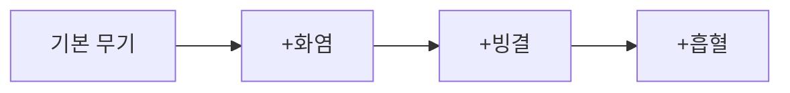
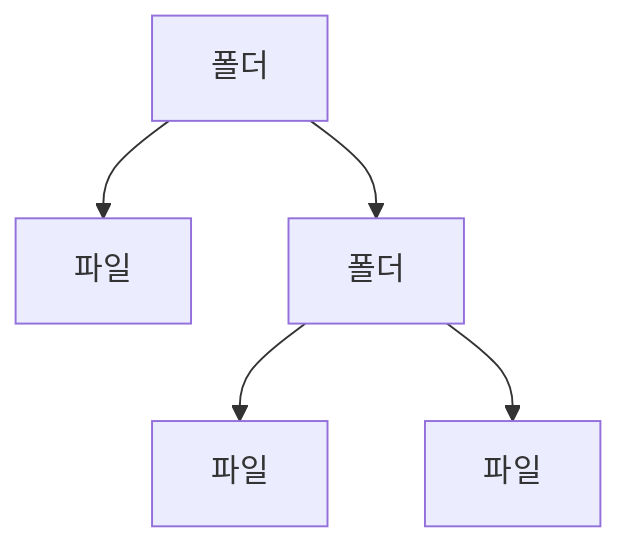
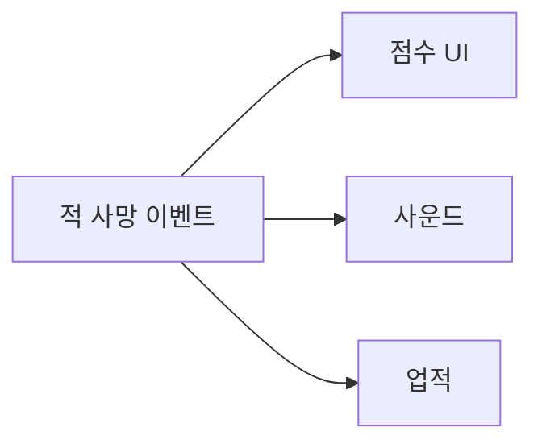
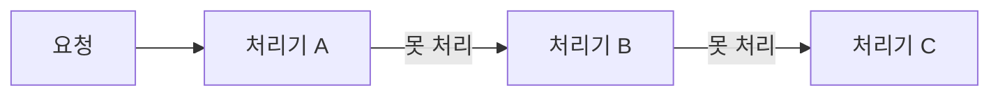
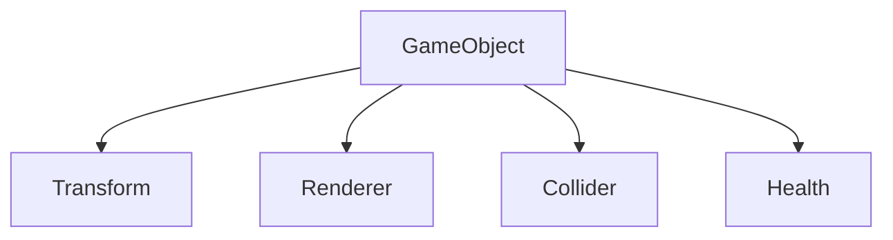
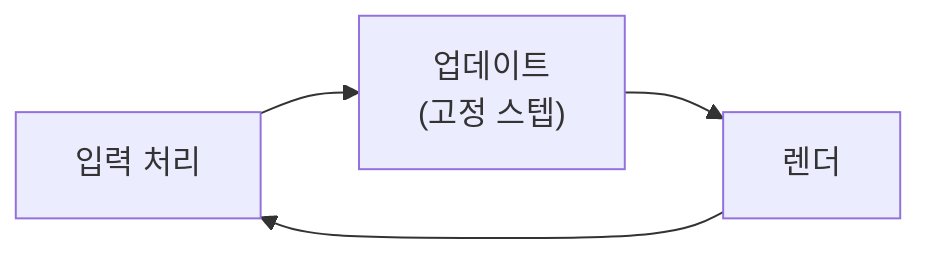

분야 핵심 개념을 얕고 넓게 정리한 노트. 쓱 훑어보며 복습한다.

항목 제목의 ★는 면접에서 개념·원리를 깊게 파고드는 축이라는 표시. 나머지도 ★ 항목의 꼬리질문에서 나오므로 건너뛰지 않는다.

## 생성 패턴

객체를 어떻게 만들지. 생성 로직을 사용처에서 떼어내 결합을 낮추는 게 공통 동기.

### 팩토리 메서드

부모 클래스가 생성 절차를 갖고, 그 안에서 무엇을 만들지만 서브클래스가 오버라이드해 정하는 패턴. 초기화·등록 같은 절차는 부모가 모든 타입에 똑같이 강제하고 바뀌는 생성 단계 하나만 자식에게 넘김 — 생성에 특화된 템플릿 메서드.

```csharp
abstract class Spawner {
    protected abstract IEnemy CreateEnemy();   // 팩토리 메서드
    public IEnemy Spawn(Vector3 pos) {         // 공통 절차는 부모가 고정
        IEnemy e = CreateEnemy();
        e.Init(pos);
        Register(e);
        return e;
    }
}
class GoblinSpawner : Spawner { protected override IEnemy CreateEnemy() => new Goblin(); }
class OrcSpawner    : Spawner { protected override IEnemy CreateEnemy() => new Orc(); }
// Troll 추가 → TrollSpawner 하나 추가, 기존 코드 수정 0
```

흔히 같은 이름으로 부르는 단순 팩토리(정적 메서드 하나에 `switch`)는 GoF 패턴이 아님. 구체 타입을 아는 곳을 한 군데로 모을 뿐, 새 타입마다 그 `switch`는 고쳐야 해 엄밀히는 OCP가 아님. 셋의 차이는 새 타입 추가 시 어디를 고치느냐.

<svg viewBox="0 0 600 320" width="600" style="max-width:100%;height:auto" xmlns="http://www.w3.org/2000/svg" role="img" aria-label="Troll 추가 시 고치는 곳 — 직접 new는 사용처 Wave의 switch를, 단순 팩토리는 EnemyFactory의 switch를 고쳐야 하고, 팩토리 메서드는 기존 코드를 고치지 않고 Troll 스포너 서브클래스만 추가한다"><defs><marker id="fm-n" viewBox="0 0 6 6" markerWidth="6" markerHeight="6" refX="5" refY="3" orient="auto"><path d="M0,0L6,3L0,6Z" fill="currentColor"/></marker></defs><g stroke-width="1.5"><g fill="currentColor" fill-opacity=".05" stroke="currentColor" stroke-opacity=".35"><rect x="10" y="124" width="85" height="36" rx="8"/><rect x="105" y="124" width="85" height="36" rx="8"/><rect x="210" y="36" width="180" height="36" rx="8"/><rect x="210" y="184" width="85" height="36" rx="8"/><rect x="305" y="184" width="85" height="36" rx="8"/><rect x="410" y="36" width="180" height="48" rx="8"/><rect x="426" y="132" width="148" height="32" rx="8"/><rect x="426" y="172" width="148" height="32" rx="8"/></g><rect x="414" y="104" width="172" height="152" rx="10" fill="none" stroke="currentColor" stroke-opacity=".3" stroke-dasharray="4 3"/><g fill="#e2574c" fill-opacity=".13" stroke="#e2574c"><rect x="10" y="36" width="180" height="48" rx="8"/><rect x="210" y="96" width="180" height="48" rx="8"/><rect x="12" y="272" width="16" height="16" rx="3"/></g><g fill="#3fae7a" fill-opacity=".13" stroke="#3fae7a" stroke-dasharray="5 4"><rect x="426" y="212" width="148" height="32" rx="8"/><rect x="12" y="296" width="16" height="16" rx="3"/></g></g><g fill="none" stroke="currentColor" stroke-width="1.5" opacity=".55"><path d="M80 84L60 119" marker-end="url(#fm-n)"/><path d="M120 84L140 119" marker-end="url(#fm-n)"/><path d="M300 72V91" marker-end="url(#fm-n)"/><path d="M280 144L260 179" marker-end="url(#fm-n)"/><path d="M320 144L340 179" marker-end="url(#fm-n)"/><path d="M500 84V99" marker-end="url(#fm-n)"/></g><g fill="currentColor" font-size="15" font-weight="600" text-anchor="middle"><text x="100" y="22">직접 new</text><text x="300" y="22">단순 팩토리</text><text x="500" y="22">팩토리 메서드(GoF)</text></g><g fill="currentColor" font-size="15" text-anchor="middle"><text x="100" y="56">Wave</text><text x="52" y="147">Goblin</text><text x="147" y="147">Orc</text><text x="300" y="59">Wave</text><text x="300" y="116">EnemyFactory</text><text x="252" y="207">Goblin</text><text x="347" y="207">Orc</text><text x="500" y="56">Spawner</text><text x="500" y="153">Goblin 스포너</text><text x="500" y="193">Orc 스포너</text><text x="500" y="233">Troll 스포너(추가)</text></g><g fill="currentColor" fill-opacity=".65" font-size="13" text-anchor="middle"><text x="100" y="74">switch로 new</text><text x="300" y="134">switch로 new</text><text x="500" y="74">CreateEnemy() 추상</text><text x="500" y="122">서브클래스가 결정</text></g><g fill="currentColor" fill-opacity=".8" font-size="14"><text x="38" y="285">Troll 추가 시 고치는 곳</text><text x="38" y="309">새로 추가만 하는 곳 — 기존 코드 수정 0</text></g></svg>

| | 구체 타입을 아는 곳 | 새 타입 추가 시 | 비용 |
| --- | --- | --- | --- |
| 직접 `new` | 사용처마다 | 사용처를 전부 찾아 수정 | 없음 |
| 단순 팩토리 | 팩토리 한 곳 | 팩토리의 `switch` 수정 | 클래스 하나 |
| 팩토리 메서드 | 각 서브클래스 | 서브클래스 추가만(수정 0) | 제품마다 생성자 클래스가 하나씩 |

- 선택은 가장자리로 밀려남 — "이번엔 TrollSpawner를 쓴다"는 결정은 여전히 어딘가에서 내려야 하고, 씬 배치·설정 같은 구성 쪽으로 옮겨갈 뿐. `switch`가 사라지는 게 아니라 바뀌는 지점이 한 곳으로 좁혀짐
- 클래스가 병렬로 늘어남 — 제품이 20종이면 생성자 서브클래스도 20개. 그래서 유니티에선 스포너 하나에 프리팹을 `[SerializeField]`로 꽂는 데이터 주도 방식이 더 흔함(타입 선택이 코드에서 데이터로 넘어감, 프로토타입 항목과 연결)
- 쓸 자리 — 구체 타입을 사용처가 몰라야 할 때(플랫폼·설정·레벨 데이터로 결정), 생성에 반드시 지킬 공통 절차(풀에서 꺼내기·초기화·등록)가 붙을 때. 타입이 하나뿐이고 늘어날 계획도 없으면 직접 `new`

### 추상 팩토리

서로 짝이 맞아야 하는 여러 종류의 객체를 만드는 생성 메서드들을 인터페이스 하나에 묶고, 계열마다 그 인터페이스를 구현한 팩토리를 하나씩 두는 패턴. 사용처는 팩토리 객체 하나를 받아 모든 생성을 그걸로 하므로 계열 선택이 팩토리를 고르는 순간 한 번으로 고정되고, 다른 계열과 섞는 게 구조적으로 불가능해짐.

```csharp
interface IEnemyFactory {          // 제품 종류마다 생성 메서드 하나
    IMelee  CreateMelee();
    IRanged CreateRanged();
}
class ForestFactory : IEnemyFactory {
    public IMelee  CreateMelee()  => new Wolf();
    public IRanged CreateRanged() => new ElfArcher();
}
class DesertFactory : IEnemyFactory {
    public IMelee  CreateMelee()  => new Scorpion();
    public IRanged CreateRanged() => new SandMage();
}

void Spawn(IEnemyFactory f) {      // 계열 선택은 f를 넘기는 쪽에서 한 번
    var m = f.CreateMelee();
    var r = f.CreateRanged();      // m과 r은 항상 같은 계열
}
Spawn(new ForestFactory());        // Wolf + ElfArcher
Spawn(new DesertFactory());        // Scorpion + SandMage
```

팩토리 하나에 `theme` 인자를 받아 메서드마다 `switch`를 두는 방식도 동작은 하지만, 같은 계열이라는 보장이 매번 같은 값을 넘기는 규율에 달리고 테마를 추가할 때마다 모든 `switch`를 고쳐야 함. 추상 팩토리는 그 규율을 객체 하나로 고정한 것 — 제품끼리 짝이 맞을 필요가 없으면 쓸 이유가 없음.

확장 방향에 따라 비용이 정반대. 행이 계열(팩토리 클래스), 열이 제품 종류(생성 메서드).

<svg viewBox="0 0 600 272" width="600" style="max-width:100%;height:auto" xmlns="http://www.w3.org/2000/svg" role="img" aria-label="추상 팩토리의 확장 비대칭 — 행은 계열(팩토리 클래스), 열은 제품 종류(생성 메서드). 새 계열 SnowFactory는 행 하나를 추가하면 끝나지만, 새 제품 종류 CreateBoss는 인터페이스와 기존 팩토리 전부에 열이 생겨 모두 고쳐야 한다"><g stroke-width="1.5"><g fill="currentColor" fill-opacity=".05" stroke="currentColor" stroke-opacity=".35"><rect x="10" y="10" width="150" height="40" rx="8"/><rect x="172" y="10" width="130" height="40" rx="8"/><rect x="312" y="10" width="130" height="40" rx="8"/><rect x="10" y="60" width="150" height="40" rx="8"/><rect x="172" y="60" width="130" height="40" rx="8"/><rect x="312" y="60" width="130" height="40" rx="8"/><rect x="10" y="110" width="150" height="40" rx="8"/><rect x="172" y="110" width="130" height="40" rx="8"/><rect x="312" y="110" width="130" height="40" rx="8"/></g><g fill="#e2574c" fill-opacity=".13" stroke="#e2574c" stroke-dasharray="5 4"><rect x="452" y="10" width="130" height="40" rx="8"/><rect x="452" y="60" width="130" height="40" rx="8"/><rect x="452" y="110" width="130" height="40" rx="8"/><rect x="12" y="246" width="16" height="16" rx="3"/></g><g fill="#3fae7a" fill-opacity=".13" stroke="#3fae7a" stroke-dasharray="5 4"><rect x="10" y="160" width="150" height="40" rx="8"/><rect x="172" y="160" width="130" height="40" rx="8"/><rect x="312" y="160" width="130" height="40" rx="8"/><rect x="12" y="220" width="16" height="16" rx="3"/></g></g><g fill="currentColor" font-size="15" text-anchor="middle"><text x="85" y="35" font-weight="600">IEnemyFactory</text><text x="237" y="35">CreateMelee()</text><text x="377" y="35">CreateRanged()</text><text x="517" y="35">CreateBoss()</text><text x="85" y="85">ForestFactory</text><text x="237" y="85">Wolf</text><text x="377" y="85">ElfArcher</text><text x="517" y="85">Treant</text><text x="85" y="135">DesertFactory</text><text x="237" y="135">Scorpion</text><text x="377" y="135">SandMage</text><text x="517" y="135">Sandworm</text><text x="85" y="185">SnowFactory</text><text x="237" y="185">Yeti</text><text x="377" y="185">IceArcher</text></g><g fill="currentColor" fill-opacity=".8" font-size="14"><text x="38" y="233">계열 추가 — 새 클래스 하나만, 기존 코드 수정 0</text><text x="38" y="259">제품 종류 추가 — 인터페이스와 기존 팩토리를 전부 수정</text></g></svg>

- 계열 추가 — `SnowFactory` 클래스 하나 추가로 끝. 이 축으로는 OCP를 지킴
- 제품 종류 추가 — 인터페이스에 `CreateBoss()`가 생겨 그걸 구현한 팩토리를 전부 고쳐야 함. 이 축으로는 OCP 위반. 그래서 제품 종류는 거의 고정이고 계열만 늘어나는 곳(플랫폼별 UI 위젯 세트)에 맞음

팩토리 메서드와의 차이는 만드는 개수보다 메커니즘.

| | 팩토리 메서드 | 추상 팩토리 |
| --- | --- | --- |
| 만드는 것 | 제품 한 종류 | 짝이 맞는 제품 여러 종류(계열) |
| 바꿔 끼우는 방식 | 상속 — 서브클래스가 생성 메서드를 오버라이드 | 조합 — 팩토리 객체를 주입받아 위임 |
| 계열이 정해지는 시점 | 어떤 서브클래스를 만드느냐 | 어떤 팩토리 객체를 넘기느냐 |

둘은 경쟁 관계가 아님 — 추상 팩토리의 각 생성 메서드가 흔히 구체 팩토리에서 오버라이드되는 팩토리 메서드로 구현됨.

유니티에선 계열마다 팩토리 클래스를 짜기보다, 근접·원거리·보스 프리팹을 필드로 가진 `ScriptableObject` 테마 에셋을 계열마다 하나씩 만드는 방식이 흔함. 계열 추가가 코드 없이 에셋 추가로 끝나지만, 제품 종류를 늘리면 필드를 추가하고 모든 에셋을 채워야 하는 비대칭은 데이터에서도 그대로 남음.

### 빌더 패턴

완성될 객체 대신 조립용 객체(빌더)에 값을 하나씩 쌓고, 다 모이면 `Build()`에서 한 번에 검증해 완성품을 내주는 패턴. 원래 겨냥한 건 텔레스코핑 생성자(옵션 조합마다 오버로드가 늘고, 같은 타입 인자는 순서를 헷갈림)인데, C#은 그 상당 부분을 언어 기능으로 풂.

```csharp
new Enemy(100, 3.5f, 2.0f, true);        // 텔레스코핑 — 3.5가 speed인지 range인지 모름
new Enemy(hp: 100, speed: 3.5f);         // 이름 있는 + 선택적 인자 — 나머지는 기본값
new Enemy { Hp = 100, Speed = 3.5f };    // 객체 초기화자 — 생성자가 먼저 돌고 setter가 차례로

var b = new WaveBuilder().Name("Boss Rush");
for (int i = 0; i < stage; i++) b.Add(goblin, count: 5);   // 반복으로 쌓기
if (hardMode) b.Add(orc, count: 2);                          // 조건부로 쌓기
Wave wave = b.Build();   // 다 모인 뒤 검증하고 불변 Wave로 완성
```

갈리는 건 값이 다 모인 시점을 알 수 있느냐.

<svg viewBox="0 0 600 256" width="600" style="max-width:100%;height:auto" xmlns="http://www.w3.org/2000/svg" role="img" aria-label="값이 다 모인 시점과 검증 지점 — 생성자는 값을 한 호출에 받아 생성자에서 검증하고, 객체 초기화자는 생성자가 먼저 돌고 setter가 차례로 불려 다 모인 뒤 검증할 지점이 없으며, 빌더는 단계·반복·조건으로 쌓은 뒤 Build에서 검증해 불변 객체를 만든다"><defs><marker id="bd-n" viewBox="0 0 6 6" markerWidth="6" markerHeight="6" refX="5" refY="3" orient="auto"><path d="M0,0L6,3L0,6Z" fill="currentColor"/></marker></defs><g stroke-width="1.5"><g fill="currentColor" fill-opacity=".05" stroke="currentColor" stroke-opacity=".35"><rect x="10" y="34" width="170" height="40" rx="8"/><rect x="420" y="34" width="170" height="40" rx="8"/><rect x="10" y="120" width="170" height="40" rx="8"/><rect x="215" y="120" width="170" height="40" rx="8"/><rect x="10" y="206" width="170" height="40" rx="8"/></g><g fill="#3fae7a" fill-opacity=".13" stroke="#3fae7a"><rect x="215" y="34" width="170" height="40" rx="8"/><rect x="215" y="206" width="170" height="40" rx="8"/></g><rect x="420" y="120" width="170" height="40" rx="8" fill="#e2574c" fill-opacity=".13" stroke="#e2574c"/><rect x="420" y="206" width="170" height="40" rx="8" fill="#4f83e0" fill-opacity=".13" stroke="#4f83e0"/></g><g fill="none" stroke="currentColor" stroke-width="1.5" opacity=".55"><path d="M184 54H209" marker-end="url(#bd-n)"/><path d="M389 54H414" marker-end="url(#bd-n)"/><path d="M184 140H209" marker-end="url(#bd-n)"/><path d="M389 140H414" marker-end="url(#bd-n)"/><path d="M184 226H209" marker-end="url(#bd-n)"/><path d="M389 226H414" marker-end="url(#bd-n)"/></g><g fill="currentColor" font-size="15" font-weight="600" fill-opacity=".85"><text x="10" y="22">생성자 + 이름 있는 인자</text><text x="10" y="108">객체 초기화자</text><text x="10" y="194">빌더</text></g><g fill="currentColor" font-size="15" text-anchor="middle"><text x="95" y="59">값을 한 호출에 전부</text><text x="300" y="59">생성자에서 검증</text><text x="505" y="59">완성</text><text x="95" y="145">생성자가 먼저 실행</text><text x="300" y="145">setter가 차례로</text><text x="505" y="145">다 모인 뒤 훅 없음</text><text x="95" y="231">단계·반복·조건으로</text><text x="300" y="231">Build()에서 검증</text><text x="505" y="231">불변 객체</text></g></svg>

- 생성자 + 이름 있는 인자 — 값을 한 번에 받아 여러 필드에 걸친 검증(min ≤ max 같은)이 가능. 대신 값이 한 호출 지점에 다 모여 있어야 함
- 객체 초기화자 — 생성자 실행 후 setter가 하나씩 불려, 마지막 setter가 끝났음을 타입이 알 수 없음. 조합을 검증할 지점이 없음
- 빌더 — 값이 반복·조건·여러 메서드에 흩어져 쌓여도 됨. 쌓는 동안은 가변 빌더가 받고, 완성 순간에 일괄 검증과 불변 완성품을 되찾음

| 문제 | C#에서 먼저 쓸 것 |
| --- | --- |
| 인자 순서·의미가 헷갈림 | 이름 있는 인자 |
| 선택 옵션이 많음 | 선택적 인자, 객체 초기화자 |
| 여러 필드 조합 검증 | 생성자에서 검증(객체 초기화자로는 불가) |
| 값이 단계·반복·조건으로 쌓인 뒤 완성 | 빌더 |

BCL의 대표 빌더가 `StringBuilder` — 가변 버퍼에 쌓았다가 `ToString()`에서 불변 `string`을 한 번만 만듦(원리는 C# 노트의 "문자열 불변성과 StringBuilder").

GoF 원래 의도는 조립 절차(Director)와 결과물 표현(Builder)의 분리 — 같은 절차로 다른 결과물을 만드는 것. 레벨 데이터를 읽어 "벽 놓기·문 놓기"를 지시하는 절차는 하나인데, 3D 씬 빌더에 넘기면 오브젝트가 배치되고 미니맵 빌더에 넘기면 텍스처가 그려짐. 흔히 쓰는 메서드 체이닝 빌더는 텔레스코핑 생성자를 피하려는 변형.

- 필드 두 벌 — 제품과 빌더에 같은 필드가 생겨, 필드를 추가할 때 양쪽을 고침
- 필수값 누락은 런타임에 — `Build()` 때 예외로야 드러남. 필수 인자는 생성자로 받으면 컴파일 타임에 막힘

### 프로토타입

이미 설정을 마친 객체를 틀로 두고, 새 객체가 필요하면 그 틀을 복제해 얻는 패턴. 복제를 요청하는 쪽은 구체 타입을 몰라도 됨 — `IEnemy`로만 들고 있는 객체에 `Clone()`을 부르면 같은 구체 타입·같은 초기 상태가 나옴. 그래서 새 종류를 클래스가 아니라 데이터(설정된 인스턴스)로 추가함. 팩토리 메서드가 제품마다 생성자 서브클래스를 요구하던 비용을 이렇게 품.

```csharp
var protos = new Dictionary<string, IEnemy> {
    ["goblin"]       = new Goblin { Hp = 30, Speed = 4f },
    ["elite_goblin"] = new Goblin { Hp = 80, Speed = 5f },   // 새 클래스 없이 변종 추가
};
IEnemy e = protos[kind].Clone();   // 구체 타입을 몰라도 같은 타입·같은 초기 상태
```

흔히 말하는 "생성 비용이 클 때"는 정확히는 초기화 비용. `new`로 메모리를 잡는 건 싸고, 비싼 건 파일 읽기·파싱·계산으로 쓸 수 있는 상태를 만드는 과정 — 복제는 계산이 끝난 상태를 그대로 복사해 이를 건너뜀.

실제로 어려운 건 복제할 때 무엇을 공유하고 무엇을 새로 만들지.

```csharp
class Enemy {
    public EnemyStats Stats;           // 종류별 정의 데이터, 바뀌지 않음
    public int Hp;                     // 개체마다 다른 값
    public List<Buff> Buffs = new();   // 개체마다 다른 가변 컬렉션

    public Enemy Clone() {
        var c = (Enemy)MemberwiseClone();   // 얕은 복사 — 필드 칸을 그대로 복사
        c.Buffs = new List<Buff>(Buffs);    // 가변 컬렉션만 새로 만들어 끊음
        return c;                           // Stats는 의도적으로 공유
    }
}

var proto = new Enemy { Stats = goblinStats, Hp = 30 };
var a = proto.Clone();
a.Hp -= 10;            // proto.Hp는 30 그대로 — int는 값 자체가 복사됨
a.Buffs.Add(poison);   // proto.Buffs는 비어 있음 — 리스트를 새로 만들었으므로
// MemberwiseClone만 했다면 proto.Buffs에도 poison이 들어감(같은 List 하나를 둘이 가리킴)
```

<svg viewBox="0 0 600 314" width="600" style="max-width:100%;height:auto" xmlns="http://www.w3.org/2000/svg" role="img" aria-label="프로토타입 복제 후 메모리 — proto와 clone은 EnemyStats를 의도적으로 공유하고, Hp는 각자 값을 가지며, Buffs는 리스트를 새로 만들어 따로 가진다. MemberwiseClone만 하면 clone의 Buffs가 proto의 리스트를 가리킨다"><defs><marker id="pt-n" viewBox="0 0 6 6" markerWidth="6" markerHeight="6" refX="5" refY="3" orient="auto"><path d="M0,0L6,3L0,6Z" fill="currentColor"/></marker><marker id="pt-c" viewBox="0 0 6 6" markerWidth="6" markerHeight="6" refX="5" refY="3" orient="auto"><path d="M0,0L6,3L0,6Z" fill="#e2574c"/></marker></defs><g stroke-width="1.5"><g fill="currentColor" fill-opacity=".03" stroke="currentColor" stroke-opacity=".3" stroke-dasharray="4 3"><rect x="10" y="10" width="200" height="160" rx="10"/><rect x="390" y="10" width="200" height="160" rx="10"/></g><g fill="currentColor" fill-opacity=".05" stroke="currentColor" stroke-opacity=".35"><rect x="24" y="86" width="172" height="32" rx="8"/><rect x="24" y="126" width="172" height="32" rx="8"/><rect x="404" y="86" width="172" height="32" rx="8"/><rect x="404" y="126" width="172" height="32" rx="8"/><rect x="24" y="210" width="172" height="40" rx="8"/><rect x="404" y="210" width="172" height="40" rx="8"/></g><g fill="#4f83e0" fill-opacity=".13" stroke="#4f83e0"><rect x="24" y="46" width="172" height="32" rx="8"/><rect x="404" y="46" width="172" height="32" rx="8"/><rect x="235" y="46" width="130" height="32" rx="8"/><rect x="12" y="264" width="16" height="16" rx="3"/></g></g><g fill="none" stroke="currentColor" stroke-width="1.5" opacity=".55"><path d="M196 62H229" marker-end="url(#pt-n)"/><path d="M404 62H371" marker-end="url(#pt-n)"/><path d="M110 158V204" marker-end="url(#pt-n)"/><path d="M490 158V204" marker-end="url(#pt-n)"/></g><path d="M404 146L203 226" fill="none" stroke="#e2574c" stroke-width="1.5" stroke-dasharray="5 4" marker-end="url(#pt-c)"/><path d="M12 296H30" fill="none" stroke="#e2574c" stroke-width="1.5" stroke-dasharray="5 4"/><g fill="currentColor" font-size="15" text-anchor="middle"><text x="110" y="32" font-weight="600">proto</text><text x="490" y="32" font-weight="600">clone</text><text x="110" y="67">Stats</text><text x="110" y="107">Hp = 30</text><text x="110" y="147">Buffs</text><text x="490" y="67">Stats</text><text x="490" y="107">Hp = 20</text><text x="490" y="147">Buffs</text><text x="300" y="67" font-weight="600">EnemyStats</text><text x="110" y="235">List · 비어 있음</text><text x="490" y="235">List · poison</text></g><g fill="currentColor" fill-opacity=".8" font-size="14"><text x="38" y="277">의도적으로 공유 — 바뀌지 않는 정의 데이터</text><text x="38" y="301">MemberwiseClone만 하면 clone이 proto의 List를 가리킴</text></g></svg>

- 공유 — 바뀌지 않는 정의 데이터(종류별 스탯·메시·텍스처). 참조만 복사해 공유하는 게 맞고 메모리도 아낌(플라이웨이트와 같은 발상)
- 새로 만듦 — 개체마다 따로 변하는 참조 타입(버프 목록·인벤토리). 공유하면 한 개체의 변화가 원본과 다른 복제본에 번짐
- 깊이는 단계마다 — `new List<Buff>(Buffs)`는 리스트 껍데기만 새로 만들고 안의 `Buff`는 여전히 공유. `Buff`가 가변이면 한 단계 더 내려가 복제. 깊은 복사는 스위치 하나가 아니라 참조 단계마다 내리는 결정

C#의 `MemberwiseClone()`은 `protected` 얕은 복사(값 타입 필드는 값, 참조 타입 필드는 위치가 복사됨). `ICloneable`은 얕은지 깊은지 계약이 없고 `object`를 반환해 비권장 — 타입이 정해진 `Clone()`을 두고 복사 깊이를 밝히는 편이 나음. `record`의 `with`도 얕은 복사(C# 노트의 "record와 값 동등성").

유니티의 `Instantiate`가 엔진에 들어간 프로토타입 — 프리팹 에셋이 등록된 원형이고, 변형을 만들면 코드 없이 새 종류가 생김(유니티 노트의 "프리팹과 프리팹 변형"). 복사 범위도 같은 기준.

- 계층 안은 복제 — 게임오브젝트와 자식, 컴포넌트, 직렬화된 필드 값을 새로 만들고, 계층 안을 가리키던 참조는 새 사본을 가리키도록 다시 연결
- 계층 밖 에셋은 공유 — 메시·머티리얼·다른 에셋 참조는 같은 것을 가리킴. 개체별로 바꾸려 `renderer.material`에 접근하는 순간 그 렌더러 전용 사본이 생김(유니티 노트의 "material vs sharedMaterial")

### 오브젝트 풀

객체 수명을 "만들고 버린다"에서 "빌리고 돌려준다"로 바꾸는 패턴. 자주 생성·파괴하는 객체(총알·이펙트·적)를 미리 만들어 두고 꺼내 쓴 뒤 반납. 객체의 주인은 사용처가 아니라 풀이고, 사용처는 빌린 동안만 쓸 권리를 가짐. 유니티 구현(`OnEnable` 초기화, `ObjectPool<T>` 인자, 크기·프리웜)은 유니티 노트의 "오브젝트 풀링".

```csharp
class Pool<T> where T : class, new() {
    readonly Stack<T> free = new();     // 프리 리스트 — 꺼내기·넣기 모두 O(1)
    public T Rent() => free.Count > 0 ? free.Pop() : new T();
    public void Return(T item) => free.Push(item);
}

var p = pool.Rent();  p.Damage = 10;  pool.Return(p);
var q = pool.Rent();   // 같은 객체(ReferenceEquals(p, q) == true), q.Damage == 10
p.Damage = 99;         // 반납 후 옛 참조로 쓰기 — q가 오염됨
```

- 프리 리스트 — 놀고 있는 객체만 스택·큐에 모아 꺼내기·넣기 O(1). 전체를 돌며 비활성 플래그를 찾는 방식은 O(n)
- 풀이 비었을 때 — 새로 만들어 늘리기, 가장 오래된 것 강제 회수, 실패 반환 중 선택

풀링은 GC가 해주던 수명 관리를 손으로 되찾는 것이라, 수동 메모리 관리의 버그가 같은 모양으로 돌아옴.

| 풀 버그 | 수동 메모리 대응 | 증상 |
| --- | --- | --- |
| 반납 시 상태 미초기화 | 초기화 안 된 메모리 | 이전 사용의 값(데미지·버프)이 남음 |
| 반납 후 옛 참조 사용 | use-after-free | 다른 용도로 재사용된 객체를 건드림 |
| 두 번 반납 | double free | 한 객체가 두 사용처에 동시에 대여됨 |
| 반납 누락 | 메모리 누수 | 풀이 계속 늘거나 고갈 |

옛 참조는 null 검사로 못 잡음 — 객체는 살아 있고 용도만 바뀌었기 때문. 세대 번호를 두고 반납마다 올리면, 핸들이 받을 때의 세대를 기억해 두었다가 현재 세대와 다를 때 죽은 것으로 판단할 수 있음.

```csharp
class Enemy { public int Gen; }   // 풀의 Return에서 item.Gen++

readonly struct EnemyHandle {
    readonly Enemy obj; readonly int gen;
    public EnemyHandle(Enemy e) { obj = e; gen = e.Gen; }
    public bool IsAlive => obj.Gen == gen;   // 반납·재사용 후엔 false
}
```

<svg viewBox="0 0 600 272" width="600" style="max-width:100%;height:auto" xmlns="http://www.w3.org/2000/svg" role="img" aria-label="반납 후 옛 참조 — 객체 #7이 적 A로 쓰이다 반납돼 세대가 3에서 4로 오르고 적 B로 재사용될 때, null만 검사하는 일반 참조는 계속 살아 있다고 보고 B를 쫓아가지만 세대 핸들은 기억한 3과 현재 4가 달라 소멸을 감지한다"><defs><marker id="op-n" viewBox="0 0 6 6" markerWidth="6" markerHeight="6" refX="5" refY="3" orient="auto"><path d="M0,0L6,3L0,6Z" fill="currentColor"/></marker></defs><g fill="currentColor" font-size="15" font-weight="600" text-anchor="middle"><text x="212.5" y="18">사용 중</text><text x="364.5" y="18">반납</text><text x="516.5" y="18">재사용</text></g><g opacity=".45"><path d="M140 27H586" fill="none" stroke="currentColor" stroke-width="1.5" marker-end="url(#op-n)"/></g><g stroke-width="1.5"><g fill="currentColor" fill-opacity=".05" stroke="currentColor" stroke-opacity=".35"><rect x="140" y="36" width="145" height="52" rx="8"/><rect x="292" y="36" width="145" height="52" rx="8"/><rect x="444" y="36" width="145" height="52" rx="8"/><rect x="140" y="98" width="145" height="52" rx="8"/><rect x="140" y="160" width="145" height="52" rx="8"/></g><g fill="#e2574c" fill-opacity=".13" stroke="#e2574c"><rect x="292" y="98" width="145" height="52" rx="8"/><rect x="444" y="98" width="145" height="52" rx="8"/><rect x="12" y="224" width="16" height="16" rx="3"/></g><g fill="#3fae7a" fill-opacity=".13" stroke="#3fae7a"><rect x="292" y="160" width="145" height="52" rx="8"/><rect x="444" y="160" width="145" height="52" rx="8"/><rect x="12" y="248" width="16" height="16" rx="3"/></g></g><g fill="currentColor" font-size="15" text-anchor="middle"><text x="70" y="58">객체 #7</text><text x="70" y="120">일반 참조</text><text x="70" y="182">세대 핸들</text><text x="212.5" y="58">적 A로 사용</text><text x="364.5" y="58">풀에 반납</text><text x="516.5" y="58">적 B로 재사용</text><text x="212.5" y="120">A를 추적</text><text x="364.5" y="120">null 아님</text><text x="516.5" y="120">B를 쫓아감</text><text x="212.5" y="182">3 = 3</text><text x="364.5" y="182">3 ≠ 4</text><text x="516.5" y="182">3 ≠ 4</text></g><g fill="currentColor" fill-opacity=".65" font-size="13" text-anchor="middle"><text x="70" y="76">풀 안의 실제 객체</text><text x="70" y="138">null만 검사</text><text x="70" y="200">gen 3 기억</text><text x="212.5" y="76">Gen 3</text><text x="364.5" y="76">Gen 3 → 4</text><text x="516.5" y="76">Gen 4</text><text x="212.5" y="138">참조 ≠ null</text><text x="364.5" y="138">A인 줄 알고 유지</text><text x="516.5" y="138">엉뚱한 대상</text><text x="212.5" y="200">추적</text><text x="364.5" y="200">소멸 감지</text><text x="516.5" y="200">무시</text></g><g fill="currentColor" fill-opacity=".8" font-size="14"><text x="36" y="237">옛 참조가 새 용도를 따라감</text><text x="36" y="261">기억한 세대와 현재 세대가 달라 감지</text></g></svg>

풀은 게임 오브젝트만의 것이 아님. 만드는 비용이 비싼 자원이면 같은 구조가 반복됨.

| 풀 | 재사용하는 것 | 아끼는 비용 |
| --- | --- | --- |
| 게임 오브젝트 풀 | 총알·이펙트·적 | 할당·GC, `Instantiate`의 생성·초기화 |
| `ArrayPool<T>` | 배열 버퍼 | 큰 배열 할당. 85KB 이상은 LOH에 올라가 Gen2 수집 때만 회수 |
| 스레드 풀 | 스레드 | 스레드 생성·파괴(커널 객체·스택 할당) — 운영체제 노트의 "스레드 풀" |
| DB 커넥션 풀 | DB 연결 | TCP 연결·인증 핸드셰이크 |

- `ArrayPool<T>.Rent(n)` — n 이상 크기의 배열을 줄 수 있어 실제 사용 길이는 따로 들고 다녀야 함
- `Return(arr, clearArray)` — `clearArray` 기본값이 false라 이전 내용이 그대로 남음. 위 표의 미초기화 버그가 BCL에서도 같은 모양

"GC 부담을 없앤다"는 효과는 런타임마다 크기가 다름.

- .NET CoreCLR — 세대별 GC라 짧게 사는 작은 객체는 Gen0에서 싸게 회수됨. 풀이 오래 붙잡는 객체는 Gen2로 승격되고, Gen2 객체가 새 객체를 가리키게 되면 쓰기 장벽·카드 테이블 비용이 붙음. 작고 단순한 객체는 풀링이 오히려 손해일 수 있음(C# 노트의 "세대별 GC")
- 유니티(Mono·IL2CPP) — 기본 GC인 Boehm은 비세대라 수집 때마다 힙 전체를 훑음. 할당이 쌓여 수집이 돌면 프레임이 끊기므로 할당 자체를 줄이는 풀링 효과가 큼. 대신 풀 객체도 살아 있는 객체라 매 수집의 마킹 대상에 남음

### 스레드 안전 싱글톤 ★

지연 초기화 `if (instance == null) instance = new X();`는 검사와 생성·대입이 한 덩어리가 아니라서, 두 스레드가 검사를 함께 통과하면 각자 생성함(check-then-act 경쟁 조건). 생성자가 두 번 도는 것보다, 먼저 대입된 인스턴스에 쌓인 상태(구독·로드한 데이터)가 덮어쓰기로 조용히 버려지는 게 실제 피해. 예외가 나지 않아 추적이 어려움.

<svg viewBox="0 0 600 340" width="600" style="max-width:100%;height:auto" xmlns="http://www.w3.org/2000/svg" role="img" aria-label="지연 초기화 경쟁 — 스레드 1과 2가 모두 null 검사를 통과한 뒤 각자 new를 실행해, 스레드 2가 대입한 B가 스레드 1이 대입한 A를 덮어쓰고 스레드 1은 전역에서 사라진 A를 계속 사용한다"><defs><marker id="sg-n" viewBox="0 0 6 6" markerWidth="6" markerHeight="6" refX="5" refY="3" orient="auto"><path d="M0,0L6,3L0,6Z" fill="currentColor"/></marker></defs><g fill="currentColor" font-size="15" font-weight="600" text-anchor="middle"><text x="175" y="22">스레드 1</text><text x="465" y="22">스레드 2</text></g><text x="30" y="22" fill="currentColor" fill-opacity=".65" font-size="13" text-anchor="middle">시간</text><g opacity=".45"><path d="M30 36V292" fill="none" stroke="currentColor" stroke-width="1.5" marker-end="url(#sg-n)"/></g><g stroke-width="1.5"><g fill="currentColor" fill-opacity=".05" stroke="currentColor" stroke-opacity=".35"><rect x="60" y="36" width="230" height="40" rx="8"/><rect x="350" y="84" width="230" height="40" rx="8"/><rect x="60" y="132" width="230" height="40" rx="8"/><rect x="350" y="244" width="230" height="52" rx="8"/></g><g fill="#e2574c" fill-opacity=".13" stroke="#e2574c"><rect x="350" y="180" width="230" height="52" rx="8"/><rect x="60" y="244" width="230" height="52" rx="8"/><rect x="12" y="312" width="16" height="16" rx="3"/></g></g><g fill="currentColor" font-size="15" text-anchor="middle"><text x="175" y="61">null 검사 → 통과</text><text x="465" y="109">null 검사 → 통과</text><text x="175" y="157">new → instance = A</text><text x="465" y="202">new → instance = B</text><text x="175" y="266">A를 계속 사용</text><text x="465" y="266">B 사용</text></g><g fill="currentColor" fill-opacity=".65" font-size="13" text-anchor="middle"><text x="465" y="220">A를 덮어씀</text><text x="175" y="284">전역에선 사라진 객체</text><text x="465" y="284">이후 모두가 보는 것</text></g><text x="36" y="325" fill="currentColor" fill-opacity=".8" font-size="14">덮어쓰기로 A에 쌓인 상태가 조용히 버려짐</text></svg>

해법은 셋.

- 정적 필드 초기화 — `static readonly X Instance = new X();`. CLR이 타입 초기화를 타입당 한 번, 런타임 내부 잠금 아래 실행해 보장. 명시적 정적 생성자가 없으면 `beforefieldinit`이 붙어 런타임이 첫 접근보다 일찍 초기화해도 되므로, 시점이 중요하면 빈 정적 생성자를 둠(C# 노트의 "sealed·정적 클래스·정적 생성자")
- `Lazy<T>` — 첫 `.Value`에서 생성. 기본 모드 `ExecutionAndPublication`은 여러 스레드가 동시에 와도 팩토리를 한 번만 실행하고 나머지는 결과를 기다림. 생성 시점이 코드에 드러남
- 이중 검사 잠금(DCL) — lock과 재확인을 직접 작성

```csharp
static volatile GameData instance;
static readonly object gate = new();

public static GameData Instance {
    get {
        if (instance == null) {              // 1차: 생성 후엔 lock 없이 바로 반환
            lock (gate) {
                if (instance == null)        // 2차: 기다리는 동안 남이 만들었을 수 있음
                    instance = new GameData();
            }
        }
        return instance;
    }
}
```

- 2차 검사(lock 안) — 정확성 담당. lock 앞에서 기다리던 스레드가 들어와 이미 만들어진 걸 보고 나감. 없으면 lock을 걸어도 두 번 생성
- 1차 검사(lock 밖) — 성능 담당. 생성 후 모든 호출이 lock을 잡지 않게 함. 없으면 "항상 lock"과 같아 정확하지만 느림
- `volatile` — `new`는 할당 → 생성자 실행 → 참조 대입 순인데, 뒤 둘이 재정렬되면 1차 검사가 null 아닌 참조를 보고 생성자가 덜 돈 객체를 그대로 반환. lock 안 스레드와 달리 밖에서 읽는 쪽은 lock의 순서 보장을 못 받기 때문. 재정렬 원리는 운영체제 노트의 "메모리 배리어와 원자적 연산"

이 재정렬로 Java 5 이전엔 DCL이 실제로 깨졌음. .NET은 ECMA 표준만 보면 같은 위험이 있지만, 현재 런타임은 공유 위치에 객체 참조를 저장하는 것을 그 객체 필드에 대한 release로 취급해 `volatile` 없이도 동작. 그래도 의도와 이식성을 위해 `volatile`을 붙이는 게 정석.

| | 지연 생성 | 직접 쓰는 동기화 | 예외 후 재시도 | 쓸 때 |
| --- | --- | --- | --- | --- |
| 정적 필드 초기화 | 타입 첫 사용 시점(정적 생성자가 있으면 정확) | 없음, 런타임 보장 | 불가 — 타입이 `TypeInitializationException` 상태로 고정 | 기본 선택. 생성이 단순하고 실패하지 않을 때 |
| `Lazy<T>` | 첫 `.Value` | 없음, 라이브러리 보장 | 기본 모드는 불가 — 예외가 캐시됨 | 생성 시점을 명확히 늦추고 싶을 때 |
| 이중 검사 잠금 | 첫 접근 | lock + `volatile` 직접 | 가능 | 실무에선 드묾. `Lazy<T>` 이전 코드 |

생성이 안전해도 사용은 별개. 보장되는 건 인스턴스가 하나라는 것까지이고, `Instance.Score += 10`을 여러 스레드가 부르면 여전히 경쟁 조건이라 필드 접근은 따로 lock이나 `Interlocked`로 보호해야 함.

유니티 MonoBehaviour 싱글톤엔 이 문제가 없음. 유니티 API는 메인 스레드 전용이라 `Awake`의 `Instance = this`에 스레드 경쟁이 없음. 거기서 생기는 중복은 씬 재로드로 씬 파일의 매니저가 또 만들어지는 것이고, "이미 있으면 새로 생긴 쪽을 `Destroy`"는 씬 중복의 해법이지 스레드 안전 해법이 아님(유니티 노트의 "DontDestroyOnLoad").

### 싱글톤의 단점과 SOLID 위반 ★

싱글톤은 두 약속을 한꺼번에 함 — 인스턴스가 하나라는 개수의 약속, 어디서든 `X.Instance`로 꺼낸다는 접근 방식의 약속. 문제 대부분은 개수가 아니라 전역 접근에서 나옴. "하나만 있어야 한다"는 요구는 정당한 경우가 많고, 대안도 하나는 유지하고 전역 접근만 버리는 것.

```csharp
class Shop {
    public bool Buy(Item item) {
        if (GameData.Instance.Gold < item.Price) return false;   // 시그니처에 안 보임
        GameData.Instance.Gold -= item.Price;
        return true;
    }
}

var shop = new Shop();   // 생성자만 봐선 GameData가 필요하다는 걸 모름
```

- 숨은 의존 — 무엇에 기대는지가 생성자·매개변수에 안 드러나 본문을 끝까지 읽어야 앎
- 테스트가 실제 객체에 묶임 — 가짜로 바꿀 길이 없어 진짜가 하는 로드·저장을 그대로 탐. 프로세스 내내 살아 있어 한 테스트가 바꾼 값이 다음 테스트로 남고, 실행 순서에 따라 결과가 바뀜
- 전역 가변 상태 — `Gold`가 음수가 되는 버그가 나면 쓰는 쪽 후보가 `Instance`를 부르는 모든 줄
- 암묵적 초기화 순서 — 싱글톤끼리 서로 부르면 생성 순서가 첫 접근 순서로 정해지고 코드 어디에도 안 적힘. 순환하면 초기화 도중의 객체를 봄. 유니티에선 "없으면 만드는" 싱글톤을 종료 중 `OnDestroy`에서 부르면 파괴된 매니저가 다시 생겨 유령 오브젝트가 남음
- "하나"가 나중에 틀림 — 분할 화면 2인 모드처럼 개수 가정이 바뀌면 모든 호출부를 고쳐야 함. 개수 결정을 클래스 스스로 내렸기 때문

| 원칙 | 걸리는 지점 | 강도 |
| --- | --- | --- |
| DIP | 고수준 `Shop`이 `GameData.Instance`라는 구체 타입 이름을 직접 부름. 정적 접근이라 사이에 인터페이스를 끼울 자리가 없음 | 핵심 |
| OCP | 저장 방식을 로컬에서 클라우드로 바꾸려면 새 구현 추가가 아니라 `GameData`나 호출부 수정 | DIP 위반의 결과 |
| SRP | 본업(골드 관리)과 자기 생성 정책(하나만, 언제 만들지)을 같이 짐 — 변경 이유가 둘 | 흔한 지적이지만 약한 편 |

DIP 중심으로 답하는 게 정확. OCP는 DIP가 깨진 결과로 따라오고 SRP는 해석이 갈리는 지적이라, 셋을 같은 무게로 나열하면 근거가 약해 보임.

대안은 의존성 주입(DI). 의존을 생성자로 받고, 조립 지점(composition root)이 한 번만 만들어 넘김. "하나만 존재"를 클래스가 아니라 조립하는 쪽이 보장.

```csharp
interface IWallet { int Gold { get; } bool Spend(int amount); }

class Shop {
    readonly IWallet wallet;
    public Shop(IWallet wallet) => this.wallet = wallet;   // 의존이 시그니처에 드러남
    public bool Buy(Item item) => wallet.Spend(item.Price);
}

// 조립 지점 — 게임 시작 시 한 곳
var wallet = new Wallet();          // 여기서 한 번만 만듦
var shop   = new Shop(wallet);
var quest  = new QuestReward(wallet);

// 테스트
var testShop = new Shop(new FakeWallet(gold: 50));   // 진짜 저장소 없이, 테스트마다 새 상태
```

<svg viewBox="0 0 600 344" width="600" style="max-width:100%;height:auto" xmlns="http://www.w3.org/2000/svg" role="img" aria-label="숨은 의존과 드러난 의존 — 싱글톤에서는 Shop, Quest, UI가 본문에서 구체 타입 GameData를 직접 부르고 테스트도 진짜를 쓴다. DI에서는 조립 지점이 Wallet을 한 번 만들어 Shop과 Quest에 넘기고, 둘은 IWallet에만 의존해 테스트 때 FakeWallet으로 바꿀 수 있다"><defs><marker id="sd-n" viewBox="0 0 6 6" markerWidth="6" markerHeight="6" refX="5" refY="3" orient="auto"><path d="M0,0L6,3L0,6Z" fill="currentColor"/></marker></defs><g fill="currentColor" font-size="15" font-weight="600" text-anchor="middle"><text x="150" y="22">싱글톤 — 숨은 의존</text><text x="450" y="22">DI — 드러난 의존</text></g><g stroke-width="1.5"><g fill="currentColor" fill-opacity=".05" stroke="currentColor" stroke-opacity=".35"><rect x="10" y="40" width="110" height="40" rx="8"/><rect x="10" y="104" width="110" height="40" rx="8"/><rect x="10" y="168" width="110" height="40" rx="8"/><rect x="310" y="104" width="130" height="40" rx="8"/><rect x="460" y="104" width="130" height="40" rx="8"/><rect x="390" y="168" width="120" height="40" rx="8"/><rect x="310" y="240" width="130" height="40" rx="8"/></g><g fill="#e2574c" fill-opacity=".13" stroke="#e2574c"><rect x="160" y="96" width="130" height="56" rx="8"/><rect x="10" y="232" width="280" height="48" rx="8"/><rect x="12" y="298" width="16" height="16" rx="3"/></g><g fill="#3fae7a" fill-opacity=".13" stroke="#3fae7a"><rect x="310" y="40" width="280" height="40" rx="8"/><rect x="460" y="240" width="130" height="40" rx="8"/><rect x="312" y="298" width="16" height="16" rx="3"/></g></g><g fill="none" stroke="currentColor" stroke-width="1.5" opacity=".55"><path d="M120 64L158 106" marker-end="url(#sd-n)"/><path d="M120 124H158" marker-end="url(#sd-n)"/><path d="M120 184L158 142" marker-end="url(#sd-n)"/><path d="M225 232V156" marker-end="url(#sd-n)"/><path d="M375 80V100" marker-end="url(#sd-n)"/><path d="M525 80V100" marker-end="url(#sd-n)"/><path d="M385 144L425 165" marker-end="url(#sd-n)"/><path d="M515 144L475 165" marker-end="url(#sd-n)"/><path d="M385 240L425 211" stroke-dasharray="4 3" marker-end="url(#sd-n)"/><path d="M515 240L475 211" stroke-dasharray="4 3" marker-end="url(#sd-n)"/></g><g fill="currentColor" font-size="15" text-anchor="middle"><text x="65" y="65">Shop</text><text x="65" y="129">Quest</text><text x="65" y="193">UI</text><text x="225" y="119">GameData</text><text x="150" y="252">테스트</text><text x="450" y="65">조립 지점 — new Wallet() 1회</text><text x="375" y="129">Shop(IWallet)</text><text x="525" y="129">Quest(IWallet)</text><text x="450" y="193" font-weight="600">IWallet</text><text x="375" y="265">Wallet</text><text x="525" y="265">FakeWallet</text></g><g fill="currentColor" fill-opacity=".65" font-size="13" text-anchor="middle"><text x="225" y="138">구체 타입·전역</text><text x="150" y="270">진짜 GameData를 쓸 수밖에</text></g><g fill="currentColor" fill-opacity=".8" font-size="14"><text x="36" y="311">바꿀 수 없는 고정 의존</text><text x="336" y="311">교체·조립을 맡는 지점</text></g><text x="12" y="336" fill="currentColor" fill-opacity=".65" font-size="13">점선 화살표 = 인터페이스 구현</text></svg>

- 2인 모드가 생기면 조립 지점에서 두 번 만들면 끝. `Shop`은 그대로
- 유니티 `MonoBehaviour`는 생성자를 못 써 넘기는 통로가 바뀜 — 인스펙터 직렬화 필드, ScriptableObject 에셋, 조립하는 쪽이 부르는 `Init(...)`, DI 컨테이너(VContainer·Zenject). 의존이 필드·매개변수로 드러나고 무엇을 꽂을지 바깥이 정한다는 원리는 같음

싱글톤의 비용은 부르는 곳의 수와 상태의 가변성에 비례. 진짜 하나뿐이고 바뀔 일이 없거나, 상태가 없거나 읽기 위주거나, 로깅 같은 횡단 관심사거나, 게임 잼처럼 짧게 사는 코드면 비용이 작음. 인터페이스로 접근하되 전역 조회는 유지하는 중간 지점이 다음 항목의 서비스 로케이터.

### 서비스 로케이터 vs 싱글톤

서비스 로케이터는 서비스들을 한 곳에 등록하고 인터페이스로 조회. 싱글톤과 달리 인터페이스로 접근해 결합도가 낮고, Mock 구현으로 교체해 테스트하기 쉬움. 둘 다 전역 접근이라는 점은 공통.

## 구조 패턴

객체를 어떻게 조립하고 감싸는지. 똑같이 감싸는 패턴들은 목적으로 구분.

### 어댑터

인터페이스가 맞지 않는 외부/레거시 클래스를 우리 인터페이스로 감싸 변환. 외부 SDK 교체 시 어댑터만 고치면 클라이언트 코드는 영향 없음.

### 데코레이터 ★



원본 객체를 감싸 기능을 더함. 화염+빙결+흡혈처럼 자유 조합이 필요할 때 상속은 조합 수만큼 클래스가 폭발(최대 2ⁿ)하지만, 데코레이터는 런타임에 임의 조합·순서로 쌓을 수 있음.

### 프록시

실제 객체와 같은 인터페이스를 가진 대리인을 앞에 세워 접근을 제어. 무거운 객체 생성을 실제 사용 시점까지 미루거나(가상 프록시·지연 로딩), 접근 권한을 검사하거나(보호 프록시), 원격 객체를 로컬처럼 다루거나(원격 프록시), 결과를 캐싱. 어댑터가 인터페이스를 바꾸고 데코레이터가 기능을 더한다면, 프록시는 인터페이스를 그대로 두고 접근만 가로챔.

### 퍼사드

여러 하위 시스템(오디오·저장·씬)을 감싸 메서드 하나로 노출. 호출 쪽은 내부 동작을 몰라도 되고, 하위 시스템이 바뀌어도 퍼사드 인터페이스만 유지되면 영향 없음.

### 브리지

추상(무엇)과 구현(어떻게)을 별개의 클래스 계층으로 분리해 각각 독립적으로 확장. 리모컨×TV 조합처럼 두 축이 곱으로 늘 때, 상속으로 다 조합하면 클래스가 폭발하지만 브리지는 한 축을 다른 축에 위임해 M+N으로 줄임. 어댑터가 이미 있는 것을 사후에 맞춘다면, 브리지는 처음부터 두 축을 나눠 설계.

### 플라이웨이트

동일한 데이터를 여러 객체가 공유해 메모리를 절약. 변하지 않는 내부 상태(intrinsic, 예: 나무 메시·텍스처)는 한 벌만 두고 공유하고, 개체마다 다른 외부 상태(extrinsic, 위치·크기)만 따로 보관. 숲의 나무 수천 그루, 파티클, 타일맵처럼 같은 자원을 대량 반복할 때 유효.

### 컴포지트

개별 객체와 그 묶음을 같은 인터페이스로 다뤄, 트리 구조를 재귀로 일관되게 처리. 잎(파일)과 가지(폴더)가 같은 타입이라 클라이언트가 하나든 묶음이든 구분 없이 같은 연산을 호출(폴더 크기 = 자식들의 합을 재귀로). UI 계층, 씬 그래프, 스킬 트리처럼 부분-전체 관계에 씀.



## 행동 패턴

객체들이 어떻게 협력하고 책임을 나누는지. 구조가 비슷한 패턴은 의도로 갈림.

### 전략 패턴과 OCP ★

if/switch로 무기 종류를 분기하면 새 무기 추가마다 분기문을 수정(OCP 위반). 전략 패턴으로 각 무기를 `IWeaponStrategy` 구현체로 만들면 새 무기는 새 클래스 추가만, 호출부(`currentWeapon.Attack()`)는 불변 → OCP 준수. 추상 의존은 DIP도 관련되나 방점은 OCP(if/switch 분기 제거가 OCP 신호).

### 상태 패턴


적 AI 상태(순찰/추적/공격 등)를 각각 클래스로 분리. 거대한 switch 대신이라 복잡도가 낮고, 새 상태 추가 시 기존 코드 수정이 최소화됨.

### 전략 vs 상태 패턴 ★

구조는 비슷하나(swappable 객체에 위임) 의도가 다름.

| | 누가 바꾸는가 | 전이 |
| --- | --- | --- |
| 전략 | 외부(클라이언트)가 알고리즘을 선택 | 전략 간 전이가 없음 |
| 상태 | 내부 상태가 행동을 바꿈 | 각 상태가 스스로 다음 상태로 전이 |

### 템플릿 메서드

알고리즘의 뼈대를 부모 메서드에 고정하고, 달라지는 단계만 자식이 오버라이드. 전략이 조합(위임)으로 행동 전체를 갈아끼운다면, 템플릿 메서드는 상속으로 일부 단계만 바꿈. 전체 흐름은 같고 세부만 다를 때(초기화 → 처리 → 정리) 적합. 유연성은 전략이, 흐름 강제는 템플릿 메서드가 우위.

### 옵저버 패턴 ★



사건 발생 지점이 모든 반응 시스템을 직접 호출하는 대신, 이벤트를 발행하면 구독자들이 각자 반응해 결합을 끊음. 적 사망 시 이벤트를 발행하면 점수 UI·사운드·업적 시스템이 각자 구독해 반응하는 식. 적이 그들을 직접 참조하지 않아 결합도가 낮고, 새 구독자 추가 시 발행 지점 코드를 안 고쳐도 됨(OCP).

### 이벤트 버스 vs 옵저버

옵저버는 구독자가 발행자를 참조해 구독함(발행자를 알아야 함). 이벤트 버스는 중앙 버스를 통해 발행자·구독자가 서로를 전혀 모름 → 더 느슨한 결합. 대신 누가 무엇에 반응하는지 추적이 어렵고 구독 해제 관리가 필요.

### 중재자(Mediator)

객체들이 서로 직접 참조하는 대신 중재자 하나를 거쳐 소통 → N:N 그물 결합을 N:1 별 모양으로 정리. 한 컴포넌트가 바뀌어도 상호작용 로직이 중재자에 모여 있어 그곳만 고침(관제탑이 항공기끼리의 직접 교신을 막듯). 옵저버·이벤트 버스가 익명 브로드캐스트라면, 중재자는 참여자를 알고 상호작용 규칙을 조율하는 역할.

### 커맨드 패턴

행동을 객체로 캡슐화(`Execute`/`Undo`를 함께 가짐). undo 스택·redo 스택 두 개로 관리(되돌리면 undo → redo로 이동)하고, Undo를 위해 커맨드가 실행 전 상태나 역연산을 보관. 시간과 함께 저장하면 리플레이, 키 → 커맨드 매핑으로 입력 리바인딩도 됨.

### 책임 연쇄(Chain of Responsibility)

요청을 처리기(handler)들의 사슬에 흘려보내, 각 처리기가 자기가 처리할 수 있으면 처리하고 아니면 다음으로 넘김. 입력을 UI → 플레이어 → 기본 순으로 넘기거나, 데미지를 방어구 → 저항 → 최종 순으로 통과시킬 때. if 더미 대신 처리 단계를 독립 객체로 분리·재배열.



### 이터레이터

컬렉션의 내부 구조를 노출하지 않고 원소를 차례로 순회하는 방법을 제공. 배열·트리·그래프 등 저장 방식이 달라도 같은 순회 인터페이스로 다뤄, 순회 로직을 컬렉션 밖으로 뺌. C#은 `IEnumerator`와 `yield`로 언어에 내장 — foreach가 곧 이 패턴. 여러 순회를 동시에 독립적으로 유지할 수 있음.

### 메멘토(Memento)

객체의 내부 상태를 캡슐화를 깨지 않고 스냅샷으로 저장했다 복원. 세이브/로드·undo에 쓰이며 커맨드 패턴과 자주 함께 씀(실행 전 상태를 메멘토로 보관). 상태를 통째로 저장하므로 크면 메모리 부담 — 그럴 땐 역연산(커맨드)이 가벼움.

### 널 오브젝트

null 대신 "아무것도 안 하는" 기본 구현 객체를 반환해, 호출부의 null 검사를 없앰. 빈 AI·무음 사운드·빈 로거처럼 인터페이스는 지키되 동작이 비어 있음. `if (x != null) x.Do()`가 흩어지는 걸 막아 코드가 단순해지나, 조용히 아무 일도 안 해 버그를 숨길 수 있어 "없음"이 정상인 경우에만.

## 게임 프로그래밍 패턴

GoF 밖에서 왔지만 게임 구조의 뼈대가 되는 패턴들.

### 컴포넌트 패턴 — 조합 > 상속 ★



GameObject는 컨테이너이고 여러 컴포넌트를 붙여 행동을 조합. 깊은 상속의 강결합·불필요 기능 상속·다이아몬드 문제를 피하고, 단일 책임 컴포넌트라 재사용·독립 테스트가 쉬움.

### 게임 루프 패턴 ★

입력 처리 → 업데이트 → 렌더를 매 프레임 반복하는 게임의 심장. 핵심은 이 루프를 실제 시간과 분리하는 것 — 프레임률이 달라도 물리·로직이 같게 흐르도록 누적 시간을 고정 스텝으로 나눠 업데이트하고(fixed timestep), 남는 시간은 렌더 보간으로 메움. 하드웨어 속도에 게임 속도가 묶이던 옛 방식의 문제를 푼다.



### 더티 플래그

값이 바뀌었을 때만 표시(dirty)를 세워, 비싼 재계산·저장을 실제 변경이 있을 때로 미룸. 매 프레임 무조건 월드 행렬을 다시 구하는 대신 트랜스폼이 바뀐 것만 갱신하거나, 변경된 데이터만 디스크에 기록. 트리에선 부모가 더티면 자식도 더티로 전파. 대가는 플래그 상태 관리가 늘고, 무효화를 빠뜨리면 낡은 값이 남는 버그.

## 설계 원칙과 아키텍처

패턴들이 공통으로 노리는 목표와 그것을 지침으로 푼 원칙들.

### 결합도와 응집도 ★

설계 품질을 재는 두 축. 결합도(coupling)는 모듈 사이가 얼마나 얽혀 있는지, 응집도(cohesion)는 한 모듈 안의 것들이 얼마나 한 목적으로 모여 있는지. 목표는 낮은 결합도와 높은 응집도.

| | 결합도(coupling) | 응집도(cohesion) |
| --- | --- | --- |
| 보는 곳 | 모듈 사이 | 모듈 안 |
| 재는 것 | 서로를 얼마나 아는가 | 얼마나 한 목적으로 모였는가 |
| 목표 | 낮게 | 높게 |

왜 이 둘이냐 — 결합도가 높으면 한쪽을 고칠 때 얽힌 쪽이 줄줄이 깨져 변경 비용이 커지고 따로 떼어 테스트하기도 어려움. 응집도가 낮으면 한 클래스가 여러 이유로 바뀌어 그때마다 무관한 코드까지 영향권에 들어감. 둘은 맞물려서, 관련 없는 것을 한 곳에 몰면(응집도 낮아짐) 그 클래스가 여기저기와 얽히게 됨(결합도 높아짐).

단계로 나눠 부르기도 함 — 결합도는 남의 내부를 직접 건드리는 내용 결합이 최악이고 필요한 값만 주고받는 데이터 결합이 최선, 응집도는 관련 없는 것이 우연히 묶인 우연적 응집이 최악이고 한 기능을 위해 모인 기능적 응집이 최선.

낮추고 높이는 방법이 곧 앞 패턴들이 하는 일. 구체 클래스 대신 인터페이스에 의존하고, 생성을 팩토리에 맡기고, 직접 호출 대신 이벤트로 알리고(옵저버), 상속 대신 구성으로 부품을 갈아끼움. 뒤 SOLID 다섯 원칙도 전부 이 두 축을 구체적 지침으로 푼 것.

### S — 단일 책임 원칙(SRP)

한 클래스는 변경 이유가 하나여야 함("한 가지 일"이 아니라 "변경 이유 하나"). 입력 + 이동 + 애니메이션 + 저장이 한 클래스에 섞이면 각기 다른 이유로 바뀌어 파급이 큼. 분리하면 변경 영향이 그 클래스에 갇힘. 단 과하게 쪼개면 파편화.

### O — 개방-폐쇄 원칙(OCP) ★

확장에 열림(새 동작 추가 가능), 수정에 닫힘(기존 코드 불변). 새 기능은 기존 코드 수정이 아니라 새 코드 추가로. 다형성(가상 디스패치)이 엔진. 전략·팩토리·상태 패턴이 이를 실현하는 도구. SOLID의 중심 원칙.

### L — 리스코프 치환 원칙(LSP) ★

자식은 부모 자리를 대체해도 프로그램이 올바르게 동작해야 함. 자식이 부모의 계약을 어기면 안 됨(정사각형-직사각형, 못 나는 펭귄-Bird 문제). LSP가 깨지면 다형성이 무너지고 호출부에 타입 검사(`if is`)가 다시 들어와 OCP가 무너짐. 상속 자격을 검증하는 원칙.

### I — 인터페이스 분리 원칙(ISP)

크고 뚱뚱한 인터페이스보다 작고 구체적인 여러 개가 낫다. 안 쓰는 메서드를 빈 껍데기로 구현하게 강요하면 안 됨. `IMovable`/`IDamageable`/`IAttacker`로 쪼개 필요한 것만 조합(유니티 컴포넌트 철학). `IDamageable`로 적·플레이어·상자를 통일 처리.

### D — 의존성 역전 원칙(DIP) ★

고수준·저수준 모두 추상(인터페이스)에 의존. 고수준이 구체 클래스에 직접 의존하면 교체·테스트가 막힘. 인터페이스를 두고 주입(DI)하면 갈아끼우기·Mock 테스트 가능. "역전"은 저수준이 고수준이 정의한 인터페이스를 따르게 방향이 뒤집힌다는 뜻. 서비스 로케이터·ScriptableObject 주입이 실천.

### 다섯 원칙을 관통하는 실

SOLID 다섯 원칙 모두 "변경의 영향을 최소 범위에 가둔다"는 목표를 공유. SOLID는 규칙이 아니라 원칙 — 코드가 오래 살고 자주 바뀌는 곳에 선택 적용(짧은 게임 잼 전체에 강제하면 오버엔지니어링).

### MVC / MVP / MVVM

UI를 로직·데이터에서 분리하는 아키텍처 계열. 공통 목표는 데이터(Model)와 표시(View)를 떼어 각각 테스트·교체 가능하게 하는 것.

| | 연결 방식 |
| --- | --- |
| MVC | Controller가 입력을 받아 Model을 갱신, View는 Model을 표시 |
| MVP | Presenter가 View·Model 사이를 중재, View는 수동(인터페이스 뒤) |
| MVVM | ViewModel이 상태를 노출, View가 데이터 바인딩으로 자동 반영 |

바인딩을 지원하는 프레임워크(WPF·Unity UI Toolkit)에선 MVVM이, 수동 UI에선 MVP가 흔함.
