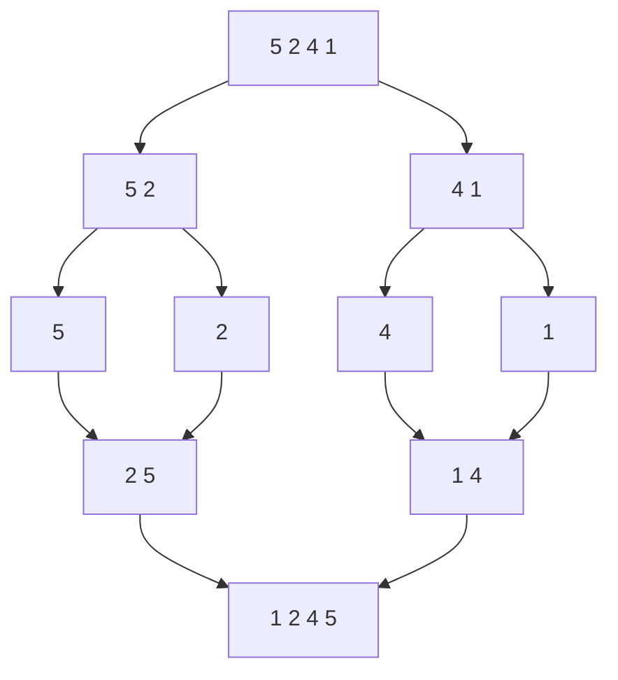
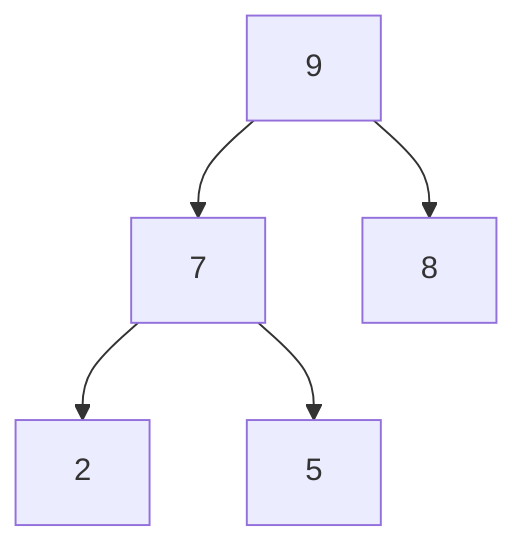
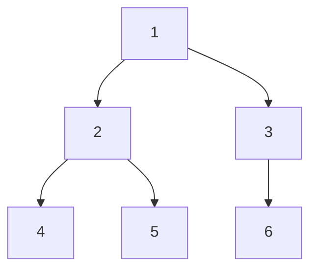
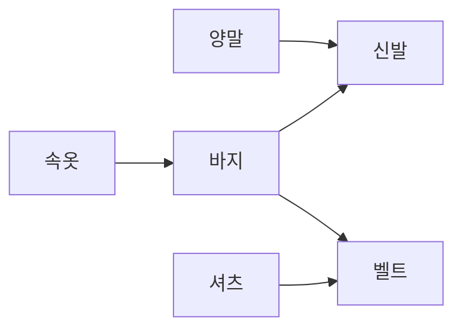
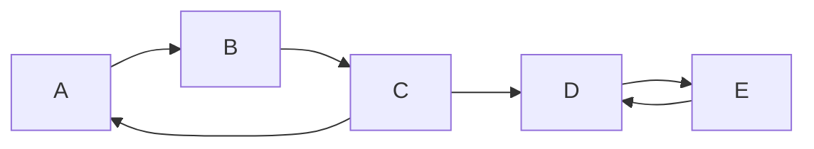
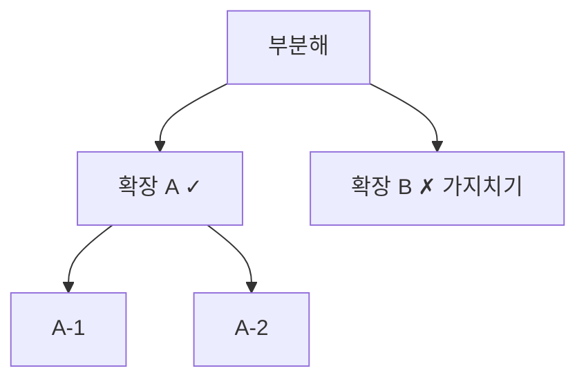

분야 핵심 개념을 얕고 넓게 정리한 노트. 쓱 훑어보며 복습한다.

항목 제목의 ★는 면접에서 개념·원리를 깊게 파고드는 축이라는 표시. 나머지도 ★ 항목의 꼬리질문에서 나오므로 건너뛰지 않는다.

## 복잡도와 재귀

얼마나 빨리 커지는지 재고, 쪼개고, 호출을 쌓는 기본기.

### 시간복잡도 — 중첩 루프

중첩 루프의 시간복잡도는 가장 안쪽 문장이 총 몇 번 실행되느냐로 정해짐. 루프 하나가 몇 번 도는지 먼저 보고, 그다음 겹친 루프들의 횟수를 곱하거나 더해 조합함.

루프 하나의 반복 횟수는 i가 얼마나 빨리 커지느냐로 갈림.

| 루프 | i가 거치는 값 (n = 16) | 반복 횟수 |
| --- | --- | --- |
| `for (i = 0; i < n; i++)` | 0, 1, 2, …, 15 | n번 (16) |
| `for (i = 1; i < n; i *= 2)` | 1, 2, 4, 8 | log₂ n번 (4) |
| `for (i = n; i > 1; i /= 2)` | 16, 8, 4, 2 | log₂ n번 (4) |
| `for (i = 1; i * i < n; i++)` | 1, 2, 3 | 약 √n번 (3) |

i를 2배씩 키우면 1에서 n까지 가는 데 "2를 몇 번 곱해야 n이 되나"만큼 걸리고, 그 횟수가 log₂ n. 반씩 줄여 가는 루프와 이분 탐색이 log n인 것도 같은 이유. 로그의 밑은 상수배 차이(log₂ n ≈ 3.32 × log₁₀ n)라 빅오에선 생략하고 그냥 O(log n).

겹친 루프는 안쪽 루프의 반복 횟수가 바깥의 i에 따라 달라지는지 봄.

- 안쪽 횟수가 i와 무관 — 매번 같은 횟수를 도니 바깥 횟수 × 안쪽 횟수
- 안쪽 횟수가 i에 따라 바뀜 — 바깥이 돌 때마다 안쪽 횟수가 다르니 하나씩 더해야 함. 결과가 곱으로 어림한 것보다 훨씬 작을 수 있음

```csharp
// 세 코드 모두 a·b·c는 "안쪽 문장이 실행된 총 횟수"
int n = 16;

// (A) 바깥은 i를 2배씩, 안쪽은 매번 n번
int a = 0;
for (int i = 1; i < n; i *= 2)        // i = 1, 2, 4, 8 → 4번
    for (int j = 0; j < n; j++) a++;  // 매번 16번
// a = 4 × 16 = 64

// (B) 바깥은 (A)와 같고, 안쪽이 i번만
int b = 0;
for (int i = 1; i < n; i *= 2)        // i = 1, 2, 4, 8
    for (int j = 0; j < i; j++) b++;  // 1번, 2번, 4번, 8번
// b = 1 + 2 + 4 + 8 = 15

// (C) 안쪽은 (B)와 같고, 바깥이 i를 1씩
int c = 0;
for (int i = 1; i < n; i++)           // i = 1, 2, 3, …, 15
    for (int j = 0; j < i; j++) c++;  // 1번, 2번, 3번, …, 15번
// c = 1 + 2 + … + 15 = 120
```

| | 안쪽 횟수 | 총 횟수 | n = 16 | n = 1024 | 복잡도 |
| --- | --- | --- | --- | --- | --- |
| (A) | 매번 n (i와 무관) | log n × n | 64 | 10,240 | O(n log n) |
| (B) | i번 | 1 + 2 + 4 + … (n 미만까지) | 15 | 1,023 | O(n) |
| (C) | i번 | 1 + 2 + 3 + … + (n − 1) | 120 | 523,776 | O(n²) |

(B)는 바깥이 log n번 도는데도 전체에 log가 붙지 않음. 안쪽 횟수가 1, 2, 4, 8처럼 2배씩 커지면 마지막 값 하나가 앞의 값을 모두 더한 것보다 큼(8 > 1 + 2 + 4 = 7). 그래서 총합은 마지막 값의 2배를 넘지 못하고, 마지막 값이 n보다 작으니 총합도 2n 미만이라 O(n).

<svg viewBox="0 0 600 150" width="643" style="max-width:100%;height:auto" xmlns="http://www.w3.org/2000/svg" role="img" aria-label="(B)의 안쪽 횟수 8, 4, 2, 1을 이어 붙여도 n = 16을 넘지 않는다"><g fill="#4f83e0" fill-opacity="0.12" stroke="#4f83e0"><rect x="40" y="20" width="260" height="36" rx="4"/><rect x="300" y="20" width="130" height="36" rx="4"/><rect x="430" y="20" width="65" height="36" rx="4"/><rect x="495" y="20" width="32.5" height="36" rx="3"/></g><rect x="40" y="74" width="520" height="36" rx="4" fill="none" stroke="currentColor" opacity="0.6"/><g font-size="14" fill="currentColor" text-anchor="middle"><text x="170" y="43">8</text><text x="365" y="43">4</text><text x="462" y="43">2</text><text x="511" y="43">1</text><text x="300" y="97">n = 16</text></g><text x="300" y="136" font-size="12" fill="currentColor" opacity="0.75" text-anchor="middle">(B)의 안쪽 횟수 8, 4, 2, 1을 이어 붙여도 합 15, n = 16을 넘지 않음</text></svg>

(C)는 안쪽 코드가 (B)와 똑같은데 바깥 i가 1씩 커져서, 안쪽 횟수가 1, 2, 3, …으로 n 아래의 모든 값을 거침. 이 합은 약 n²/2라 O(n²). 바깥 루프가 i를 어떻게 키우느냐 하나로 O(n)과 O(n²)이 갈림.

### 분할 정복 — 마스터 정리 ★

문제를 같은 형태의 작은 하위 문제로 나눠 재귀로 풀고, 답을 합쳐 원래 답을 만드는 설계 방식. 병합 정렬, 이분 탐색이 대표 예.

- 나누기 — 문제를 더 작은 하위 문제 여러 개로 쪼갬
- 정복 — 각 하위 문제를 같은 방식으로 재귀 호출해 풀고, 충분히 작아지면 바로 답을 냄
- 합치기 — 하위 문제의 답을 모아 원래 문제의 답을 만듦

전제는 하위 문제끼리 겹치지 않는 것. 겹치면 같은 계산을 여러 번 반복해서 쪼갠 게 오히려 손해가 됨. 피보나치를 정의 F(n) = F(n−1) + F(n−2) 그대로 재귀로 짜면, F(n−1)을 계산하는 안에서 F(n−2)를 또 부르기 때문에 같은 값을 계속 다시 계산함. 겹치는 하위 문제는 답을 저장해 재사용하는 DP로 풂(뒤의 DP 탑다운 vs 바텀업 항목).

```csharp
// 피보나치를 정의 그대로 재귀로: 하위 문제가 겹치는 예
int Fib(int n) => n < 2 ? n : Fib(n - 1) + Fib(n - 2);

Fib(40);   // 102334155, 그런데 호출 횟수는 331,160,281번
           // Fib(38)을 2번, Fib(37)을 3번, Fib(36)을 5번 … 같은 계산을 반복
```

복잡도는 점화식으로 나타냄. T(n)을 크기 n인 문제를 푸는 데 드는 시간이라고 하면, 분할 정복은 대개 `T(n) = a·T(n/b) + f(n)` 꼴.

- a — 한 번에 만드는 하위 문제 개수
- b — 하위 문제 하나의 크기가 n/b, 즉 b분의 1로 줄어듦
- f(n) — 재귀 호출 말고 그 단계가 직접 하는 일. 나누기와 합치기 비용의 합

병합 정렬은 배열을 반으로 나눠(a = 2, b = 2) 각각 정렬한 뒤 두 결과를 병합함(f(n) = n). f(n) = n은 쪼개기가 아니라 병합에서 나옴. 쪼개기는 가운데 위치 하나를 구하는 O(1).

```csharp
// 병합 정렬: arr[lo..hi) 구간을 정렬
void MergeSort(int[] arr, int lo, int hi)   // 크기 n = hi − lo → T(n)
{
    if (hi - lo <= 1) return;               // 크기 1이면 이미 정렬됨
    int mid = (lo + hi) / 2;                // 나누기: O(1)
    MergeSort(arr, lo, mid);                // 크기 n/2 → T(n/2)
    MergeSort(arr, mid, hi);                // 크기 n/2 → T(n/2)
    Merge(arr, lo, mid, hi);                // 합치기: 정렬된 두 절반을 병합, O(n)
}
// 하위 문제 2개(a = 2), 크기 절반(b = 2), 직접 하는 일 n(f(n) = n)
// → T(n) = 2·T(n/2) + n
```

마스터 정리는 이 점화식의 답을 재귀 트리로 구함. 재귀 트리는 호출 하나를 노드로, 그 호출이 부른 하위 호출을 자식으로 그린 트리.

- k층 — 노드가 aᵏ개, 각 노드의 문제 크기는 n/bᵏ. 그래서 층 전체 작업량은 aᵏ · f(n/bᵏ)
- 깊이 — 크기를 b로 계속 나눠 1이 될 때까지의 횟수, log_b n
- 잎 개수 — 맨 아래층 노드 수 a^(log_b n). 로그 성질로 바꿔 쓰면 n^(log_b a)

잎 하나는 크기 1이라 상수 시간이므로, 잎 개수가 곧 맨 아래층의 작업량. 결국 마스터 정리는 맨 위층 작업량 f(n)과 맨 아래층 작업량 n^(log_b a) 중 어느 쪽이 큰지 비교함.

| 경우 | 비교 | 결과 | 이유 |
| --- | --- | --- | --- |
| 잎이 무거움 | f(n)이 n^(log_b a)보다 n의 거듭제곱 배만큼 작음(n^0.1배라도) | Θ(n^(log_b a)) | 층 작업량이 아래로 갈수록 일정 비율로 늘어 맨 아래층이 전체를 정함 |
| 모든 층이 같음 | f(n)과 n^(log_b a)가 같은 크기 | Θ(n^(log_b a) · log n) | 모든 층이 같은 양이라 한 층 × 층 수 log n |
| 뿌리가 무거움 | f(n)이 n의 거듭제곱 배만큼 크고, 아래층 작업량이 실제로 일정 비율로 줄어야 함(정칙 조건, 보통의 다항식 f면 성립) | Θ(f(n)) | 층 작업량이 아래로 갈수록 일정 비율로 줄어 맨 위층이 전체를 정함 |

층 작업량이 일정 비율로 늘거나 줄면 층별 작업량이 등비수열이라, 총합이 가장 큰 층의 상수배 안에 들어감. 앞의 중첩 루프 항목에서 1 + 2 + 4 + 8 = 15가 2 × 8보다 작았던 것과 같은 원리. 그래서 가장 무거운 층 하나가 전체 복잡도를 정함.

<svg viewBox="0 0 600 230" width="643" style="max-width:100%;height:auto" xmlns="http://www.w3.org/2000/svg" role="img" aria-label="마스터 정리 세 경우의 층별 작업량: 잎이 무거움, 모든 층이 같음, 뿌리가 무거움"><g font-size="14" fill="currentColor" text-anchor="middle"><text x="100" y="22">잎이 무거움</text><text x="300" y="22">모든 층이 같음</text><text x="500" y="22">뿌리가 무거움</text></g><g font-size="12" fill="currentColor" opacity="0.7" text-anchor="middle"><text x="100" y="41">8T(n/2) + n²</text><text x="300" y="41">2T(n/2) + n</text><text x="500" y="41">2T(n/2) + n²</text></g><g fill="#4f83e0" fill-opacity="0.12" stroke="#4f83e0"><rect x="90" y="56" width="20" height="22" rx="3"/><rect x="80" y="84" width="40" height="22" rx="3"/><rect x="60" y="112" width="80" height="22" rx="3"/><rect x="240" y="56" width="120" height="22" rx="3"/><rect x="240" y="84" width="120" height="22" rx="3"/><rect x="240" y="112" width="120" height="22" rx="3"/><rect x="240" y="140" width="120" height="22" rx="3"/><rect x="460" y="84" width="80" height="22" rx="3"/><rect x="480" y="112" width="40" height="22" rx="3"/><rect x="490" y="140" width="20" height="22" rx="3"/></g><g fill="#e2574c" fill-opacity="0.12" stroke="#e2574c"><rect x="20" y="140" width="160" height="22" rx="3"/><rect x="420" y="56" width="160" height="22" rx="3"/></g><g font-size="14" fill="currentColor" text-anchor="middle"><text x="100" y="188">Θ(n³)</text><text x="300" y="188">Θ(n log n)</text><text x="500" y="188">Θ(n²)</text></g><text x="300" y="218" font-size="12" fill="currentColor" opacity="0.75" text-anchor="middle">위에서부터 뿌리 → 잎, 막대 폭 = 그 층의 총 작업량, 빨강 = 지배하는 층</text></svg>

| 알고리즘 | 점화식 | 잎 개수 n^(log_b a) | f(n) | 경우 | 결과 |
| --- | --- | --- | --- | --- | --- |
| 이분 탐색 | T(n) = T(n/2) + 1 | 1 | 1 | 같음 | Θ(log n) |
| 트리 전체 순회 | T(n) = 2T(n/2) + 1 | n | 1 | 잎이 무거움 | Θ(n) |
| 병합 정렬 | T(n) = 2T(n/2) + n | n | n | 같음 | Θ(n log n) |
| 행렬 곱(단순) | T(n) = 8T(n/2) + n² | n³ | n² | 잎이 무거움 | Θ(n³) |
| Strassen 행렬 곱 | T(n) = 7T(n/2) + n² | n^2.81 | n² | 잎이 무거움 | Θ(n^2.81) |

잎이 무거운 경우엔 f(n)을 줄여도 결과가 그대로고, 하위 문제 개수 a를 줄여야 지수가 내려감. Strassen이 절반 크기 행렬끼리의 곱셈을 8번에서 7번으로 줄여 n³을 n^2.81로 낮춘 게 그 예.

마스터 정리를 쓸 때 걸리는 점과 분할 정복 자체의 비용.

- 하위 문제 크기가 균등해야 함 — 퀵 정렬은 피벗에 따라 나뉜 크기가 달라 그대로 대입할 수 없음. 최악에는 T(n) = T(n−1) + n인데, 하위 문제가 n/b가 아니라 n−1로 1씩만 줄어 정리의 형태가 아니므로 직접 더함. n + (n−1) + … + 1 ≈ n²/2라 O(n²)(뒤의 퀵 정렬 최악 항목)
- 세 경우 사이의 틈 — 2T(n/2) + n log n은 f(n) = n log n이 잎 개수 n보다 log n배만 커서(n의 거듭제곱 배가 아님) 기본 세 경우 어디에도 안 걸림. 마스터 정리의 확장판을 쓰면 Θ(n log² n)
- 재귀 비용 — 호출마다 스택 프레임이 생기고, 균형이면 깊이는 log_b n. 구간이 작으면 재귀 호출 비용이 실제 일보다 커져서, 실무 정렬은 작은 구간을 삽입 정렬로 마무리(뒤의 삽입 정렬 항목)
- 병렬화 — 하위 문제끼리 독립이라 코어별로 나눠 맡기기 쉬움

### 재귀 스택 오버플로

재귀 함수는 자신이 부른 하위 호출이 돌아와야 끝날 수 있음. 그래서 첫 호출부터 지금 실행 중인 호출까지, 재귀 깊이만큼의 프레임이 동시에 스택에 남아 있음. 깊이 × 프레임 크기가 스택 한계를 넘으면 오버플로. 예를 들어 프레임 하나가 100바이트면 1MB 스택은 깊이 약 1만에서 넘침. 프레임 구성과 스택 한계·가드 페이지는 운영체제 노트의 스택 프레임·스택 오버플로 항목 참고.

위험을 가르는 건 재귀를 썼느냐가 아니라, 깊이가 입력 크기에 따라 얼마나 커지느냐.

| | 호출마다 줄어드는 양 | 깊이 | 예 | n = 10억일 때 |
| --- | --- | --- | --- | --- |
| 선형 재귀 | 남은 일이 하나씩 | n | `Sum(n)`, 연결 리스트 순회, 플러드 필 | 10억 단계 → 오버플로 |
| 균형 분할 정복 | 크기가 절반씩 | log₂ n | 병합 정렬, 이분 탐색 | 약 30단계 → 안전 |

.NET에선 `StackOverflowException`을 `try/catch`로 잡을 수 없고 프로세스가 그대로 종료됨. 복구가 불가능하니, 입력에 비례해 깊어지는 재귀는 아래 방법으로 미리 구조를 바꿔야 함.

- 명시적 스택 — 재귀에서는 "이 칸을 처리한 뒤 나머지 이웃도 호출해야 함" 같은 남은 일이 각 프레임 안에 대기함. 이 남은 일을 좌표처럼 필요한 값만으로 `Stack<T>`에 직접 넣고, 반복문으로 하나씩 꺼내 처리함. `Stack<T>`의 내부 배열은 힙에 있어 한계가 스택 크기가 아니라 힙 메모리가 되고, 프레임의 부가 정보(복귀 주소·저장된 레지스터)도 안 붙음. 대신 코드가 길어지고, `Stack<T>`는 마지막에 넣은 것을 먼저 꺼내서 넣은 순서와 반대로 처리됨. 순서가 중요한 DFS는 이웃을 역순으로 넣음
- 꼬리 재귀를 반복문으로 — 꼬리 호출은 함수의 마지막 동작이 재귀 호출이라, 그 호출이 돌아온 뒤 할 일이 없는 호출. 돌아와서 쓸 지역 변수가 없으니 현재 프레임을 다음 호출이 그대로 써도 됨(꼬리 호출 최적화). 하지만 C# 컴파일러는 이 최적화를 보장하지 않음(x64 릴리스 빌드의 JIT가 경우에 따라 해줄 뿐, 디버그 빌드에선 그대로 쌓임). 꼬리 재귀는 인자 갱신을 변수 갱신으로, 재귀 호출을 다음 반복으로 바꾸면 그대로 반복문이 되므로 직접 바꾸는 게 확실
- 작은 쪽만 재귀 — 퀵 정렬처럼 한 번에 두 하위 문제로 나뉘는 재귀에서, 작은 쪽만 재귀로 들어가고 큰 쪽은 반복문으로 처리함. 재귀로 들어가는 쪽이 항상 현재 크기의 절반 이하라 깊이가 log₂ n을 넘지 않음. 깊이만 해결될 뿐 시간 복잡도는 그대로(뒤의 퀵 정렬 최악 항목)
- 스택 크기 늘리기 — `new Thread(work, maxStackSize)`로 큰 스택을 가진 스레드를 띄움. 깊이가 입력에 비례하면 한계를 뒤로 미룰 뿐이라, 입력 크기의 상한이 확실할 때만 씀

```csharp
// 1부터 n까지의 합을 세 방식으로
long Sum(int n) => n == 0 ? 0 : n + Sum(n - 1);                         // 돌아와서 n을 더해야 함 → 꼬리 호출 아님
long SumTail(int n, long acc = 0) => n == 0 ? acc : SumTail(n - 1, acc + n);  // 마지막 동작이 호출 → 꼬리 호출
long SumLoop(int n) { long acc = 0; while (n > 0) { acc += n; n--; } return acc; }  // SumTail을 반복문으로

Sum(10_000_000);       // 프레임 천만 개 → 오버플로, 프로세스 종료
SumLoop(10_000_000);   // 50000005000000
```

```csharp
// 플러드 필: (sx, sy)에서 시작해 상하좌우로 이어진 빈 칸(0)을 모두 1로 칠함
// grid는 세로 H, 가로 W인 격자

// 재귀 버전: 1000×1000 빈 격자면 깊이가 칸 수(100만)까지 감
void Fill(int x, int y)
{
    if (x < 0 || y < 0 || x >= W || y >= H || grid[y, x] != 0) return;
    grid[y, x] = 1;
    Fill(x + 1, y); Fill(x - 1, y); Fill(x, y + 1); Fill(x, y - 1);
}

// 명시적 스택 버전: 칠할 후보 좌표를 힙의 Stack<T>에 쌓고 하나씩 꺼냄
void FillIter(int sx, int sy)
{
    var todo = new Stack<(int x, int y)>();
    todo.Push((sx, sy));
    while (todo.Count > 0)
    {
        var (x, y) = todo.Pop();
        if (x < 0 || y < 0 || x >= W || y >= H || grid[y, x] != 0) continue;
        grid[y, x] = 1;
        todo.Push((x + 1, y)); todo.Push((x - 1, y));
        todo.Push((x, y + 1)); todo.Push((x, y - 1));
    }
}
```

```csharp
// Partition: 구간 [lo, hi)에서 피벗을 제자리에 놓고 그 위치 p를 반환
//            → 왼쪽 [lo, p)는 피벗 이하, 오른쪽 [p + 1, hi)는 피벗 이상
void QuickSort(int[] a, int lo, int hi)
{
    while (hi - lo > 1)
    {
        int p = Partition(a, lo, hi);
        if (p - lo < hi - p) { QuickSort(a, lo, p); lo = p + 1; }  // 작은 쪽만 재귀
        else                 { QuickSort(a, p + 1, hi); hi = p; }  // 큰 쪽은 반복
    }
}
// 재귀로 들어가는 쪽은 항상 절반 이하 → 분할이 아무리 나빠도 깊이 ≤ log₂ n
```

## 정렬

비교 정렬의 한계와 비비교 정렬, 상황별 선택.

### 병합 정렬이 O(n log n)인 이유

절반씩 나눠 깊이가 log n. 각 레벨의 병합을 다 합치면 n개 원소를 한 번씩 훑어 O(n)(n은 한 레벨의 병합 총량). 따라서 n × log n.



### 퀵 정렬 최악 O(n²)

이미 정렬된 배열에서 첫 원소를 피벗으로 잡으면 분할이 0개 vs n-1개로 완전히 치우쳐 재귀 깊이 n → O(n²). 완화는 랜덤 피벗, median-of-three(첫·중간·끝의 중앙값).

### 퀵 vs 병합 — 실무 배열 정렬 ★

| | 장점 | 대가 |
| --- | --- | --- |
| 퀵 | 제자리(in-place)라 추가 메모리 불필요, 인접 원소 교환이라 캐시 지역성 높음, 작은 상수 | 최악 O(n²) |
| 병합 | 안정 정렬, 최악까지 O(n log n) 보장 | 보조 배열 O(n)과 복사 비용 |

둘 다 평균 O(n log n)이라 배열 정렬엔 퀵 계열이 선호됨. 병합이 유리한 곳은 안정 정렬이 필요할 때, 최악 보장이 필요할 때, 연결 리스트 정렬, 외부 정렬.

### 삽입 정렬 — 거의 정렬된 배열

각 원소를 왼쪽 정렬부에 넣을 때 큰 원소를 밀며 자리를 찾음. 거의 정렬돼 있으면 이 안쪽 시프트가 거의 0이라(비교 약 1회) O(n)에 수렴.

### 계수 정렬(Counting Sort) ★

원소를 비교하지 않고 각 값의 등장 횟수를 세서 정렬 → 비교 정렬의 하한 O(n log n)에 안 걸리고 O(n + k). 단 값을 배열 인덱스로 쓰므로 범위가 한정된 정수에만 가능(실수·문자열 불가). 값 범위 k가 원소 수 n보다 훨씬 크면 O(n+k)가 폭발해 메모리 낭비·저속. "n과 비슷한 좁은 정수 범위"에서만 유리.

### 힙 정렬과 우선순위 큐

힙은 부모가 자식보다 항상 크거나(최대 힙) 작은(최소 힙) 완전 이진 트리. 삽입·삭제가 O(log n), 최댓값/최솟값 조회 O(1)이라 우선순위 큐의 표준 구현체. 힙 정렬은 배열을 힙으로 만든 뒤 루트를 하나씩 빼며 정렬 → O(n log n) 보장에 제자리(추가 메모리 없음). 단 원소 접근이 트리를 오르내려 캐시 지역성이 나빠 실측은 퀵보다 느림. C#은 .NET 6+의 `PriorityQueue<TElement, TPriority>` 제공.



최대 힙 — 부모가 자식보다 크므로 루트(9)가 최댓값. 루트를 빼고 정리하길 반복해 정렬.

### 안정 정렬(stable sort)

같은 키를 가진 원소들의 상대 순서가 정렬 후에도 유지. 예를 들어 점수가 같으면 먼저 등록한 사람이 위. C#에서 `List.Sort`/`Array.Sort`는 불안정, LINQ `OrderBy`는 안정.

## 그래프 순회와 최단 경로

넓게 퍼지느냐 깊게 파느냐, 그리고 가중치를 어떻게 다루느냐.

### BFS vs DFS ★

BFS는 큐(FIFO)로 구현. 한 노드의 이웃을 모두 펼쳐 가까운 칸부터 레벨 순으로 탐색하므로, 가중치 없는 그래프에서 처음 목표에 도달한 경로가 곧 최단. DFS는 막힐 때까지 파고들다 막히면 최근 갈림길로 되돌아가야 해 LIFO 스택. 재귀 DFS는 호출 스택을 쓰는 것이고, 반복문 DFS는 이를 명시적 스택으로 대체한 것.



BFS는 레벨 순 `1 → 2 3 → 4 5 6`(큐), DFS는 한 길로 파고들어 `1 → 2 → 4 → 5 → 3 → 6`(스택).

### 다익스트라 vs A* ★

A*는 다익스트라에 휴리스틱 h(목표까지 추정 비용)를 추가한 것. 노드 우선순위를 `f = g + h`(g = 실제 비용, h = 추정)로 매겨 목표 방향을 먼저 탐색 → 더 적은 노드 탐색. h = 0이면 다익스트라와 동일.

h가 실제 남은 거리를 과대평가하면 좋은 경로의 f가 부풀려져 우선순위에서 밀려 최적해를 놓침. 과소평가(admissible)여야 최단 경로 보장.

### 벨만-포드와 플로이드-워셜

다익스트라는 음수 간선을 못 다룸 — 방문 확정한 노드를 나중에 더 줄일 수 없기 때문. 벨만-포드는 모든 간선을 V-1번 반복 완화(relax)해 음수 간선을 허용하고, 한 번 더 완화되는 간선이 있으면 음수 사이클로 탐지. 플로이드-워셜은 중간 정점을 하나씩 거치는 3중 루프로 모든 쌍 최단 경로를 구함.

| | 용도 | 음수 간선 | 복잡도 |
| --- | --- | --- | --- |
| 다익스트라 | 단일 출발점 | 불가 | O(E log V) |
| 벨만-포드 | 단일 출발점 | 가능(사이클 탐지) | O(VE) |
| 플로이드-워셜 | 모든 쌍 | 가능 | O(V³) |

## 그래프 구조 분석

순서·연결·묶음처럼 그래프의 구조를 밝히는 알고리즘.

### 위상 정렬(Topological Sort)

의존 관계를 어기지 않는 일렬 순서. Kahn은 진입 차수 0인 노드를 큐에 넣고 처리하며 이웃 차수를 감소시키고, DFS는 후위 순회를 뒤집음. DAG(방향·사이클 없음)에서만 가능 — 사이클이 있으면 순서 모순. 결과 노드 수가 전체보다 적으면 사이클 존재(탐지에도 쓰임).



옷 입는 순서 — 화살표가 "먼저 입어야 함". 양말·속옷·셔츠처럼 들어오는 화살표가 없는 것부터 시작해 바지 → 신발·벨트 순으로 줄 세우는 게 위상 정렬.

### 최소 신장 트리(MST)

모든 정점을 잇는 간선 가중치 합이 최소인 트리 — 사이클 없이 간선 V-1개. 크루스칼은 간선을 가중치 오름차순으로 정렬해 사이클을 안 만드는 것부터 추가(사이클 판정은 유니온-파인드) → 간선이 성긴 그래프에 유리. 프림은 한 정점에서 시작해 트리에 닿는 최소 간선을 우선순위 큐로 골라 확장 → 간선이 조밀한 그래프에 유리. 둘 다 국소 최선을 고르는 그리디이며 MST에선 최적을 보장.

### 유니온-파인드(서로소 집합) ★

원소들을 겹치지 않는 집합으로 관리 — find(대표 원소 찾기)와 union(두 집합 합치기). 경로 압축(find 도중 거친 노드를 루트에 직접 연결)과 랭크/사이즈 기반 병합을 함께 쓰면 연산이 사실상 O(1)(역아커만 함수 α). 연결 요소 개수, 사이클 판정, 크루스칼 MST에 쓰임.

### 최소 공통 조상(LCA)

트리에서 두 노드의 가장 가까운 공통 조상. 순진하게는 깊은 쪽을 끌어올려 같은 깊이로 맞춘 뒤 함께 위로 올라가며 만나는 지점을 찾음. 이진 승천(binary lifting)으로 2^k번째 조상을 미리 표에 채우면 질의당 O(log n). 트리에서 두 노드 간 거리·경로 계산의 기반.

### 강한 연결 요소(SCC)

방향 그래프에서 서로 오갈 수 있는 노드들의 최대 묶음. 각 SCC를 한 점으로 축약하면 사이클 없는 DAG가 되어 위상 정렬·의존 분석이 가능. 코사라주는 원본과 역방향 그래프에서 DFS를 두 번, 타잔은 DFS 한 번에 low-link 값으로 구함. 2-SAT, 데드락 사이클 분석에 쓰임.



A·B·C가 한 SCC, D·E가 또 하나 — 각 묶음 안에서는 서로 오갈 수 있다.

## 배열·구간·탐색 기법

정렬과 누적을 활용해 반복 계산을 없애는 패턴.

### 이진 탐색과 lower bound ★

일반 이진 탐색은 아무 일치 지점에서 멈추지만, lower bound는 "target 이상인 가장 왼쪽(첫 번째)" 위치를 찾음. 중복 원소가 많을 때, target이 없어도 삽입 위치를 반환. 범위 개수 질의(구간 개수 = `upper_bound(b) − lower_bound(a)`)에도 쓰임.

### 투 포인터

정렬된 배열에서 양 끝 포인터를 좁히며 합을 target과 비교. 작으면 왼쪽을 오른쪽으로(합 증가), 크면 오른쪽을 왼쪽으로(합 감소). 포인터가 안쪽으로만 이동해 배열을 한 번만 훑으므로 O(n). 정렬 전제 필수.

<svg viewBox="0 0 340 110" width="425" style="max-width:100%;height:auto" xmlns="http://www.w3.org/2000/svg" role="img" aria-label="정렬된 배열의 양 끝 두 포인터"><defs><marker id="tp-a" markerWidth="8" markerHeight="8" refX="6" refY="3" orient="auto"><path d="M0,0L6,3L0,6Z" fill="#4f83e0"/></marker><marker id="tp-b" markerWidth="8" markerHeight="8" refX="6" refY="3" orient="auto"><path d="M0,0L6,3L0,6Z" fill="#e2574c"/></marker></defs><g font-size="15" fill="currentColor" text-anchor="middle"><rect x="20" y="25" width="48" height="42" rx="4" fill="none" stroke="currentColor" opacity="0.7"/><text x="44" y="52">1</text><rect x="70" y="25" width="48" height="42" rx="4" fill="none" stroke="currentColor" opacity="0.7"/><text x="94" y="52">3</text><rect x="120" y="25" width="48" height="42" rx="4" fill="none" stroke="currentColor" opacity="0.7"/><text x="144" y="52">4</text><rect x="170" y="25" width="48" height="42" rx="4" fill="none" stroke="currentColor" opacity="0.7"/><text x="194" y="52">6</text><rect x="220" y="25" width="48" height="42" rx="4" fill="none" stroke="currentColor" opacity="0.7"/><text x="244" y="52">8</text><rect x="270" y="25" width="48" height="42" rx="4" fill="none" stroke="currentColor" opacity="0.7"/><text x="294" y="52">11</text></g><path d="M44 90 L44 72" stroke="#4f83e0" stroke-width="2" marker-end="url(#tp-a)"/><path d="M294 90 L294 72" stroke="#e2574c" stroke-width="2" marker-end="url(#tp-b)"/><text x="44" y="105" font-size="12" fill="#4f83e0" text-anchor="middle">L →</text><text x="294" y="105" font-size="12" fill="#e2574c" text-anchor="middle">← R</text></svg>

### 슬라이딩 윈도우

크기 K 윈도우의 합을 매번 다시 더하면 O(n·K). 나간 값 빼고 들어온 값 더하는 누적 합으로 매 스텝 O(1) → 전체 O(n). 연속 윈도우가 K-1개 겹치니 양 끝 변화만 반영하면 됨.

### 누적 합(prefix sum)

구간 합을 매번 더하면 질의마다 O(n). 앞에서부터 누적한 배열 P를 미리 만들면(P[i] = a[0] + … + a[i]) 임의 구간 [l, r]의 합 = P[r] − P[l−1]로 O(1). 슬라이딩 윈도우가 고정 크기 구간에만 쓰인다면 누적 합은 임의 구간에 대응. 2차원으로 확장하면 부분 직사각형 합도 O(1).

<svg viewBox="0 0 330 150" width="413" style="max-width:100%;height:auto" xmlns="http://www.w3.org/2000/svg" role="img" aria-label="누적 합으로 구간 합을 O(1)에"><g font-size="14" fill="currentColor" text-anchor="middle"><text x="12" y="50" font-size="12" opacity="0.7">a</text><rect x="30" y="27" width="46" height="36" rx="4" fill="none" stroke="currentColor" opacity="0.6"/><text x="53" y="50">2</text><rect x="80" y="27" width="46" height="36" rx="4" fill="#4f83e0" fill-opacity="0.12" stroke="#4f83e0"/><text x="103" y="50">4</text><rect x="130" y="27" width="46" height="36" rx="4" fill="#4f83e0" fill-opacity="0.12" stroke="#4f83e0"/><text x="153" y="50">1</text><rect x="180" y="27" width="46" height="36" rx="4" fill="#4f83e0" fill-opacity="0.12" stroke="#4f83e0"/><text x="203" y="50">5</text><rect x="230" y="27" width="46" height="36" rx="4" fill="none" stroke="currentColor" opacity="0.6"/><text x="253" y="50">3</text><text x="12" y="105" font-size="12" opacity="0.7">P</text><rect x="30" y="82" width="46" height="36" rx="4" fill="#e2574c" fill-opacity="0.12" stroke="#e2574c"/><text x="53" y="105">2</text><rect x="80" y="82" width="46" height="36" rx="4" fill="none" stroke="currentColor" opacity="0.6"/><text x="103" y="105">6</text><rect x="130" y="82" width="46" height="36" rx="4" fill="none" stroke="currentColor" opacity="0.6"/><text x="153" y="105">7</text><rect x="180" y="82" width="46" height="36" rx="4" fill="#e2574c" fill-opacity="0.12" stroke="#e2574c"/><text x="203" y="105">12</text><rect x="230" y="82" width="46" height="36" rx="4" fill="none" stroke="currentColor" opacity="0.6"/><text x="253" y="105">15</text></g><text x="30" y="140" font-size="12" fill="currentColor" opacity="0.75">구간 [1..3] 합 = P[3] − P[0] = 12 − 2 = 10</text></svg>

### 좌표 압축

값의 범위는 넓지만 실제 등장하는 값이 적을 때, 값을 크기 순위(0, 1, 2…)로 바꿔 배열 인덱스로 쓸 수 있게 함. 정렬 후 중복 제거한 목록에서 lower bound로 각 값의 순위를 찾음. 세그먼트 트리·누적 합처럼 값을 인덱스로 쓰는 구조에서 큰 좌표를 다룰 때 필수.

### 비트마스크

정수 한 개의 각 비트에 상태를 대응(켜짐 1 / 꺼짐 0). OR(`|=`)로 켜기, AND(`&`)로 확인, XOR(`^=`)로 토글. 빠르고 메모리를 절약하며 여러 상태를 한 번에 검사·조합 가능. 예: 상태 효과, LayerMask.

## 수학과 문자열

되풀이를 로그로 접거나, 이미 맞춘 정보를 재활용하는 발상.

### 에라토스테네스의 체

2부터 각 소수의 배수를 모두 지우면 남는 수가 소수. 2의 배수 제거 → 다음 안 지워진 3의 배수 제거 → … √n까지만 하면 됨(그 위 합성수는 이미 작은 소인수로 지워졌으므로). 전체 O(n log log n)이라 소수를 대량으로 구할 때 빠름.

<svg viewBox="0 0 310 130" width="332" style="max-width:100%;height:auto" xmlns="http://www.w3.org/2000/svg" role="img" aria-label="에라토스테네스의 체 — 배수를 지우면 소수가 남음"><g font-size="14" text-anchor="middle"><rect x="20" y="25" width="44" height="34" rx="4" fill="#4f83e0" fill-opacity="0.12" stroke="#4f83e0"/><text x="42" y="47" fill="#4f83e0">2</text><rect x="66" y="25" width="44" height="34" rx="4" fill="#4f83e0" fill-opacity="0.12" stroke="#4f83e0"/><text x="88" y="47" fill="#4f83e0">3</text><rect x="112" y="25" width="44" height="34" rx="4" fill="none" stroke="currentColor" opacity="0.5"/><text x="134" y="47" fill="currentColor" opacity="0.5">4</text><line x1="118" y1="31" x2="150" y2="53" stroke="#e2574c" stroke-width="1.5"/><rect x="158" y="25" width="44" height="34" rx="4" fill="#4f83e0" fill-opacity="0.12" stroke="#4f83e0"/><text x="180" y="47" fill="#4f83e0">5</text><rect x="204" y="25" width="44" height="34" rx="4" fill="none" stroke="currentColor" opacity="0.5"/><text x="226" y="47" fill="currentColor" opacity="0.5">6</text><line x1="210" y1="31" x2="242" y2="53" stroke="#e2574c" stroke-width="1.5"/><rect x="250" y="25" width="44" height="34" rx="4" fill="#4f83e0" fill-opacity="0.12" stroke="#4f83e0"/><text x="272" y="47" fill="#4f83e0">7</text><rect x="20" y="70" width="44" height="34" rx="4" fill="none" stroke="currentColor" opacity="0.5"/><text x="42" y="92" fill="currentColor" opacity="0.5">8</text><line x1="26" y1="76" x2="58" y2="98" stroke="#e2574c" stroke-width="1.5"/><rect x="66" y="70" width="44" height="34" rx="4" fill="none" stroke="currentColor" opacity="0.5"/><text x="88" y="92" fill="currentColor" opacity="0.5">9</text><line x1="72" y1="76" x2="104" y2="98" stroke="#e2574c" stroke-width="1.5"/><rect x="112" y="70" width="44" height="34" rx="4" fill="none" stroke="currentColor" opacity="0.5"/><text x="134" y="92" fill="currentColor" opacity="0.5">10</text><line x1="118" y1="76" x2="150" y2="98" stroke="#e2574c" stroke-width="1.5"/><rect x="158" y="70" width="44" height="34" rx="4" fill="#4f83e0" fill-opacity="0.12" stroke="#4f83e0"/><text x="180" y="92" fill="#4f83e0">11</text><rect x="204" y="70" width="44" height="34" rx="4" fill="none" stroke="currentColor" opacity="0.5"/><text x="226" y="92" fill="currentColor" opacity="0.5">12</text><line x1="210" y1="76" x2="242" y2="98" stroke="#e2574c" stroke-width="1.5"/><rect x="250" y="70" width="44" height="34" rx="4" fill="#4f83e0" fill-opacity="0.12" stroke="#4f83e0"/><text x="272" y="92" fill="#4f83e0">13</text></g><text x="20" y="122" font-size="12" fill="currentColor" opacity="0.75">√n까지 각 소수의 배수를 지우면 남는 수(파랑)가 소수</text></svg>

### 유클리드 호제법(GCD)

두 수의 최대공약수는 큰 수를 작은 수로 나눈 나머지로 바꿔도 안 변함 — gcd(a, b) = gcd(b, a mod b), b가 0이면 a가 답. 뺄셈 반복 대신 나머지로 접어 로그 시간. 기약분수, LCM(= a·b / gcd) 계산에 쓰임.

### 빠른 거듭제곱(분할 정복)

aⁿ을 n번 곱하면 O(n)이지만, 지수를 반으로 접어 `aⁿ = (a^(n/2))²`로 계산하면 O(log n). n이 홀수면 a를 한 번 더 곱함. 큰 수의 모듈러 지수(암호·해시)나, 행렬 거듭제곱으로 선형 점화식(피보나치)을 로그 시간에 구하는 데 쓰임.

### KMP 문자열 매칭 ★

텍스트에서 패턴을 찾을 때 순진한 방법은 불일치마다 패턴을 한 칸 밀며 처음부터 재비교해 O(nm). KMP는 패턴의 "접두사이자 접미사"인 최대 길이(실패 함수)를 미리 구해, 불일치 시 이미 맞춘 만큼 패턴을 건너뛰고 텍스트 포인터는 되돌리지 않음 → O(n + m). 실패 함수도 패턴을 자기 자신과 매칭해 O(m)에 계산.

<svg viewBox="0 0 300 120" width="346" style="max-width:100%;height:auto" xmlns="http://www.w3.org/2000/svg" role="img" aria-label="KMP 실패 함수 — 패턴의 접두사이자 접미사 길이"><g font-size="15" text-anchor="middle"><rect x="30" y="25" width="46" height="36" rx="4" fill="none" stroke="currentColor" opacity="0.6"/><text x="53" y="49" fill="currentColor">a</text><rect x="78" y="25" width="46" height="36" rx="4" fill="none" stroke="currentColor" opacity="0.6"/><text x="101" y="49" fill="currentColor">b</text><rect x="126" y="25" width="46" height="36" rx="4" fill="none" stroke="currentColor" opacity="0.6"/><text x="149" y="49" fill="currentColor">a</text><rect x="174" y="25" width="46" height="36" rx="4" fill="none" stroke="currentColor" opacity="0.6"/><text x="197" y="49" fill="currentColor">b</text><rect x="222" y="25" width="46" height="36" rx="4" fill="#4f83e0" fill-opacity="0.12" stroke="#4f83e0"/><text x="245" y="49" fill="#4f83e0">c</text><text x="53" y="83" font-size="13" fill="#e2574c">0</text><text x="101" y="83" font-size="13" fill="#e2574c">0</text><text x="149" y="83" font-size="13" fill="#e2574c">1</text><text x="197" y="83" font-size="13" fill="#e2574c">2</text><text x="245" y="83" font-size="13" fill="#e2574c">0</text></g><text x="18" y="108" font-size="12" fill="currentColor" opacity="0.7">π = 접두사이자 접미사인 최대 길이 → 불일치 시 건너뛸 양</text></svg>

## 완전 탐색·그리디·DP

모든 경우를 다루되 잘라내고, 겹치는 계산을 재사용하는 전략.

### 백트래킹 가지치기

유망하지 않은 부분 해에서 뻗어나갈 하위 트리를 통째로 잘라냄. 셀 몇 개를 빼는 게 아니라, 그 시작으로 만들어질 지수적으로 많은 경우(서브트리)를 한 번에 버리는 것.



유망하지 않은 B는 그 아래 서브트리를 통째로 버려 탐색을 건너뛴다.

### 그리디가 실패하는 경우 ★

국소 최선이 전역 최적과 어긋날 때 실패. 예를 들어 1·3·4 동전으로 6을 만들면 그리디는 4+1+1로 3개, 최적은 3+3으로 2개. 기준은 배수 관계가 아니라 그리디 선택 속성 — 그리디가 최적을 보장하려면 그리디 선택 속성 + 최적 부분 구조가 필요.

### 활동 선택 그리디

겹치지 않게 최대한 많은 활동을 고르는 문제. 끝나는 시각이 이른 것부터 고르고, 앞서 고른 것과 안 겹치면 채택하는 그리디가 최적. 일찍 끝낼수록 남는 시간이 많아 뒤에 더 담을 수 있다는 게 그리디 선택 속성. 시작 시각·길이 기준으로 고르면 반례가 생기므로 정렬 기준이 핵심.

### DP 탑다운 vs 바텀업 ★

| | 방식 | 장점 | 대가 |
| --- | --- | --- | --- |
| 탑다운 | 메모이제이션, 재귀 | 필요한 부분 문제만 계산 | 재귀 오버헤드, 스택 오버플로 위험 |
| 바텀업 | 타뷸레이션, 반복문 | 스택 위험 없고 캐시 친화적 | 모든 부분 문제를 계산 |

### 최장 증가 부분 수열(LIS)

수열에서 증가하는 부분 수열의 최대 길이. DP로 각 원소를 끝점으로 하는 LIS 길이를 채우면 O(n²). 대신 "각 길이의 LIS를 끝낼 수 있는 최소 마지막 값" 배열을 두고 원소마다 lower bound로 자리를 찾아 교체하면 O(n log n). 이 배열의 길이가 답이며, 배열 내용 자체는 실제 부분 수열이 아님에 주의.

### 0/1 배낭 문제

무게 한도 안에서 가치 합을 최대화하되 각 물건은 넣거나 뺌(쪼갤 수 없음). `dp[w]` = 무게 w 이하의 최대 가치를 두고, 물건마다 무게를 역순으로 훑어 갱신하면 한 물건을 두 번 쓰지 않음 → O(nW). 쪼갤 수 있는 분수 배낭은 가치·무게 비 그리디로 풀리지만, 0/1은 그리디가 실패해 DP가 필요.
