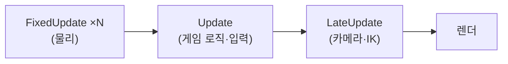
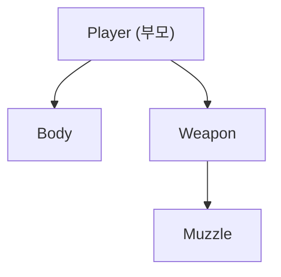

분야 핵심 개념을 얕고 넓게 정리한 노트. 쓱 훑어보며 복습한다.

## 생명주기와 프레임 루프

콜백이 언제, 어떤 순서로 불리는지.

### Awake / OnEnable / Start 순서

초기화를 두 단계로 나눠, 오브젝트끼리 서로 참조할 때 누가 먼저 준비됐는지 모르는 문제를 푸는 구조.

| 콜백 | 호출 시점 | 횟수 | 용도 |
| --- | --- | --- | --- |
| `Awake` | 게임오브젝트가 처음 활성화될 때 | 수명당 1회 | 자기 초기화 |
| `OnEnable` | 활성화될 때마다 | 켤 때마다 | 구독·재초기화 |
| `Start` | 첫 `Update` 직전 | 수명당 1회 | 다른 오브젝트와 연결 |

모든 오브젝트의 Awake가 끝난 뒤에야 Start가 시작됨. 오브젝트 간 Awake 순서는 보장되지 않지만, 이 장벽 덕에 Start에서는 남이 Awake 초기화를 마쳤다고 믿고 참조 가능. "내 준비는 Awake, 남과 연결은 Start".

<svg viewBox="0 0 620 214" width="720" style="max-width:100%;height:auto" xmlns="http://www.w3.org/2000/svg" role="img" aria-label="모든 오브젝트의 Awake가 끝난 뒤에야 Start가 시작되는 2단계 초기화"><defs><marker id="aw-a" markerWidth="8" markerHeight="8" refX="6" refY="3" orient="auto"><path d="M0,0L6,3L0,6Z" fill="currentColor" opacity="0.6"/></marker></defs><g fill="none" stroke="currentColor" stroke-opacity="0.25" stroke-dasharray="4 3"><rect x="16" y="40" width="250" height="140" rx="10"/><rect x="354" y="40" width="250" height="140" rx="10"/></g><g font-size="13" fill="currentColor" text-anchor="middle" opacity="0.8"><text x="141" y="30">1단계 — Awake·OnEnable (순서 보장 안 됨)</text><text x="479" y="30">2단계 — Start (서로 참조 가능)</text></g><g fill="none" stroke="currentColor" stroke-opacity="0.6"><rect x="46" y="54" width="190" height="30" rx="4"/><rect x="46" y="96" width="190" height="30" rx="4"/><rect x="46" y="138" width="190" height="30" rx="4"/></g><g fill="#3fae7a" fill-opacity="0.12" stroke="#3fae7a"><rect x="384" y="54" width="190" height="30" rx="4"/><rect x="384" y="96" width="190" height="30" rx="4"/><rect x="384" y="138" width="190" height="30" rx="4"/></g><g font-size="13" fill="currentColor" text-anchor="middle"><text x="141" y="74">A.Awake → A.OnEnable</text><text x="141" y="116">B.Awake → B.OnEnable</text><text x="141" y="158">C.Awake → C.OnEnable</text><text x="479" y="74">A.Start</text><text x="479" y="116">B.Start</text><text x="479" y="158">C.Start</text></g><line x1="272" y1="110" x2="346" y2="110" stroke="currentColor" stroke-opacity="0.6" stroke-width="1.4" marker-end="url(#aw-a)"/><line x1="310" y1="40" x2="310" y2="180" stroke="#e2574c" stroke-width="1.6" stroke-dasharray="5 4"/><text x="310" y="202" font-size="12" fill="#e2574c" text-anchor="middle">모든 Awake·OnEnable이 끝난 뒤에야 Start 시작</text></svg>

```csharp
public class Player : MonoBehaviour {
    Inventory inventory;

    void Awake() {
        // 내 것만 준비 — 남은 아직 준비 전일 수 있음
        inventory = new Inventory();
    }

    void Start() {
        // 남과 연결 — 모든 Awake가 끝난 뒤라 안전
        GameManager.Instance.Register(this);
    }
}
```

Awake에서 `GameManager.Instance`를 참조하면, GameManager의 Awake가 아직 안 돈 경우 null이라 터짐.

OnEnable은 모든 Awake 뒤가 아니라 자기 Awake 직후에 붙어서 불림. 씬이 로드될 때 A, B 두 오브젝트의 호출 순서:

```
A.Awake
A.OnEnable     ← B.Awake보다 먼저 불림
B.Awake
B.OnEnable
──── 위가 전부 끝난 뒤 ────
A.Start
B.Start
```

| 관계 | 보장 |
| --- | --- |
| 자기 Awake → 자기 OnEnable → 자기 Start | 항상 이 순서 |
| 모든 Awake·첫 OnEnable → 어떤 Start든 | 보장(장벽) |
| A의 OnEnable → B의 Awake | 보장 안 됨 |

장벽은 Start 앞에 하나뿐이라, Start에서는 남이 준비됐다고 믿어도 되지만 OnEnable에서는 그럴 수 없음.

- 순서 지정 — 초기화 순서가 꼭 필요하면 Script Execution Order나 `[DefaultExecutionOrder]`로 지정
- 재활성화 — Start는 다시 불리지 않고 OnEnable만 불림. Start 뒤에 불린 OnEnable은 두 번째 이후의 것
- 비활성 생성 — 비활성으로 생성되면 Awake가 미뤄졌다가 첫 `SetActive(true)` 때 Awake, OnEnable 순으로 호출. 이후 껐다 켜면 OnEnable·OnDisable만 반복

### Update vs FixedUpdate

`Update`는 매 프레임 호출돼 간격이 기기 성능·부하에 따라 들쭉날쭉하고, `FixedUpdate`는 고정 간격(기본 0.02초)으로 호출됨.

물리를 들쭉날쭉한 간격으로 계산하면 같은 힘을 줘도 기기마다 결과가 달라지고, 충돌 판정이 한 번에 건너뛰는 거리도 달라짐. 그래서 물리 엔진을 거치는 이동·힘(Rigidbody)은 FixedUpdate에서 처리해 프레임률과 무관하게 결과를 재현.

<svg viewBox="0 0 620 186" width="720" style="max-width:100%;height:auto" xmlns="http://www.w3.org/2000/svg" role="img" aria-label="프레임 길이에 따라 한 프레임 안에서 FixedUpdate가 2회, 0회, 4회 호출되는 타임라인"><g font-size="13" fill="currentColor" opacity="0.8"><text x="16" y="24">Update — 매 프레임 (간격 불규칙)</text><text x="16" y="110">FixedUpdate — 고정 간격 (기본 0.02초)</text></g><g stroke="currentColor" stroke-opacity="0.4"><line x1="16" y1="50" x2="604" y2="50"/><line x1="16" y1="136" x2="604" y2="136"/></g><g stroke="#4f83e0" stroke-dasharray="3 3"><line x1="60" y1="120" x2="60" y2="152"/><line x1="222" y1="120" x2="222" y2="152"/><line x1="262" y1="120" x2="262" y2="152"/><line x1="540" y1="120" x2="540" y2="152"/></g><g fill="#4f83e0"><circle cx="60" cy="50" r="6"/><circle cx="222" cy="50" r="6"/><circle cx="262" cy="50" r="6"/><circle cx="540" cy="50" r="6"/></g><g fill="#3fae7a"><circle cx="40" cy="136" r="5"/><circle cx="120" cy="136" r="5"/><circle cx="200" cy="136" r="5"/><circle cx="280" cy="136" r="5"/><circle cx="360" cy="136" r="5"/><circle cx="440" cy="136" r="5"/><circle cx="520" cy="136" r="5"/><circle cx="600" cy="136" r="5"/></g><g font-size="11" fill="currentColor" text-anchor="middle" opacity="0.6"><text x="141" y="72">긴 프레임</text><text x="242" y="72">짧은</text><text x="401" y="72">긴 프레임</text></g><g font-size="12" fill="currentColor" text-anchor="middle"><text x="141" y="172">2회</text><text x="242" y="172" fill="#e2574c">0회</text><text x="401" y="172">4회 — 밀린 만큼 몰아서 실행</text></g></svg>

고정 간격을 맞추다 보니 FixedUpdate는 한 프레임에 0번·1번·여러 번 돌 수 있음. 그 프레임에만 true인 `GetKeyDown`을 FixedUpdate에서 읽으면 문제가 됨.

- 0번 돈 프레임 — 입력을 놓침
- 여러 번 돈 프레임 — 한 번 누른 것을 중복 감지

그래서 입력은 Update에서 받아 플래그에 저장하고, FixedUpdate에서 읽어 물리에 반영.

```csharp
bool jumpQueued;

void Update() {                          // 매 프레임 — 입력은 여기서 받아 저장
    if (Input.GetKeyDown(KeyCode.Space)) jumpQueued = true;
}

void FixedUpdate() {                     // 고정 간격 — 물리는 여기서
    if (!jumpQueued) return;
    rb.AddForce(Vector3.up * power, ForceMode.Impulse);
    jumpQueued = false;
}
```

가르는 기준은 물리 엔진을 거치느냐. 물리 엔진을 안 거치는 transform 이동은 Update에서 `deltaTime`을 곱해 처리해도 됨. FixedUpdate로 움직인 물체가 화면에서 뚝뚝 끊겨 보이면 Rigidbody의 Interpolate 옵션으로 고정 스텝 사이를 렌더에서 보간.

### Update vs LateUpdate

`LateUpdate`는 그 프레임의 모든 `Update`가 끝난 뒤 실행. 한 프레임 안에서 Update끼리의 호출 순서는 보장되지 않아, 남이 다 움직인 결과를 보고 반응해야 하는 일을 위한 단계.

카메라와 플레이어를 둘 다 Update에 두면, 카메라가 먼저 불린 프레임엔 아직 안 움직인 플레이어를 따라가 한 박자 뒤처짐. 이게 프레임마다 엇갈리며 화면이 떨림(지터). 카메라를 LateUpdate에 두면 항상 이동을 마친 플레이어를 따라감.

```csharp
// 플레이어 — Update에서 이동
void Update() {
    transform.position += move * speed * Time.deltaTime;
}

// 카메라 — LateUpdate에서 추적 (플레이어 이동이 끝난 걸 보장받음)
void LateUpdate() {
    transform.position = target.position + offset;
}
```



LateUpdate에 두는 것:

- 카메라 추적
- IK 보정 — 애니메이션이 뼈대를 움직인 뒤 손·발 위치를 맞춤
- 월드 UI — 캐릭터를 따라다니는 체력바·이름표

LateUpdate끼리의 오브젝트 간 순서는 여전히 보장되지 않음. 카메라를 FixedUpdate에 두면 물리 간격과 렌더 프레임이 어긋나 오히려 더 끊겨 보임.

### timeScale과 unscaledDeltaTime

`Time.timeScale`은 게임 속 시간이 실제 시간보다 얼마나 빠르게 흐를지를 정하는 배율. 기본값 1, 0.5면 슬로 모션, 2면 두 배속, 0이면 정지.

엔진은 매 프레임 지난 프레임부터 실제로 흐른 시간을 재고(`unscaledDeltaTime`), 거기에 배율을 곱한 값을 `deltaTime`으로 줌.

```
deltaTime = unscaledDeltaTime × timeScale
```

<svg viewBox="0 0 620 176" width="720" style="max-width:100%;height:auto" xmlns="http://www.w3.org/2000/svg" role="img" aria-label="실제 시간 1초 동안 게임 시간은 timeScale이 1이면 1초, 0.5면 0.5초 흐르고 0이면 흐르지 않는다"><g font-size="13" fill="currentColor" opacity="0.8"><text x="16" y="38">실제 시간</text><text x="16" y="78">timeScale 1</text><text x="16" y="118">timeScale 0.5</text><text x="16" y="158">timeScale 0</text></g><rect x="150" y="20" width="440" height="26" rx="4" fill="none" stroke="currentColor" stroke-opacity="0.6"/><g fill="#3fae7a" fill-opacity="0.12" stroke="#3fae7a"><rect x="150" y="60" width="440" height="26" rx="4"/><rect x="150" y="100" width="220" height="26" rx="4"/></g><line x1="150" y1="140" x2="150" y2="166" stroke="#3fae7a" stroke-width="2"/><g font-size="13" fill="currentColor" text-anchor="middle"><text x="370" y="38">1초</text><text x="370" y="78">게임 시간 1초</text><text x="260" y="118">게임 시간 0.5초</text></g><text x="162" y="158" font-size="13" fill="currentColor">게임 시간 0초 — deltaTime이 0</text></svg>

움직임은 보통 `속도 × deltaTime`으로 계산하므로, `timeScale`이 0이면 `deltaTime`이 0이 되어 이동량도 0. 게임이 멈추는 건 엔진이 무언가를 정지시켜서가 아니라 시간에 곱해지는 값이 0이 되기 때문.

```csharp
void Update() {
    // timeScale이 0이면 deltaTime이 0이라 이동량도 0
    transform.position += velocity * Time.deltaTime;

    // unscaledDeltaTime은 배율을 곱하지 않은 실제 경과 시간 — 계속 진행
    menuPanel.alpha += fadeSpeed * Time.unscaledDeltaTime;
}
```

일시정지를 `timeScale = 0`으로 구현하면 일시정지 메뉴가 나타나는 애니메이션도 `deltaTime`으로 계산되고 있어 같이 멈춤. 정지 중에도 움직여야 하는 것은 배율의 영향을 받지 않는 쪽으로 바꿈.

| 구동 방식 | 정지 중에도 움직이게 하려면 |
| --- | --- |
| 직접 계산 | `Time.deltaTime` 대신 `Time.unscaledDeltaTime` |
| 코루틴 대기 | `WaitForSeconds` 대신 `WaitForSecondsRealtime` |
| Animator | Update Mode를 Unscaled Time으로 설정 |

`timeScale`은 시간 값에 곱해지는 배율일 뿐 프레임 루프를 세우지 않아 `Update`는 계속 호출됨. `deltaTime`을 쓰지 않는 코드는 정지 중에도 그대로 실행돼, 일시정지 중에 총이 나가거나 캐릭터가 도는 버그가 생김. 입력 처리는 정지 상태를 직접 확인해 막음.

```csharp
void Update() {
    if (GameState.IsPaused) return;                // 정지 중이면 아래를 건너뜀

    if (Input.GetKeyDown(KeyCode.Space)) Fire();   // 위 줄이 없으면 정지 중에도 발사됨
    transform.Rotate(0f, 2f, 0f);                  // deltaTime을 안 써 정지 중에도 돎
}
```

| `timeScale = 0`일 때 | 동작 |
| --- | --- |
| `Time.deltaTime`·`Time.time` | 0이 되고 흐르지 않음 |
| `FixedUpdate`와 물리 | 호출되지 않음 |
| `WaitForSeconds` | 끝나지 않음 |
| Animator·파티클(기본 설정) | 멈춤 |
| `Update`·`LateUpdate` | 계속 호출됨 |
| `Time.unscaledDeltaTime`·`Time.unscaledTime` | 정상적으로 흐름 |
| `WaitForSecondsRealtime` | 정상적으로 끝남 |
| 입력 감지, UI 버튼 클릭 | 정상 동작 |
| 오디오 | 계속 재생됨(따로 멈춰야 함) |

`FixedUpdate`가 멈추는 이유는 호출 방식. 엔진은 게임 시간이 일정 간격(기본 0.02초)만큼 흐를 때마다 한 번 부르는데, 게임 시간이 흐르지 않으면 그 간격이 채워지지 않아 한 번도 불리지 않음.

- 슬로 모션의 물리 — `timeScale`이 0.5면 게임 시간 0.02초마다 불리는 FixedUpdate가 실제로는 0.04초마다 불려, 화면은 초당 60번 그려지는데 물리는 초당 25번만 갱신돼 끊겨 보임. `Time.fixedDeltaTime = 0.02f * Time.timeScale`로 물리 간격도 같이 줄임
- 되돌리기 — `timeScale`은 전역 값이고 씬을 바꿔도 유지됨. 일시정지 메뉴에서 씬을 나가며 1로 되돌리지 않으면 다음 씬이 멈춘 채 시작

### 입력 시스템 — 레거시 vs 새 Input System

코드가 "어떤 키를 눌렀나"를 직접 묻느냐, "무슨 행동인가"와 "어떤 키인가"를 분리해 데이터로 두느냐의 차이.

| | 레거시 (Input Manager) | 새 Input System |
| --- | --- | --- |
| 방식 | `Update`에서 키를 직접 폴링 | 액션·바인딩을 에셋으로 분리 |
| 다중 기기 | 기기별 분기 필요 | 키보드·패드·터치 통합 |
| 리바인딩 | 매핑을 직접 관리 | 바인딩 교체로 해결 |
| 비용 | 간단·빠름, 확장에 약함 | 초기 설정 복잡, 확장에 강함 |

레거시는 "점프 = 스페이스"가 코드에 박힘. 새 Input System은 "점프·이동" 같은 행동(액션)과 실제 키(바인딩) 사이에 한 겹을 끼워, 코드는 액션만 구독하고 어떤 키인지는 바인딩 에셋이 정함.

```csharp
// 레거시 — 코드가 "스페이스 키"를 직접 지목
void Update() {
    if (Input.GetKeyDown(KeyCode.Space)) Jump();
}

// 새 Input System — 코드는 "점프"라는 액션만 앎
[SerializeField] InputActionReference jumpAction;

void OnEnable()  => jumpAction.action.performed += OnJump;
void OnDisable() => jumpAction.action.performed -= OnJump;
void OnJump(InputAction.CallbackContext ctx) => Jump();
```

이 간접 계층을 설정·유지하는 비용을 내고 유연성(기기 통합·리바인딩)을 사는 구조라, 입력 소스가 하나뿐인 작은 프로젝트면 레거시가 더 간편. 레거시가 매 프레임 묻는 폴링이라면, 새 시스템은 액션이 발생할 때 콜백으로 받는 방식도 지원.

## 코루틴과 이벤트

시간을 다루는 코루틴과, 오브젝트를 느슨하게 잇는 이벤트.

### 코루틴과 yield

`yield` 지점에서 멈췄다가 나중에 그 자리부터 이어서 재개되는 함수. 보통 함수는 호출되면 끝까지 돌고 반환하지만, 코루틴은 `yield`를 만나면 제어를 유니티에 돌려주고 멈추고, 유니티가 조건이 될 때 다시 이어서 실행. 여러 프레임에 걸친 연출·대기를 한 프레임을 붙잡지 않고 풀어 쓸 수 있음.

```csharp
IEnumerator FadeOut() {
    for (float a = 1f; a > 0f; a -= Time.deltaTime) {
        SetAlpha(a);
        yield return null;   // 여기서 멈추고 다음 프레임에 이어서 재개
    }
    SetAlpha(0f);
}

StartCoroutine(FadeOut());   // 호출 즉시 끝까지 도는 게 아니라 프레임에 걸쳐 조금씩 진행
```

`yield` 뒤에 두는 대상이 재개 시점을 정함.

| yield | 재개 시점 |
| --- | --- |
| `yield return null` | 다음 프레임 |
| `WaitForSeconds(t)` | t초 후(스케일된 시간. `timeScale = 0`이면 안 풀림 → 실시간은 `WaitForSecondsRealtime`) |
| `WaitForEndOfFrame` | 그 프레임 렌더링이 끝난 직후(스크린샷 등) |
| `WaitForFixedUpdate` | 다음 FixedUpdate 직후 |

엔진은 프레임 루프를 돌며 매 프레임 조건을 확인하고, 조건이 맞은 프레임에만 재개. `null`과 `WaitForSeconds`는 Update 뒤·LateUpdate 앞에서 재개됨.

<svg viewBox="0 0 620 132" width="720" style="max-width:100%;height:auto" xmlns="http://www.w3.org/2000/svg" role="img" aria-label="코루틴 본문이 프레임마다 한 조각씩 실행되고 yield에서 멈췄다가 다음 프레임에 재개되는 모습"><defs><marker id="co-a" markerWidth="8" markerHeight="8" refX="6" refY="3" orient="auto"><path d="M0,0L6,3L0,6Z" fill="currentColor" opacity="0.6"/></marker></defs><g stroke="currentColor" stroke-opacity="0.25" stroke-dasharray="4 3"><line x1="30" y1="34" x2="30" y2="78"/><line x1="170" y1="34" x2="170" y2="78"/><line x1="310" y1="34" x2="310" y2="78"/><line x1="450" y1="34" x2="450" y2="78"/><line x1="590" y1="34" x2="590" y2="78"/></g><g font-size="13" fill="currentColor" text-anchor="middle" opacity="0.8"><text x="100" y="24">프레임 1</text><text x="240" y="24">프레임 2</text><text x="380" y="24">프레임 3</text><text x="520" y="24">프레임 4</text></g><g fill="#4f83e0" fill-opacity="0.12" stroke="#4f83e0"><rect x="40" y="42" width="64" height="28" rx="4"/><rect x="180" y="42" width="64" height="28" rx="4"/><rect x="320" y="42" width="64" height="28" rx="4"/><rect x="460" y="42" width="64" height="28" rx="4"/></g><g font-size="13" fill="currentColor" text-anchor="middle"><text x="72" y="61">실행</text><text x="212" y="61">실행</text><text x="352" y="61">실행</text><text x="492" y="61">실행</text></g><g font-size="12" fill="currentColor" opacity="0.7"><text x="109" y="52">yield</text><text x="249" y="52">yield</text><text x="389" y="52">yield</text></g><g stroke="currentColor" stroke-opacity="0.6" stroke-width="1.4" stroke-dasharray="3 3" marker-end="url(#co-a)"><line x1="109" y1="62" x2="175" y2="62"/><line x1="249" y1="62" x2="315" y2="62"/><line x1="389" y1="62" x2="455" y2="62"/></g><g font-size="13" fill="currentColor" text-anchor="middle" opacity="0.8"><text x="310" y="102">한 조각 실행 → yield에서 멈춤 → 다음 프레임에 그 자리부터 재개</text><text x="310" y="122">모두 메인 스레드 위 — 병렬 실행이 아님</text></g></svg>

코루틴은 스레드가 아님. `yield`는 제어를 유니티에 돌려줬다가 다시 받는 협력적 양보일 뿐, 그 사이에 코루틴이 다른 스레드에서 계속 도는 게 아님.

그래서 본문에 무거운 계산을 한 번에 몰면 그 프레임이 그대로 멈춤. 코루틴은 작업을 프레임 단위로 쪼개 나눠 담을 뿐 병렬화도 가속도 아님.

### WaitForSeconds 캐싱

`WaitForSeconds`는 class(참조 타입)라 `new` 할 때마다 힙에 객체가 생김. 스폰 타이머·깜빡임·쿨다운처럼 주기 반복하는 코루틴에서 매번 new 하면, 게임이 도는 내내 쓰레기가 조금씩 계속 쌓여 GC를 자주 부름.

대기 시간이 고정이면 한 번만 만들어 필드에 캐싱해 재사용. 동작은 똑같고 할당만 사라짐.

```csharp
// 반복마다 new — 루프를 돌 때마다 객체가 힙에 쌓임
IEnumerator SpawnLoop() {
    while (true) {
        Spawn();
        yield return new WaitForSeconds(1f);
    }
}

// 한 번만 만들어 재사용 — 반복 중 할당 0
readonly WaitForSeconds wait = new WaitForSeconds(1f);

IEnumerator SpawnLoop() {
    while (true) {
        Spawn();
        yield return wait;
    }
}
```

- 공유해도 되는 이유 — 생성할 때 시간만 담아두고 이후 바뀌지 않아, 여러 코루틴이 같은 인스턴스를 써도 됨. `WaitForSecondsRealtime`은 내부에 진행 상태를 갖고 있어 동시에 공유하면 안 됨
- 캐싱이 안 되는 경우 — 대기 시간이 매번 다르면 재사용 불가. `yield return null`로 도는 수동 타이머나 UniTask 같은 대안을 씀
- `yield return null` — 객체를 만들지 않아 매번 써도 할당이 없음

### 코루틴 vs async/await

둘 다 멈췄다 재개하는 방식이지만, 누가 재개하느냐와 오브젝트 수명에 묶이느냐가 다름.

코루틴은 엔진이 프레임 루프에서 조건을 확인해 재개하고, `StartCoroutine`을 호출한 MonoBehaviour에 소속됨. async/await는 유니티 기능이 아니라 C# 언어 기능 — 컴파일러가 메서드를 상태 머신으로 바꾸고 `await`한 작업(Task)이 끝나면 이어서 실행하며, 엔진은 이 메서드의 존재를 모름.

| | 코루틴 | async/await |
| --- | --- | --- |
| 정체 | 유니티 엔진 기능 | C# 언어 기능(Task 기반) |
| 재개 주체 | 엔진의 프레임 루프 | await한 작업의 완료 |
| 수명 | 게임오브젝트 비활성·파괴 시 자동 중단 | 자동 중단 없음 — 취소 토큰 필요 |
| 반환값·예외 | 반환값 없음, `yield`에 try-catch 불가 | `Task<T>`로 반환, try-catch 가능 |
| 맞는 용도 | 프레임 대기·연출·타이머 | 파일·네트워크 같은 비동기 I/O |

<svg viewBox="0 0 620 172" width="720" style="max-width:100%;height:auto" xmlns="http://www.w3.org/2000/svg" role="img" aria-label="게임오브젝트가 파괴되면 코루틴은 자동으로 멈추지만 async 메서드는 계속 실행돼 파괴된 객체에 접근한다"><text x="380" y="20" font-size="13" fill="#e2574c" text-anchor="middle">게임오브젝트 파괴</text><line x1="380" y1="28" x2="380" y2="96" stroke="#e2574c" stroke-width="1.6" stroke-dasharray="5 4"/><g font-size="13" fill="currentColor" opacity="0.8"><text x="16" y="63">코루틴</text><text x="16" y="123">async/await</text></g><g fill="#4f83e0" fill-opacity="0.12" stroke="#4f83e0"><rect x="130" y="42" width="250" height="32" rx="4"/><rect x="130" y="102" width="250" height="32" rx="4"/></g><rect x="380" y="102" width="180" height="32" rx="4" fill="#e2574c" fill-opacity="0.12" stroke="#e2574c"/><g font-size="13" fill="currentColor" text-anchor="middle"><text x="255" y="63">조건이 맞으면 재개</text><text x="255" y="123">await 대기</text><text x="470" y="123">계속 실행</text></g><text x="392" y="63" font-size="13" fill="currentColor" opacity="0.7">자동 중단</text><text x="470" y="158" font-size="13" fill="#e2574c" text-anchor="middle">파괴된 객체 접근 → 예외</text></svg>

코루틴은 엔진이 소유자를 알아서 오브젝트가 사라지면 재개를 그만둠. async 메서드는 엔진과 무관하니 오브젝트가 사라져도 `await` 뒤의 코드가 그대로 실행됨.

```csharp
// 코루틴 — 오브젝트가 파괴되면 같이 멈춤
IEnumerator Co() {
    yield return new WaitForSeconds(3f);
    transform.position = Vector3.zero;   // 3초 안에 파괴됐으면 여기까지 오지 않음
}

// async — 오브젝트와 무관하게 끝까지 실행
async Task RunAsync() {
    await Task.Delay(3000);
    transform.position = Vector3.zero;   // 파괴됐으면 MissingReferenceException
}

// 해결 — 수명에 묶인 취소 토큰을 넘긴다. 파괴되면 await에서 취소 예외로 빠져나감
async Task RunAsync() {
    await Task.Delay(3000, destroyCancellationToken);
    transform.position = Vector3.zero;
}
```

- 취소 토큰 — `destroyCancellationToken`은 그 오브젝트가 파괴될 때, `Application.exitCancellationToken`은 플레이 모드·앱 종료 때 취소(둘 다 유니티 2022.2 이상). 이전 버전은 `CancellationTokenSource`를 만들어 `OnDestroy`에서 취소
- 에디터에서 — 플레이 모드를 꺼도 에디터 프로세스는 살아 있어, 취소하지 않은 Task가 계속 진행되다 플레이가 끝난 뒤에 로그를 찍거나 예외를 냄. 빌드한 게임은 종료하면 프로세스가 끝나 Task도 함께 사라짐

대신 async는 결과값을 돌려주고 예외를 평소처럼 처리할 수 있음.

```csharp
async Task<string> LoadTextAsync(string path) {
    try {
        return await File.ReadAllTextAsync(path);   // 결과값을 그대로 반환
    } catch (IOException e) {
        Debug.LogError(e.Message);                  // 예외도 평소처럼 처리
        return null;
    }
}
```

- async도 스레드가 아님 — `await`는 끝나면 이어서 해 달라는 예약일 뿐 새 스레드를 만들지 않음. 유니티에서는 `await` 뒤가 기본적으로 메인 스레드에서 이어져 유니티 API를 그대로 쓸 수 있음. 다른 스레드에서 도는 건 `Task.Run`으로 넘긴 작업뿐이고 그 안에서는 유니티 API 호출 불가
- 코루틴은 컴포넌트를 꺼도 안 멈춤 — `enabled = false`로는 계속 돌고, 게임오브젝트 비활성·파괴나 `StopCoroutine`으로 멈춤
- 할당 — `Task`는 class라 만들 때마다 힙 할당. 그래서 구조체 기반이고 프레임 루프와 연동되는 UniTask를 많이 쓰고, 유니티 2023.1부터는 엔진의 `Awaitable`로 프레임 대기를 async로 쓸 수 있음

### OnEnable / OnDisable 이벤트 구독

구독(`+=`)하면 이벤트를 가진 쪽이 구독자를 참조로 붙들고, 해제(`-=`)하기 전까지 계속 호출함. 이 호출은 엔진을 거치지 않는 평범한 C# 메서드 호출이라 게임오브젝트를 꺼도 멈추지 않음 — 비활성화로 멈추는 건 `Update` 같은 엔진 콜백뿐.

그래서 구독과 해제를 어느 콜백 쌍에 두느냐가 구독 구간을 정함. `Start`는 수명에 한 번뿐이라 켜고 끄는 주기와 짝을 이룰 콜백이 없고, `OnEnable`·`OnDisable`은 구독 구간이 활성 구간과 정확히 겹침.

<svg viewBox="0 0 620 200" width="720" style="max-width:100%;height:auto" xmlns="http://www.w3.org/2000/svg" role="img" aria-label="풀링 오브젝트에서 OnEnable과 OnDisable로 구독하면 활성 구간에만 구독되고, Start에서만 구독하면 비활성 구간에도 반응한다"><g font-size="13" fill="currentColor" opacity="0.7"><text x="30" y="20">Awake, OnEnable, Start</text><text x="230" y="20" text-anchor="middle">OnDisable</text><text x="380" y="20" text-anchor="middle">OnEnable</text><text x="540" y="20" text-anchor="middle">OnDisable</text></g><g fill="#3fae7a" fill-opacity="0.12" stroke="#3fae7a"><rect x="30" y="30" width="200" height="28" rx="4"/><rect x="380" y="30" width="160" height="28" rx="4"/></g><rect x="230" y="30" width="150" height="28" rx="4" fill="none" stroke="currentColor" stroke-opacity="0.4" stroke-dasharray="4 3"/><g fill="#4f83e0" fill-opacity="0.12" stroke="#4f83e0"><rect x="30" y="96" width="200" height="26" rx="4"/><rect x="380" y="96" width="160" height="26" rx="4"/><rect x="30" y="160" width="200" height="26" rx="4"/><rect x="380" y="160" width="160" height="26" rx="4"/></g><rect x="230" y="160" width="150" height="26" rx="4" fill="#e2574c" fill-opacity="0.12" stroke="#e2574c"/><g font-size="13" fill="currentColor" text-anchor="middle"><text x="130" y="49">활성</text><text x="305" y="49" opacity="0.7">비활성 (풀에 반환)</text><text x="460" y="49">활성</text><text x="130" y="114">구독 중</text><text x="460" y="114">구독 중</text><text x="130" y="178">구독 중</text><text x="305" y="178">꺼졌는데도 반응</text><text x="460" y="178">구독 중</text></g><g font-size="13" fill="currentColor" opacity="0.8"><text x="30" y="88">OnEnable에서 구독, OnDisable에서 해제</text><text x="30" y="152">Start에서 구독, 해제 없음</text></g></svg>

```csharp
public static class GameEvents {
    public static event Action OnGameOver;
}

public class Enemy : MonoBehaviour {
    void OnEnable()  => GameEvents.OnGameOver += HandleGameOver;   // 켜질 때 구독
    void OnDisable() => GameEvents.OnGameOver -= HandleGameOver;   // 꺼질 때 해제

    void HandleGameOver() => animator.Play("Idle");
}
```

| 구독·해제 위치 | 구독 구간 | 맞는 경우 |
| --- | --- | --- |
| `OnEnable` / `OnDisable` | 켜져 있는 동안 | 켜고 끄는 오브젝트. 풀링 대상은 필수 |
| `Start` / `OnDestroy` | 존재하는 동안 | 켜고 끄지 않는 오브젝트. 초기화 순서 걱정이 없어 가장 단순 |
| `Awake` / `OnDestroy` | 존재하는 동안 | 꺼져 있어도 들어야 할 때(닫힌 UI 패널이 데이터 변경을 따라가야 하는 경우) |

해제를 빼먹으면 생기는 일:

- 꺼진 오브젝트가 반응 — 풀에 반환된 총알이 이벤트를 받아 움직이거나 소리를 냄
- 파괴된 오브젝트가 호출됨 — `Destroy`해도 이벤트 쪽이 C# 객체를 붙들고 있어 핸들러가 계속 불리고, 안에서 `transform` 등을 건드리면 MissingReferenceException
- 메모리가 안 풀림 — 이벤트가 구독자를 참조하는 한 GC가 회수 못 함. 게임 내내 살아 있는 `static` 이벤트가 가장 심함
- 중복 구독 — OnEnable에서 구독만 하고 OnDisable 해제가 없으면, 다시 켤 때마다 한 번씩 더 등록돼 이벤트 한 번에 핸들러가 여러 번 불림

OnEnable은 남의 Awake보다 먼저일 수 있어 초기화 순서를 따져야 함. 문제 되는 건 상대가 자기 Awake에서 준비하는 것(대표적으로 `Instance = this` 싱글턴)을 같은 씬 로드 때 내 OnEnable에서 쓰는 경우뿐이고, 아래는 순서와 무관하게 OnEnable에서 바로 구독해도 됨.

| 상대를 얻는 방법 | 순서가 무관한 이유 |
| --- | --- |
| `[SerializeField]`로 인스펙터에서 연결 | 참조가 Awake보다 앞선 역직렬화 단계에서 채워짐 |
| `static` 이벤트 | 인스턴스가 필요 없음 |
| ScriptableObject 이벤트 채널 | 에셋이라 씬 오브젝트보다 먼저 존재 |
| 런타임에 생성하거나 풀에서 꺼낸 오브젝트 | 매니저의 Awake가 이미 끝나 있음 |
| 이전 씬에서 넘어온 `DontDestroyOnLoad` 매니저 | 이미 초기화돼 있음 |

싱글턴을 OnEnable에서 구독해야 할 때의 해법:

```csharp
// 1. 실행 순서 지정 — 값이 작을수록 먼저(기본 0)
[DefaultExecutionOrder(-100)]
public class GameManager : MonoBehaviour {
    public static GameManager Instance;
    void Awake() => Instance = this;
}

// 2. 지연 초기화 — 처음 읽는 순간에 찾아 채움
static GameManager instance;
public static GameManager Instance =>
    instance != null ? instance : (instance = FindFirstObjectByType<GameManager>());

// 3. 첫 구독만 Start에서 — 재활성화부터는 OnEnable이 맡음
bool started;
void Start()     { started = true; Subscribe(); }
void OnEnable()  { if (started) Subscribe(); }
void OnDisable() { Unsubscribe(); }
```

람다로 구독하면 해제가 안 됨. `+= () => Foo()`와 `-= () => Foo()`는 서로 다른 델리게이트라 아무것도 빠지지 않으므로, 해제하려면 메서드 이름으로 구독.

### Action · event · UnityEvent

셋 다 발행하는 쪽이 누가 듣는지 모른 채 알리는 옵저버 구조. `Action`은 따로 있는 이벤트 시스템이 아니라 메서드를 담는 델리게이트 타입이고, 거기에 `event` 키워드를 붙인 것이 C# event(델리게이트와 `event`의 차이는 C# 노트의 "delegate vs event").

| | 연결이 저장되는 곳 | 밖에서 할 수 있는 일 | 인스펙터 | 맞는 용도 |
| --- | --- | --- | --- | --- |
| `Action` 필드 | 코드 | 구독·교체·초기화·발생 전부 | 안 보임 | 콜백 하나 전달 |
| `event Action` | 코드 | 구독과 해제만 | 안 보임 | 코드끼리의 통신, 고빈도 이벤트 |
| `UnityEvent` | 씬·프리팹 파일 | 리스너 추가·제거, 발생 | 보임 | 기획자가 배선하는 버튼·트리거 콜백 |

C# event와 UnityEvent의 차이는 연결 정보가 어디에 저장되느냐에서 나옴. C# event는 `+=`로 메서드 자체를 델리게이트 목록에 넣고 직접 호출. UnityEvent는 인스펙터에서 고른 "대상 참조 + 메서드 이름 문자열"을 씬·프리팹에 직렬화해 두고, 실행 중 그 이름으로 메서드를 찾아 호출.

<svg viewBox="0 0 620 176" width="720" style="max-width:100%;height:auto" xmlns="http://www.w3.org/2000/svg" role="img" aria-label="C# event는 델리게이트 목록의 메서드를 직접 호출하고, UnityEvent는 직렬화된 대상과 메서드 이름을 리플렉션으로 찾은 뒤 호출한다"><defs><marker id="ev-a" markerWidth="8" markerHeight="8" refX="6" refY="3" orient="auto"><path d="M0,0L6,3L0,6Z" fill="currentColor" opacity="0.6"/></marker></defs><g font-size="13" fill="currentColor" opacity="0.8"><text x="16" y="20">C# event</text><text x="16" y="100">UnityEvent</text></g><g fill="none" stroke="currentColor" stroke-opacity="0.6"><rect x="16" y="30" width="190" height="36" rx="4"/><rect x="272" y="30" width="190" height="36" rx="4"/><rect x="16" y="110" width="190" height="50" rx="4"/><rect x="436" y="110" width="168" height="50" rx="4"/></g><rect x="236" y="110" width="170" height="50" rx="4" fill="#e2574c" fill-opacity="0.12" stroke="#e2574c"/><g stroke="currentColor" stroke-opacity="0.6" stroke-width="1.4" marker-end="url(#ev-a)"><line x1="210" y1="48" x2="266" y2="48"/><line x1="210" y1="135" x2="230" y2="135"/><line x1="410" y1="135" x2="430" y2="135"/></g><g font-size="13" fill="currentColor" text-anchor="middle"><text x="111" y="53">델리게이트 목록</text><text x="367" y="53">메서드 직접 호출</text><text x="111" y="131">직렬화된 목록</text><text x="321" y="131">리플렉션으로 탐색</text><text x="520" y="140">메서드 호출</text></g><g font-size="12" fill="currentColor" text-anchor="middle" opacity="0.7"><text x="111" y="150">대상 + 메서드 이름 문자열</text><text x="321" y="150">첫 호출 때 한 번</text></g></svg>

```csharp
// C# event — 코드에서 배선
public class Health : MonoBehaviour {
    public event Action<int> OnDamaged;      // 밖에서는 +=, -= 만 가능
    public void Take(int dmg) => OnDamaged?.Invoke(dmg);
}
health.OnDamaged += ui.ShowDamage;           // 메서드 이름이 바뀌면 컴파일 에러

// UnityEvent — 인스펙터에서 배선
public class Door : MonoBehaviour {
    public UnityEvent onOpened;              // 인스펙터에 연결 목록이 나타남
    public void Open() => onOpened.Invoke();
}
// 인스펙터: onOpened → AudioSource.Play
// (대상과 "Play"라는 이름이 씬 파일에 저장됨)
```

- 누가 배선하나 — C# event는 코드를 고쳐야 연결이 바뀌어 프로그래머만 다룸. UnityEvent는 기획자·디자이너가 코드 없이 인스펙터에서 이음. UI 버튼의 `onClick`이 UnityEvent인 이유
- 깨질 때 — C# event는 메서드를 지우거나 이름을 바꾸면 컴파일 에러. UnityEvent는 이름을 문자열로 저장해, 메서드 이름을 바꿔도 컴파일은 통과하고 인스펙터 연결만 조용히 끊김
- 호출 비용 — C# event는 델리게이트 직접 호출. UnityEvent는 이름으로 메서드를 찾는 과정(처음 한 번, 이후 캐시)이 있고 호출 경로도 길어 더 느림. 버튼 클릭처럼 가끔 나는 이벤트엔 무의미하고, 매 프레임 수백 번 나는 이벤트엔 C# event
- 파괴된 대상 — C# event는 해제하지 않으면 그대로 호출됨. UnityEvent는 호출 직전 대상이 파괴된 유니티 오브젝트면 건너뜀. 다만 목록에는 남으므로 `AddListener`로 붙인 리스너는 `RemoveListener`로 직접 제거

`UnityAction`은 `AddListener`가 받는 유니티의 델리게이트 타입. 역할은 `Action`과 같지만 다른 타입이라 서로 대입은 안 되고, 메서드 이름이나 람다를 넘기면 알아서 맞춰짐.

```csharp
Action a = Foo;

UnityAction u = a;                       // 컴파일 에러 — 모양이 같아도 다른 타입
button.onClick.AddListener(Foo);         // OK
button.onClick.AddListener(() => a());   // OK — 단 람다라 RemoveListener로 못 뗌
```

실무에선 둘을 같이 씀. 시스템끼리는 C# event로 통신하고, 레벨 디자인에서 건드릴 지점(문 열림·트리거 진입)만 UnityEvent로 노출.

## 씬과 오브젝트

오브젝트의 계층, 켜고 끄기, 파괴, 씬 전환.

### Transform 계층 — 로컬과 월드

Transform이 저장하는 값은 부모 기준의 로컬 값이고, 월드 값은 조상들의 변환을 누적해 계산한 결과. 씬의 모든 오브젝트는 Transform의 부모-자식 트리로 이어져 있고, 각 Transform은 부모에서 얼마나 떨어져 있고·돌아가 있고·몇 배 크기인지만 저장.



이렇게 두는 이유는 부모 하나만 움직여도 자손 전체가 따라오게 하기 위해서. 손에 무기를 자식으로 붙이면 무기의 로컬 값은 그대로인데 손이 움직일 때마다 월드 위치가 따라감.

<svg viewBox="0 0 620 232" width="720" style="max-width:100%;height:auto" xmlns="http://www.w3.org/2000/svg" role="img" aria-label="자식의 로컬 위치는 그대로인데 부모를 Y축으로 90도 돌리면 자식의 월드 위치가 (12,0,0)에서 (10,0,-2)로 바뀐다"><defs><marker id="tf-a" markerWidth="8" markerHeight="8" refX="6" refY="3" orient="auto"><path d="M0,0L6,3L0,6Z" fill="currentColor" opacity="0.6"/></marker></defs><g font-size="13" fill="currentColor" text-anchor="middle" opacity="0.8"><text x="185" y="24">부모 회전 전</text><text x="465" y="24">부모를 Y축으로 90° 회전</text></g><line x1="310" y1="36" x2="310" y2="204" stroke="currentColor" stroke-opacity="0.2"/><g stroke="currentColor" stroke-opacity="0.6" stroke-width="1.4" marker-end="url(#tf-a)"><line x1="150" y1="120" x2="220" y2="120"/><line x1="440" y1="90" x2="440" y2="160"/></g><g fill="#4f83e0"><circle cx="140" cy="120" r="7"/><circle cx="440" cy="80" r="7"/></g><g fill="#e2574c"><circle cx="230" cy="120" r="7"/><circle cx="440" cy="170" r="7"/></g><g font-size="13" fill="currentColor"><text x="126" y="125" text-anchor="end">부모 (10, 0, 0)</text><text x="185" y="106" text-anchor="middle">로컬 (2, 0, 0)</text><text x="230" y="150" text-anchor="middle">월드 (12, 0, 0)</text><text x="426" y="85" text-anchor="end">부모 (10, 0, 0)</text><text x="454" y="129">로컬 (2, 0, 0) 그대로</text><text x="440" y="200" text-anchor="middle">월드 (10, 0, -2)</text></g><text x="16" y="224" font-size="12" fill="currentColor" opacity="0.6">위에서 내려다본 모습 (x는 오른쪽, z는 위쪽)</text></svg>

로컬 `(2, 0, 0)`은 "부모의 오른쪽으로 2"라는 뜻이라, 부모가 돌면 부모의 오른쪽이 가리키는 방향도 같이 돌아 월드 위치가 바뀜. 누적 순서는 스케일 → 회전 → 이동 — 로컬 위치에 부모 스케일을 곱하고, 부모 회전으로 돌린 뒤, 부모 위치를 더함. 부모가 여러 단계면 루트까지 반복.

```csharp
// 부모 (10, 0, 0), 자식 localPosition (2, 0, 0)
child.position;        // (12, 0, 0)  — 조상 변환을 누적한 결과
child.localPosition;   // (2, 0, 0)   — 실제로 저장된 값

parent.rotation = Quaternion.Euler(0, 90, 0);
child.position;        // (10, 0, -2) — 로컬은 그대로인데 월드가 바뀜
child.localPosition;   // (2, 0, 0)

parent.localScale = Vector3.one * 2;
child.position;        // (10, 0, -4) — 부모 스케일이 자식까지의 거리도 늘림
```

| 프로퍼티 | 기준 | 성격 |
| --- | --- | --- |
| `localPosition` `localRotation` `localScale` | 부모 | 저장된 값 |
| `position` `rotation` | 월드 | 계산된 값. 대입하면 로컬 값으로 역산해 저장 |
| `lossyScale` | 월드 | 읽기 전용 근삿값 |

- 부모가 움직이면 자손 전체 재계산 — 깊은 계층의 루트를 매 프레임 움직이면 그 아래 모든 Transform의 월드 값을 다시 구함. 부모가 가만히 있으면 이 비용은 없음
- 큰 루트 하나에 몰기 — 유니티는 루트 하나에 딸린 계층을 한 단위로 관리. 같은 루트 밑의 Transform은 병렬 갱신 때 한 스레드가 맡고, 데이터가 한 덩어리 메모리라 그 밑에서 생성·파괴·부모 변경이 잦으면 재배치 비용이 듦. 동적 오브젝트가 수백에서 수천 개일 때만 신경 쓸 문제고, 정적인 배경이나 수십 개 수준은 정리용 부모 밑에 둬도 무방
- 비균등 스케일 — 부모 스케일이 `(2, 1, 1)`처럼 축마다 다르고 자식이 회전해 있으면 자식이 기울어진 모양으로 늘어남. 스케일 값 셋으로 표현이 안 돼 `lossyScale`이 근삿값. 스케일은 말단 오브젝트에만 주고 부모로 쓰는 오브젝트는 `(1, 1, 1)`로 둠
- SetParent — 부모가 바뀌면 기준이 달라짐. `SetParent(parent)`는 로컬 값을 다시 계산해 화면상 위치를 지키고, `SetParent(parent, false)`는 로컬 값을 그대로 둬 새 부모 기준으로 옮겨 감. UI 요소를 패널에 붙일 때는 보통 `false`
- 좌표 변환 — `TransformPoint`는 로컬을 월드로, `InverseTransformPoint`는 월드를 로컬로. 적이 내 앞인지 뒤인지는 적 위치를 내 로컬로 바꿔 z 부호를 봄

### SetActive vs enabled

끄는 단위가 다름. 게임오브젝트는 그 자체로는 기능이 없는 그릇이고 기능은 붙어 있는 컴포넌트가 내므로, 그릇을 통째로 끄거나(`SetActive`) 안의 부품 하나만 끄거나(`enabled`).

<svg viewBox="0 0 620 238" width="720" style="max-width:100%;height:auto" xmlns="http://www.w3.org/2000/svg" role="img" aria-label="SetActive(false)는 모든 컴포넌트와 자식을 멈추고, 스크립트의 enabled를 끄면 그 스크립트 하나만 멈춘다"><g font-size="13" fill="currentColor" text-anchor="middle" opacity="0.8"><text x="155" y="22">SetActive(false)</text><text x="465" y="22">controller.enabled = false</text></g><g fill="none" stroke="currentColor" stroke-opacity="0.25" stroke-dasharray="4 3"><rect x="16" y="34" width="278" height="172" rx="10"/><rect x="326" y="34" width="278" height="172" rx="10"/></g><g fill="none" stroke="currentColor" stroke-opacity="0.35"><rect x="36" y="44" width="238" height="26" rx="4"/><rect x="36" y="76" width="238" height="26" rx="4"/><rect x="36" y="108" width="238" height="26" rx="4"/><rect x="36" y="140" width="238" height="26" rx="4"/><rect x="36" y="172" width="238" height="26" rx="4"/><rect x="346" y="108" width="238" height="26" rx="4"/><rect x="100" y="216" width="12" height="12" rx="2"/></g><g fill="#3fae7a" fill-opacity="0.12" stroke="#3fae7a"><rect x="346" y="44" width="238" height="26" rx="4"/><rect x="346" y="76" width="238" height="26" rx="4"/><rect x="346" y="140" width="238" height="26" rx="4"/><rect x="346" y="172" width="238" height="26" rx="4"/><rect x="16" y="216" width="12" height="12" rx="2"/></g><g font-size="13" fill="currentColor" text-anchor="middle" opacity="0.45"><text x="155" y="62">MeshRenderer</text><text x="155" y="94">BoxCollider</text><text x="155" y="126">PlayerController</text><text x="155" y="158">Animator</text><text x="155" y="190">자식 오브젝트들</text><text x="465" y="126">PlayerController</text></g><g font-size="13" fill="currentColor" text-anchor="middle"><text x="465" y="62">MeshRenderer</text><text x="465" y="94">BoxCollider</text><text x="465" y="158">Animator</text><text x="465" y="190">자식 오브젝트들</text></g><g font-size="12" fill="currentColor" opacity="0.7"><text x="34" y="227">동작 중</text><text x="118" y="227">멈춤</text></g></svg>

```csharp
gameObject.SetActive(false);    // 통째로 — 렌더·물리·모든 스크립트·자식까지 멈춤
controller.enabled = false;     // 이 스크립트의 Update류만 멈춤. 보이고 충돌도 됨
hitbox.enabled = false;         // 콜라이더 하나만 끔
meshRenderer.enabled = false;   // 안 보이게만. 충돌과 로직은 그대로
```

`enabled`는 스크립트뿐 아니라 렌더러·콜라이더·애니메이터·카메라·오디오 소스에도 각자 있어 그 기능 하나만 끌 수 있음. `Transform`과 `Rigidbody`에는 없음.

| | `SetActive(false)` | 스크립트 `enabled = false` |
| --- | --- | --- |
| 범위 | 오브젝트와 모든 자식 | 그 컴포넌트 하나 |
| `Update`류 콜백 | 전부 멈춤 | 그 스크립트 것만 멈춤 |
| 렌더링·물리 | 멈춤 | 그대로 |
| 코루틴 | 멈춤 | 계속 돎 |
| `OnDisable` | 켜져 있던 모든 컴포넌트에서 호출 | 그 스크립트에서만 호출 |
| 다른 코드가 직접 부르는 메서드 | 실행됨 | 실행됨 |

`enabled = false`는 스크립트를 엔진의 호출 목록에서 뺄 뿐이라, 엔진이 불러 주는 `Update`·`FixedUpdate`·`LateUpdate`만 멈춤. 아래는 그대로 동작.

- 코루틴 — 컴포넌트를 꺼도 계속 돎
- 직접 호출과 이벤트 — 다른 코드의 `enemy.TakeDamage(10)`이나 이벤트가 부르는 핸들러는 `enabled`를 확인하는 단계가 없어 그대로 실행됨. 꺼진 동안 이벤트에 반응하지 않으려면 `OnDisable`에서 직접 구독을 해제하고, 직접 호출은 메서드 안에서 `isActiveAndEnabled`로 걸러냄
- 충돌 콜백 — `OnCollisionEnter`·`OnTriggerEnter`는 꺼진 스크립트에도 전달됨. 충돌에 반응해 스크립트를 켤 수 있게 하려는 설계

| 하려는 일 | 방법 |
| --- | --- |
| 풀에 반환, 완전히 치우기 | `SetActive(false)` |
| 컷신 동안 조작만 막기(캐릭터는 보이고 물리도 동작) | 조작 스크립트 `enabled = false` |
| 공격 판정을 잠깐만 켜기 | 히트박스 콜라이더 `enabled` |
| 잠깐 안 보이게(깜빡임 연출) | 렌더러 `enabled` |

비용도 다름. `SetActive`는 오브젝트와 자식의 모든 컴포넌트에 OnDisable·OnEnable을 돌리고, 콜라이더를 물리 월드에서 빼고 넣고, UI라면 레이아웃과 캔버스를 다시 빌드해 큰 계층을 자주 껐다 켜면 그 순간 프레임이 튐. 자주 여닫는 큰 UI 창은 게임오브젝트 대신 `Canvas` 컴포넌트의 `enabled`만 꺼서, 그리기만 멈추고 내부 상태는 유지.

### activeSelf vs activeInHierarchy

오브젝트마다 자기 스위치가 하나씩 있고, 실제로 켜져 있으려면 자기부터 루트까지의 스위치가 전부 켜져 있어야 함.

| | 의미 | 바꾸는 방법 |
| --- | --- | --- |
| `activeSelf` | 자기 스위치의 값. 인스펙터의 체크박스. 부모 상태와 무관 | `SetActive` |
| `activeInHierarchy` | 실제로 동작 중인지. 자기와 모든 조상의 `activeSelf`가 true일 때만 true | 직접 대입 불가(계산되는 값) |

<svg viewBox="0 0 620 216" width="720" style="max-width:100%;height:auto" xmlns="http://www.w3.org/2000/svg" role="img" aria-label="부모를 끄면 자식들의 activeSelf는 그대로지만 실제로는 모두 비활성이 되고, 부모를 다시 켜면 activeSelf가 true였던 자식만 다시 활성화된다"><g font-size="13" fill="currentColor" text-anchor="middle" opacity="0.8"><text x="155" y="22">부모를 끈 상태</text><text x="465" y="22">부모를 다시 켠 상태</text></g><line x1="310" y1="30" x2="310" y2="176" stroke="currentColor" stroke-opacity="0.2"/><g stroke="currentColor" stroke-opacity="0.4"><line x1="125" y1="68" x2="82" y2="116"/><line x1="185" y1="68" x2="227" y2="116"/><line x1="435" y1="68" x2="392" y2="116"/><line x1="495" y1="68" x2="537" y2="116"/></g><g fill="none" stroke="currentColor" stroke-opacity="0.35"><rect x="85" y="34" width="140" height="34" rx="4"/><rect x="20" y="116" width="125" height="48" rx="4"/><rect x="165" y="116" width="125" height="48" rx="4"/><rect x="475" y="116" width="125" height="48" rx="4"/><rect x="220" y="192" width="12" height="12" rx="2"/></g><g fill="#3fae7a" fill-opacity="0.12" stroke="#3fae7a"><rect x="395" y="34" width="140" height="34" rx="4"/><rect x="330" y="116" width="125" height="48" rx="4"/><rect x="16" y="192" width="12" height="12" rx="2"/></g><g font-size="13" fill="currentColor" text-anchor="middle" opacity="0.5"><text x="155" y="56">부모</text><text x="82" y="136">자식 A</text><text x="227" y="136">자식 B</text><text x="537" y="136">자식 B</text></g><g font-size="13" fill="currentColor" text-anchor="middle"><text x="465" y="56">부모</text><text x="392" y="136">자식 A</text></g><g font-size="12" fill="currentColor" text-anchor="middle" opacity="0.7"><text x="82" y="154">activeSelf true</text><text x="227" y="154">activeSelf false</text><text x="392" y="154">activeSelf true</text><text x="537" y="154">activeSelf false</text></g><g font-size="12" fill="currentColor" opacity="0.7"><text x="34" y="203">activeInHierarchy true</text><text x="238" y="203">activeInHierarchy false</text></g></svg>

부모를 꺼도 자식의 `activeSelf`는 바뀌지 않음. 그래서 부모를 다시 켜면 원래 켜져 있던 자식만 살아나고 일부러 꺼 둔 자식은 그대로 꺼져 있음. 스위치를 따로 두는 이유가 이것 — 부모가 자식의 값을 덮어쓰면 다시 켤 때 어느 자식이 원래 켜져 있었는지 알 수 없음.

```csharp
parent.SetActive(false);

childA.activeSelf;             // true  — 자기 스위치는 그대로
childA.activeInHierarchy;      // false — 부모가 꺼져서 실제로는 비활성

childA.SetActive(true);        // 이미 true라 아무 일도 없음. OnEnable도 안 불림
childA.StartCoroutine(Run());  // 에러 — 실제로 비활성이면 코루틴을 시작할 수 없음

parent.SetActive(true);

childA.activeInHierarchy;      // true  — 이 시점에 A의 OnEnable 호출
childB.activeInHierarchy;      // false — 원래 꺼 둔 건 그대로
```

| 부모 | 자기 `activeSelf` | `activeInHierarchy` |
| --- | --- | --- |
| 켜짐 | true | true |
| 켜짐 | false | false |
| 꺼짐 | true | false |
| 꺼짐 | false | false |

- 실제로 동작 중인지 알고 싶을 때 — `activeInHierarchy`. 대부분의 경우가 이쪽이고, OnEnable·OnDisable도 이 값이 바뀔 때 불림
- 내가 설정해 둔 값을 알고 싶을 때 — `activeSelf`. 상태 저장이나 토글 버튼
- 켰는데 안 나타남 — 조상 중 하나가 꺼져 있으면 `SetActive(true)`는 자기 스위치만 켜고 실제로는 켜지지 않음
- 코루틴 시작 에러 — 실제로 비활성인 오브젝트에서 `StartCoroutine`을 부르면 에러. 켜는 코드와 순서가 바뀌었거나 부모가 꺼져 있을 때 생김

스크립트에는 둘을 합친 `isActiveAndEnabled`도 있음. 게임오브젝트가 실제로 활성이고 그 스크립트의 `enabled`도 true일 때만 true라, 이 스크립트가 지금 엔진에게 Update를 호출받는 상태인지를 한 번에 알려 줌.

| 게임오브젝트 | 스크립트 `enabled` | `isActiveAndEnabled` |
| --- | --- | --- |
| 실제로 활성 | true | true |
| 실제로 활성 | false | false |
| 비활성(자기 또는 조상이 꺼짐) | true | false |

오브젝트나 스크립트를 꺼도 다른 코드가 메서드를 직접 부르면 그대로 실행되므로, 꺼진 동안 아무 일도 하지 않게 하려면 메서드 안에서 이 값을 확인.

```csharp
public void TakeDamage(int damage) {
    if (!isActiveAndEnabled) return;   // 오브젝트나 스크립트가 꺼져 있으면 무시
    hp -= damage;
}

enemy.gameObject.SetActive(false);
enemy.TakeDamage(30);                  // 호출은 되지만 첫 줄에서 반환. hp는 그대로
```

### Destroy vs DestroyImmediate

둘 다 오브젝트를 파괴하고, 차이는 파괴가 실제로 일어나는 시점. `Destroy`는 파괴를 예약만 하고 실제 파괴는 그 프레임의 스크립트 실행이 모두 끝난 뒤 렌더링 전에 엔진이 한꺼번에 처리. `DestroyImmediate`는 호출한 줄에서 바로 파괴.

<svg viewBox="0 0 620 166" width="720" style="max-width:100%;height:auto" xmlns="http://www.w3.org/2000/svg" role="img" aria-label="한 프레임 안에서 Destroy는 호출 뒤에도 스크립트 실행이 끝날 때까지 오브젝트가 남아 있다가 렌더링 전에 파괴되고, DestroyImmediate는 호출한 순간 사라진다"><g fill="none" stroke="currentColor" stroke-opacity="0.6"><rect x="150" y="16" width="280" height="30" rx="4"/><rect x="440" y="16" width="80" height="30" rx="4"/><rect x="530" y="16" width="76" height="30" rx="4"/></g><line x1="270" y1="52" x2="270" y2="76" stroke="currentColor" stroke-opacity="0.6"/><g fill="#3fae7a" fill-opacity="0.12" stroke="#3fae7a"><rect x="150" y="82" width="120" height="28" rx="4"/><rect x="270" y="82" width="170" height="28" rx="4"/><rect x="150" y="122" width="120" height="28" rx="4"/></g><rect x="270" y="122" width="160" height="28" rx="4" fill="#e2574c" fill-opacity="0.12" stroke="#e2574c"/><g font-size="13" fill="currentColor" text-anchor="middle"><text x="290" y="36">스크립트 실행 (Update 등)</text><text x="480" y="36">실제 파괴</text><text x="568" y="36">렌더링</text><text x="210" y="101">존재</text><text x="355" y="101">예약됨, 아직 존재</text><text x="210" y="141">존재</text><text x="350" y="141">이미 없음</text></g><g font-size="13" fill="currentColor" opacity="0.8"><text x="16" y="101">Destroy</text><text x="16" y="141">DestroyImmediate</text></g><text x="276" y="68" font-size="12" fill="currentColor" opacity="0.7">여기서 호출</text></svg>

미루는 이유는 프레임 도중에 오브젝트가 사라지면 깨지는 것들 때문. 엔진이 돌고 있던 오브젝트 목록에서 항목이 빠져 순회가 어긋나고, 같은 프레임에서 그 오브젝트를 아직 쓰려던 다른 스크립트가 없는 대상을 건드리게 됨. 프레임 끝으로 미루면 그 프레임의 모든 코드가 오브젝트가 아직 있는 상태를 보고 일을 마침. 렌더링 전에는 처리되므로 한 프레임 더 그려지지는 않음.

```csharp
Destroy(enemy);

Debug.Log(enemy != null);   // true — 같은 프레임에서는 아직 존재
Debug.Log(enemy.name);      // 정상 출력

// 다음 프레임
Debug.Log(enemy == null);   // true
Debug.Log(enemy.name);      // MissingReferenceException
```

미뤄지기 때문에, 같은 프레임 안에서는 파괴한 오브젝트가 여전히 세어짐. 목록 UI를 비우고 다시 채울 때 흔히 겪음. 개수나 순서를 바로 써야 하면 파괴 전에 `child.SetParent(null)`로 부모에서 먼저 떼어 냄.

```csharp
foreach (Transform child in transform)
    Destroy(child.gameObject);     // 자식 5개를 전부 파괴 예약

Debug.Log(transform.childCount);   // 5 — 아직 그대로

Instantiate(itemPrefab, transform);
Debug.Log(transform.childCount);   // 6 — 사라질 5개와 새 1개가 같이 세어짐
```

`DestroyImmediate`는 즉시 사라져, Destroy가 미룸으로써 막아 주던 문제가 그대로 드러남.

```csharp
// 순회 중에 목록이 줄어들어 일부 자식을 건너뜀
foreach (Transform child in transform)
    DestroyImmediate(child.gameObject);

// 즉시 지워야 한다면 뒤에서부터
for (int i = transform.childCount - 1; i >= 0; i--)
    DestroyImmediate(transform.GetChild(i).gameObject);
```

충돌 콜백(`OnTriggerEnter` 등) 안에서 상대를 즉시 파괴하면 물리 엔진이 아직 처리 중인 대상이 사라져 에러. `DestroyImmediate`가 있는 이유는 에디터 코드 — 플레이 중이 아닌 에디터에는 프레임 끝이 없어 `Destroy`가 동작하지 않음.

| | `Destroy` | `DestroyImmediate` |
| --- | --- | --- |
| 파괴 시점 | 그 프레임의 스크립트 실행이 끝난 뒤, 렌더링 전 | 호출한 즉시 |
| 같은 프레임에서 접근 | 가능 | 불가 |
| 순회 중 호출 | 안전 | 목록이 줄어 건너뜀 |
| 쓰는 곳 | 게임 실행 중 | 에디터 코드 |

파괴되면 엔진 쪽의 실제 오브젝트는 사라지지만 C# 변수가 가리키던 껍데기 객체는 남음. 유니티는 `==` 연산자를 바꿔 놓아 이런 껍데기를 `null`과 비교하면 true가 나오게 함. `is null`·`?.`·`??`는 바꿔 놓은 `==`를 거치지 않고 변수가 진짜 null인지만 보므로, 유니티 오브젝트에는 `== null`이나 `if (enemy)`를 씀.

```csharp
if (enemy == null) { }    // 파괴된 오브젝트를 올바르게 잡아냄
if (enemy is null) { }    // 잡지 못함 — 껍데기는 진짜 null이 아님
enemy?.TakeDamage(10);    // 잡지 못함 — 파괴된 오브젝트에서 호출됨
```

무엇을 넘기느냐에 따라 파괴 대상이 달라짐. 오브젝트를 없애려다 `Destroy(this)`를 써서 스크립트만 떨어지고 오브젝트가 남는 실수가 흔함.

```csharp
Destroy(gameObject);       // 오브젝트 통째로
Destroy(this);             // 이 스크립트 컴포넌트만. 오브젝트는 남음
Destroy(gameObject, 2f);   // 2초 뒤에 파괴
```

### DontDestroyOnLoad

씬을 새로 로드하면 기본적으로 지금 씬의 오브젝트가 전부 파괴되고 새 씬의 오브젝트가 만들어짐. `DontDestroyOnLoad(obj)`는 그 오브젝트를 씬 전환 때 파괴되지 않는 별도 영역으로 옮김. 배경 음악·진행 상태·네트워크 연결처럼 씬이 바뀌어도 끊기면 안 되는 것을 맡는 매니저에 씀.

루트 오브젝트에만 동작. 다른 오브젝트의 자식에 호출하면 경고만 나오고 옮겨지지 않으며, 루트에 호출하면 자식들은 함께 따라감.

<svg viewBox="0 0 620 220" width="720" style="max-width:100%;height:auto" xmlns="http://www.w3.org/2000/svg" role="img" aria-label="유지 영역으로 옮겨진 매니저는 씬 B로 전환해도 남고, 씬 A를 다시 로드하면 씬 파일의 매니저가 새로 생성돼 두 개가 된다"><g font-size="13" fill="currentColor" text-anchor="middle" opacity="0.8"><text x="111" y="20">1. 씬 A 시작</text><text x="310" y="20">2. 씬 B 로드</text><text x="509" y="20">3. 씬 A 다시 로드</text></g><g fill="none" stroke="currentColor" stroke-opacity="0.25" stroke-dasharray="4 3"><rect x="16" y="30" width="190" height="104" rx="8"/><rect x="215" y="30" width="190" height="104" rx="8"/><rect x="414" y="30" width="190" height="104" rx="8"/><rect x="16" y="144" width="190" height="64" rx="8"/><rect x="215" y="144" width="190" height="64" rx="8"/><rect x="414" y="144" width="190" height="64" rx="8"/></g><g font-size="12" fill="currentColor" opacity="0.65"><text x="26" y="46">씬 A</text><text x="225" y="46">씬 B</text><text x="424" y="46">씬 A</text><text x="26" y="160">유지 영역</text><text x="225" y="160">유지 영역</text><text x="424" y="160">유지 영역</text></g><g fill="none" stroke="currentColor" stroke-opacity="0.6"><rect x="31" y="54" width="160" height="30" rx="4"/><rect x="230" y="54" width="160" height="30" rx="4"/><rect x="429" y="92" width="160" height="30" rx="4"/></g><g fill="#3fae7a" fill-opacity="0.12" stroke="#3fae7a"><rect x="31" y="168" width="160" height="30" rx="4"/><rect x="230" y="168" width="160" height="30" rx="4"/><rect x="429" y="168" width="160" height="30" rx="4"/></g><rect x="429" y="54" width="160" height="30" rx="4" fill="#e2574c" fill-opacity="0.12" stroke="#e2574c"/><g font-size="13" fill="currentColor" text-anchor="middle"><text x="111" y="74">Player, Enemy</text><text x="310" y="74">씬 B 오브젝트</text><text x="509" y="74">Manager (새로 생성)</text><text x="509" y="112">Player, Enemy</text><text x="111" y="188">Manager</text><text x="310" y="188">Manager</text><text x="509" y="188">Manager</text></g></svg>

씬을 로드한다는 건 씬 파일에 적힌 오브젝트를 전부 새로 만든다는 뜻이고, 유지 영역에 같은 것이 이미 있는지는 엔진이 확인하지 않음. 그래서 매니저를 배치해 둔 씬을 다시 로드할 때마다 매니저가 하나씩 늘어, 배경 음악이 겹쳐 재생되거나 점수가 두 번 올라가는 식으로 드러남.

```csharp
public class AudioManager : MonoBehaviour {
    public static AudioManager Instance { get; private set; }

    void Awake() {
        if (Instance != null && Instance != this) {
            Destroy(gameObject);     // 이미 있으면 새로 생긴 쪽이 물러남
            return;                  // 아래 초기화를 하지 않도록 바로 끝냄
        }
        Instance = this;
        DontDestroyOnLoad(gameObject);
    }
}
```

`return`이 빠지면 안 됨. `Destroy`는 그 프레임의 스크립트 실행이 끝난 뒤에야 실제로 파괴하므로, `return`이 없으면 곧 사라질 중복본이 아래 초기화 코드를 그대로 실행해 이벤트를 구독하거나 `Instance`를 덮어씀.

중복이 아예 안 생기게 하는 구조도 있음.

- 부트스트랩 씬 — 매니저들만 담은 씬을 게임 시작 때 한 번 로드하고 다시 돌아가지 않음. 규모 있는 프로젝트의 일반적인 방식이고, 위의 중복 검사는 어느 씬에서 플레이를 시작해도 동작하게 하는 안전장치로 함께 둠
- 코드로 생성 — 매니저를 씬에 배치하지 않고 게임 시작 시점에 코드에서 한 번 만듦

유지되는 오브젝트는 씬보다 오래 살기 때문에 생기는 문제가 있음.

| 문제 | 원인 | 대처 |
| --- | --- | --- |
| 매니저 중복 | 씬을 다시 로드하면 씬 파일의 매니저가 또 생성됨 | Awake에서 이미 있으면 자신을 파괴, 또는 부트스트랩 씬 |
| 끊긴 참조 | 매니저는 남고, 매니저가 들고 있던 씬 오브젝트는 파괴됨 | 씬 로드 이벤트에서 다시 찾기 |
| 초기화 누락 | Awake·Start는 수명에 한 번뿐이라 새 씬에서 다시 불리지 않음 | `SceneManager.sceneLoaded`에 등록 |
| 파괴된 구독자 호출 | 매니저의 이벤트 목록에 씬 오브젝트가 남음. 매니저가 계속 살아 있어 목록도 계속 남음 | 구독자 쪽 OnDisable·OnDestroy에서 구독 해제 |

```csharp
void OnEnable()  => SceneManager.sceneLoaded += OnSceneLoaded;
void OnDisable() => SceneManager.sceneLoaded -= OnSceneLoaded;

void OnSceneLoaded(Scene scene, LoadSceneMode mode) {
    player = FindFirstObjectByType<Player>();   // 새 씬의 Player를 다시 찾음
}
```

### LoadSceneAsync / Additive

씬 로드에는 서로 독립된 선택이 둘 있음. 로드가 끝날 때까지 게임을 멈추느냐(`LoadScene`) 프레임을 계속 돌리며 뒤에서 읽느냐(`LoadSceneAsync`), 그리고 기존 씬을 내리고 바꾸느냐(Single) 기존 씬을 둔 채 추가하느냐(Additive).

<svg viewBox="0 0 620 224" width="720" style="max-width:100%;height:auto" xmlns="http://www.w3.org/2000/svg" role="img" aria-label="LoadScene은 로드 내내 화면이 멈추고 LoadSceneAsync는 읽는 동안 화면이 갱신되다 활성화 때만 잠깐 막힌다. Single은 기존 씬을 교체하고 Additive는 기존 씬 위에 추가한다"><defs><marker id="ls-a" markerWidth="8" markerHeight="8" refX="6" refY="3" orient="auto"><path d="M0,0L6,3L0,6Z" fill="currentColor" opacity="0.6"/></marker></defs><g font-size="13" fill="currentColor" opacity="0.8"><text x="16" y="39">LoadScene</text><text x="16" y="81">LoadSceneAsync</text><text x="16" y="142">Single — 기존 씬을 내리고 로드</text><text x="326" y="142">Additive — 기존 씬 위에 추가</text></g><g fill="#e2574c" fill-opacity="0.12" stroke="#e2574c"><rect x="150" y="20" width="320" height="28" rx="4"/><rect x="390" y="62" width="80" height="28" rx="4"/><rect x="190" y="200" width="12" height="12" rx="2"/></g><g fill="#3fae7a" fill-opacity="0.12" stroke="#3fae7a"><rect x="150" y="62" width="240" height="28" rx="4"/><rect x="16" y="200" width="12" height="12" rx="2"/></g><g fill="none" stroke="currentColor" stroke-opacity="0.6"><rect x="480" y="20" width="124" height="28" rx="4"/><rect x="480" y="62" width="124" height="28" rx="4"/><rect x="16" y="152" width="90" height="30" rx="4"/><rect x="164" y="152" width="90" height="30" rx="4"/><rect x="326" y="152" width="90" height="30" rx="4"/><rect x="466" y="152" width="66" height="30" rx="4"/><rect x="538" y="152" width="66" height="30" rx="4"/></g><line x1="16" y1="120" x2="604" y2="120" stroke="currentColor" stroke-opacity="0.2"/><g stroke="currentColor" stroke-opacity="0.6" stroke-width="1.4" marker-end="url(#ls-a)"><line x1="110" y1="167" x2="158" y2="167"/><line x1="420" y1="167" x2="460" y2="167"/></g><g font-size="13" fill="currentColor" text-anchor="middle"><text x="310" y="39">화면 멈춤</text><text x="542" y="39">새 씬 시작</text><text x="270" y="81">읽기 (progress 0 → 0.9)</text><text x="430" y="81">활성화</text><text x="542" y="81">새 씬 시작</text><text x="61" y="172">씬 A</text><text x="209" y="172">씬 B</text><text x="371" y="172">씬 A</text><text x="499" y="172">씬 A</text><text x="571" y="172">씬 B</text></g><g font-size="12" fill="currentColor" opacity="0.7"><text x="430" y="106" text-anchor="middle">Awake·Start 실행</text><text x="34" y="211">화면이 계속 갱신됨</text><text x="208" y="211">메인 스레드가 막힘</text></g></svg>

`LoadScene`은 씬 파일을 읽고 오브젝트를 전부 만들 때까지 반환하지 않아, 그 호출이 든 프레임이 로드 시간만큼 길어지고 그동안 화면이 그려지지 않음. `LoadSceneAsync`는 호출 즉시 반환하고 로드가 여러 프레임에 걸쳐 두 단계로 진행됨.

| 단계 | `progress` | 하는 일 | 실행 위치 |
| --- | --- | --- | --- |
| 읽기 | 0 → 0.9 | 씬 파일과 에셋을 읽어 메모리에 준비 | 메인 스레드 밖 — 화면이 갱신됨 |
| 활성화 | 0.9 → 1 | 오브젝트를 씬에 넣고 Awake·OnEnable·Start 호출 | 메인 스레드 |

비동기 로드를 써도 활성화 순간의 끊김은 남음. 새 씬의 오브젝트들이 Awake·Start에서 무거운 일을 하면 그만큼 길어지므로, 줄이려면 그 초기화를 가볍게 하거나 여러 프레임에 나눔.

```csharp
IEnumerator LoadLevel(string sceneName) {
    AsyncOperation op = SceneManager.LoadSceneAsync(sceneName);
    op.allowSceneActivation = false;            // 다 읽어도 활성화하지 않고 대기

    while (op.progress < 0.9f) {                // 읽기 단계는 0.9에서 멈춤
        loadingBar.value = op.progress / 0.9f;  // 0.9를 100%로 환산해 표시
        yield return null;
    }

    loadingBar.value = 1f;
    yield return new WaitUntil(() => Input.anyKeyDown);

    op.allowSceneActivation = true;             // 여기서 활성화가 진행되고 씬이 바뀜
}
```

0.9는 엔진이 정해 둔 고정값. `allowSceneActivation`이 false면 엔진이 활성화 구간에 들어가지 않아 `progress`가 0.9, `isDone`이 false로 멈추고, true로 바꾸면 활성화가 진행돼 1이 됨. `while (op.progress < 1f)`로 쓰면 영원히 기다림. 이 규칙은 씬 로드에만 해당하고, `Resources.LoadAsync` 같은 다른 비동기 작업은 1까지 올라감.

| | `LoadScene` | `LoadSceneAsync` |
| --- | --- | --- |
| 반환 시점 | 로드가 끝난 뒤 | 호출 즉시 |
| 로드 중 화면 | 멈춤 | 읽는 동안 갱신됨, 활성화 때만 잠깐 막힘 |
| 진행률 | 없음 | `progress`(읽기 끝에서 0.9) |
| 전환 시점 조절 | 불가 | `allowSceneActivation` |

모드를 안 주면 Single이라 열려 있던 씬이 전부 내려가고 새 씬 하나만 남음. `LoadSceneMode.Additive`를 주면 지금 씬을 둔 채 새 씬을 추가로 열어 여러 씬이 동시에 열린 상태가 됨.

```csharp
// 현재 씬 위에 UI 씬을 얹음
SceneManager.LoadSceneAsync("UI", LoadSceneMode.Additive);

// 다음 구역을 미리 열고, 지나온 구역을 내림
SceneManager.LoadSceneAsync("Zone_02", LoadSceneMode.Additive);
SceneManager.UnloadSceneAsync("Zone_01");
```

| Additive의 용도 | 방식 |
| --- | --- |
| 매니저 유지 | 매니저 씬을 한 번 열어 두고 콘텐츠 씬만 열고 내림. 매니저 씬을 내리지 않으면 그 오브젝트는 파괴되지 않아 `DontDestroyOnLoad`가 필요 없음 |
| UI 분리 | UI를 별도 씬으로 두고 게임 씬 위에 얹음. 씬 파일이 나뉘어 여러 사람이 동시에 작업해도 충돌이 줄어듦 |
| 대형 맵 스트리밍 | 맵을 구역별 씬으로 쪼개 플레이어 주변만 열고 멀어진 구역은 내림 |
| 로딩 화면 | 로딩 씬을 먼저 얹고 뒤에서 다음 씬을 읽음 |

열린 씬은 여러 개일 수 있지만 활성 씬은 그중 항상 하나. Additive로 열어도 활성 씬은 바뀌지 않아 처음 연 씬이 계속 활성 씬이고, 바꾸려면 `SceneManager.SetActiveScene`을 직접 부름.

`Instantiate(prefab)`과 `new GameObject()`는 호출한 스크립트가 어느 씬에 있든 활성 씬에 만듦. `Instantiate`는 정적 함수라 호출에 누가 불렀는지가 들어 있지 않아, 엔진이 기준으로 삼을 씬을 하나 정해 둔 것이 활성 씬.

<svg viewBox="0 0 620 186" width="720" style="max-width:100%;height:auto" xmlns="http://www.w3.org/2000/svg" role="img" aria-label="Level_01 씬의 Spawner가 Instantiate를 호출해도 새 Enemy는 활성 씬인 Bootstrap 씬에 생성된다"><defs><marker id="as-a" markerWidth="8" markerHeight="8" refX="6" refY="3" orient="auto"><path d="M0,0L6,3L0,6Z" fill="currentColor" opacity="0.6"/></marker></defs><g fill="none" stroke="currentColor" stroke-opacity="0.25" stroke-dasharray="4 3"><rect x="16" y="16" width="280" height="130" rx="10"/><rect x="324" y="16" width="280" height="130" rx="10"/></g><g font-size="13" fill="currentColor" opacity="0.8"><text x="30" y="38">Bootstrap 씬 (활성 씬)</text><text x="338" y="38">Level_01 씬</text></g><g fill="none" stroke="currentColor" stroke-opacity="0.6"><rect x="36" y="50" width="240" height="30" rx="4"/><rect x="344" y="50" width="240" height="30" rx="4"/></g><rect x="36" y="98" width="240" height="30" rx="4" fill="#e2574c" fill-opacity="0.12" stroke="#e2574c"/><path d="M344 65 L310 65 L310 113 L282 113" fill="none" stroke="currentColor" stroke-opacity="0.6" stroke-width="1.4" marker-end="url(#as-a)"/><g font-size="13" fill="currentColor" text-anchor="middle"><text x="156" y="70">GameManager</text><text x="464" y="70">Spawner — Instantiate 호출</text><text x="156" y="118">Enemy (새로 생성됨)</text></g><text x="16" y="174" font-size="12" fill="currentColor" opacity="0.7">Level_01 씬을 내려도 Enemy는 Bootstrap 씬에 남음</text></svg>

엉뚱한 씬에 들어가면 레벨 씬을 내렸는데 거기서 만든 오브젝트가 남거나, 다른 씬을 내릴 때 지금 쓰던 오브젝트가 같이 사라짐.

```csharp
// 1. 부모를 지정 — 자식은 부모와 같은 씬에 들어감
Instantiate(enemyPrefab, transform);

// 2. 만든 뒤 옮김 — gameObject.scene은 이 스크립트가 속한 씬. 루트 오브젝트만 가능
var enemy = Instantiate(enemyPrefab);
SceneManager.MoveGameObjectToScene(enemy, gameObject.scene);

// 3. 활성 씬을 바꿔 둠 — 씬 로드가 끝난 뒤에 호출
SceneManager.SetActiveScene(SceneManager.GetSceneByName("Level_01"));
```

- 조명 — 조명 설정도 활성 씬 것이 적용돼, 레벨마다 조명이 다르면 레벨 씬을 활성 씬으로 지정
- 씬 간 참조 — 서로 다른 씬의 오브젝트는 인스펙터에서 드래그로 이을 수 없어, 실행 중에 찾거나 이벤트로 주고받음
- 메모리 — 씬을 내려도 그 오브젝트가 쓰던 텍스처·메시는 남을 수 있음. 완전히 비우려면 `Resources.UnloadUnusedAssets`

## 메모리와 CPU 최적화

프레임 끊김의 두 축은 힙 할당과 매 프레임 반복되는 탐색·호출 비용.

### GC 스파이크

가비지 컬렉터가 메모리를 정리하는 동안 게임이 멈춰, 그 프레임 하나만 유난히 길어지는 현상.

`new`로 만든 클래스 객체·배열·문자열은 힙에 놓이고, 쓰고 난 객체는 GC가 더 이상 아무도 가리키지 않는 것을 찾아 치움. GC가 도는 계기는 힙에 새 객체를 놓을 자리가 모자랄 때 — 매 프레임 조금씩 할당하면 사용량이 계속 올라가다 한계에 닿아 GC가 돌고, 뚝 떨어졌다가 다시 차오르기를 반복.

<svg viewBox="0 0 620 230" width="720" style="max-width:100%;height:auto" xmlns="http://www.w3.org/2000/svg" role="img" aria-label="매 프레임 할당으로 힙 사용량이 차오르다 한계에 닿으면 GC가 실행되고, 그 프레임의 처리 시간만 길게 튄다"><g font-size="13" fill="currentColor" opacity="0.8"><text x="16" y="20">힙 사용량</text><text x="16" y="138">프레임 시간</text></g><g stroke="currentColor" stroke-opacity="0.3" stroke-dasharray="4 3"><line x1="40" y1="34" x2="604" y2="34"/><line x1="40" y1="176" x2="604" y2="176"/><line x1="190" y1="100" x2="190" y2="142"/><line x1="340" y1="100" x2="340" y2="142"/><line x1="490" y1="100" x2="490" y2="142"/></g><polyline points="40,96 190,34 190,92 340,34 340,92 490,34 490,92 604,48" fill="none" stroke="#3fae7a" stroke-width="2" stroke-linejoin="round"/><g fill="currentColor" fill-opacity="0.3"><rect x="44" y="190" width="10" height="10"/><rect x="62" y="190" width="10" height="10"/><rect x="80" y="190" width="10" height="10"/><rect x="98" y="190" width="10" height="10"/><rect x="116" y="190" width="10" height="10"/><rect x="134" y="190" width="10" height="10"/><rect x="152" y="190" width="10" height="10"/><rect x="170" y="190" width="10" height="10"/><rect x="206" y="190" width="10" height="10"/><rect x="224" y="190" width="10" height="10"/><rect x="242" y="190" width="10" height="10"/><rect x="260" y="190" width="10" height="10"/><rect x="278" y="190" width="10" height="10"/><rect x="296" y="190" width="10" height="10"/><rect x="314" y="190" width="10" height="10"/><rect x="350" y="190" width="10" height="10"/><rect x="368" y="190" width="10" height="10"/><rect x="386" y="190" width="10" height="10"/><rect x="404" y="190" width="10" height="10"/><rect x="422" y="190" width="10" height="10"/><rect x="440" y="190" width="10" height="10"/><rect x="458" y="190" width="10" height="10"/><rect x="512" y="190" width="10" height="10"/><rect x="530" y="190" width="10" height="10"/><rect x="548" y="190" width="10" height="10"/><rect x="566" y="190" width="10" height="10"/><rect x="584" y="190" width="10" height="10"/></g><g fill="#e2574c"><rect x="185" y="146" width="10" height="54"/><rect x="335" y="146" width="10" height="54"/><rect x="485" y="146" width="10" height="54"/></g><line x1="40" y1="200" x2="604" y2="200" stroke="currentColor" stroke-opacity="0.4"/><g font-size="12" fill="currentColor" opacity="0.7"><text x="604" y="28" text-anchor="end">한계</text><text x="198" y="122">GC 실행</text><text x="604" y="170" text-anchor="end">16.6ms (60fps)</text><text x="16" y="220">평소 프레임은 짧고 GC가 도는 프레임만 길어짐</text></g></svg>

GC가 도는 동안 메인 스레드가 멈춤. 객체들이 서로를 가리키는 관계를 따라가며 아직 쓰는 것을 표시해야 하는데, 그 사이에 게임 코드가 참조를 바꾸면 표시가 틀어지기 때문. 60fps면 한 프레임에 쓸 수 있는 시간이 16.6ms라, GC가 20ms를 쓰면 프레임 하나를 통째로 건너뜀.

| | 계산이 무거울 때 | GC 스파이크 |
| --- | --- | --- |
| 증상 | 모든 프레임이 고르게 느림 | 평소엔 부드럽고 주기적으로 끊김 |
| 원인 | 프레임마다 하는 일이 많음 | 프레임마다 쌓이는 할당 |
| 프로파일러에서 볼 것 | 함수별 실행 시간 | GC Alloc 열 |
| 대처 | 연산을 줄이거나 나눔 | 할당을 줄이고 재사용 |

유니티 런타임의 GC(Boehm GC)는 두 가지 특징 때문에 스파이크가 더 두드러짐(일반 .NET의 세대별 GC와는 방식이 다름).

- 매번 힙 전체를 훑음 — 방금 만든 객체만 골라 보지 않아, 쓰레기가 적어도 살아 있는 객체가 많으면 오래 걸림. 게임이 커질수록 한 번의 GC가 길어짐
- 객체를 옮겨 빈틈을 메우지 않음 — 치운 자리가 구멍으로 남아, 빈 공간이 충분해도 큰 객체가 들어갈 연속된 자리가 없으면 힙을 더 키움. 커진 힙은 잘 줄지 않음
- Incremental GC — 한 번에 하던 표시 작업을 여러 프레임에 나눠 긴 멈춤 한 번을 짧은 멈춤 여러 번으로 바꾸는 설정. 최근 버전은 기본으로 켜져 있음. 일의 총량은 그대로고, 할당이 정리보다 빠르면 결국 한 번에 몰아서 처리

`new`가 보이지 않아도 할당되는 코드가 많음.

```csharp
void Update() {
    var hits = new List<Enemy>();                // 매 프레임 새 리스트
    scoreText.text = "Score: " + score;          // 매 프레임 새 문자열
    var alive = enemies.Where(e => e.hp > 0);    // LINQ — 반복자와 델리게이트
    if (other.tag == "Enemy") { }                // tag는 읽을 때마다 새 문자열
    var cols = Physics.OverlapSphere(pos, 5f);   // 호출마다 새 배열
    object boxed = score;                        // 박싱 — int를 감싸는 객체
}
```

| 숨은 할당 | 왜 할당되나 |
| --- | --- |
| 문자열 결합, `ToString()` | 문자열은 내용을 바꿀 수 없어 결과가 매번 새 객체 |
| LINQ | 중간 단계마다 반복자 객체와 델리게이트가 생김 |
| 지역 변수를 쓰는 람다 | 그 변수를 담아 둘 객체가 따로 만들어짐 |
| 박싱 | `int` 같은 값 타입을 `object`로 다루면 감싸는 객체가 힙에 생김 |
| 배열을 반환하는 유니티 API | `GetComponents`·`OverlapSphere`·`RaycastAll`·`mesh.vertices`가 호출마다 새 배열을 만듦 |
| `tag`, `name` | 엔진 쪽 문자열을 C# 문자열로 복사해 반환 |

줄이는 원칙은 매 프레임 도는 코드에서 새로 만들지 않고 한 번 만든 것을 다시 쓰는 것.

```csharp
readonly List<Enemy> hits = new List<Enemy>();   // 한 번만 만든다
readonly Collider[] cols = new Collider[32];
int lastScore = -1;

void Update() {
    hits.Clear();                          // 비우고 재사용 — 내부 배열은 그대로

    if (score != lastScore) {              // 값이 바뀔 때만 문자열을 만든다
        scoreText.text = "Score: " + score;
        lastScore = score;
    }

    if (other.CompareTag("Enemy")) { }     // 문자열을 만들지 않고 비교

    // 결과를 내가 넘긴 배열에 채워 줌
    int n = Physics.OverlapSphereNonAlloc(pos, 5f, cols);
}
```

- 컬렉션 — 필드에 두고 `Clear()`로 비워 재사용
- 문자열 — 값이 바뀔 때만 갱신. 매 프레임 바뀌는 타이머 같은 건 `StringBuilder`를 재사용
- 유니티 API — 이름에 `NonAlloc`이 붙었거나 리스트를 인자로 받는 버전을 씀
- 자주 생성되는 오브젝트 — 총알·이펙트는 파괴하지 않고 꺼 뒀다 다시 씀(오브젝트 풀링)

확인은 프로파일러의 CPU Usage에서 GC Alloc 열 — 그 프레임에 할당된 바이트 수와 할당한 함수가 나옴. 평상시 플레이 중 매 프레임 0이 목표. 0으로 못 만들면 로딩 화면이나 씬 전환 직후처럼 끊겨도 티가 안 나는 순간에 `System.GC.Collect()`로 미리 돌려 둠.

### 오브젝트 풀링

자주 생겼다 사라지는 오브젝트를 매번 새로 만들지 않고, 미리 만들어 둔 것을 꺼내 쓰고 다 쓰면 돌려놓는 기법. 총알·타격 이펙트·데미지 숫자·몰려오는 적처럼 짧게 살다 사라지는 것에 씀.

<svg viewBox="0 0 620 186" width="720" style="max-width:100%;height:auto" xmlns="http://www.w3.org/2000/svg" role="img" aria-label="풀링 없이는 쓸 때마다 Instantiate로 할당하고 Destroy로 쓰레기를 만들지만, 풀링은 꺼 둔 오브젝트를 꺼내서 켜고 다 쓰면 끄고 반납한다"><defs><marker id="pl-a" markerWidth="8" markerHeight="8" refX="6" refY="3" orient="auto"><path d="M0,0L6,3L0,6Z" fill="currentColor" opacity="0.6"/></marker></defs><g font-size="13" fill="currentColor" opacity="0.8"><text x="16" y="18">풀링 없이 — 쓸 때마다 만들고 버림</text><text x="16" y="112">풀링 — 미리 만들어 두고 돌려 씀</text></g><g fill="#e2574c" fill-opacity="0.12" stroke="#e2574c"><rect x="16" y="28" width="160" height="48" rx="4"/><rect x="444" y="28" width="160" height="48" rx="4"/></g><rect x="16" y="122" width="200" height="48" rx="4" fill="#3fae7a" fill-opacity="0.12" stroke="#3fae7a"/><g fill="none" stroke="currentColor" stroke-opacity="0.6"><rect x="230" y="28" width="160" height="48" rx="4"/><rect x="404" y="122" width="200" height="48" rx="4"/></g><g stroke="currentColor" stroke-opacity="0.6" stroke-width="1.4" marker-end="url(#pl-a)"><line x1="180" y1="52" x2="224" y2="52"/><line x1="394" y1="52" x2="438" y2="52"/><line x1="220" y1="138" x2="398" y2="138"/><line x1="400" y1="156" x2="222" y2="156"/></g><g font-size="13" fill="currentColor" text-anchor="middle"><text x="96" y="48">Instantiate</text><text x="310" y="57">사용</text><text x="524" y="48">Destroy</text><text x="116" y="142">풀</text><text x="504" y="142">사용 중</text></g><g font-size="12" fill="currentColor" text-anchor="middle" opacity="0.7"><text x="96" y="66">메모리 할당</text><text x="524" y="66">쓰레기 발생</text><text x="116" y="160">꺼 둔 오브젝트들</text><text x="504" y="160">켜진 오브젝트</text><text x="310" y="132">꺼내서 켬</text><text x="310" y="172">끄고 반납</text></g></svg>

`Instantiate`는 프리팹의 게임오브젝트·모든 컴포넌트·자식을 복제하고, 메모리를 할당하고, Awake·OnEnable을 부르고, 렌더러와 콜라이더를 엔진에 등록함. `Destroy`는 그 반대 작업을 하고 버려진 C# 객체를 쓰레기로 남겨 GC 스파이크로 이어짐. 초당 수십 발을 쏘면 이 비용이 매 프레임 들어감.

풀링은 로딩 중에 필요한 만큼 만들어 꺼 두고, 필요할 때 꺼내 위치를 잡고 켜고, 다 쓰면 끄고 다시 넣음. 플레이 중에는 메모리를 새로 잡지도 풀지도 않음.

```csharp
public class BulletPool : MonoBehaviour {
    [SerializeField] Bullet prefab;
    readonly Queue<Bullet> pool = new Queue<Bullet>();

    void Awake() {
        for (int i = 0; i < 50; i++) {          // 미리 50개를 만들어 꺼 둔다
            Bullet b = Instantiate(prefab, transform);
            b.gameObject.SetActive(false);
            pool.Enqueue(b);
        }
    }

    public Bullet Get(Vector3 position) {       // 꺼내서 켠다
        Bullet b = pool.Count > 0
            ? pool.Dequeue()
            : Instantiate(prefab, transform);   // 모자라면 그때 하나 더 만든다
        b.transform.position = position;
        b.gameObject.SetActive(true);
        return b;
    }

    public void Release(Bullet b) {             // 끄고 돌려놓는다
        b.gameObject.SetActive(false);
        pool.Enqueue(b);
    }
}
```

대가는 셋.

- 이전 상태가 남음 — 새로 만든 오브젝트는 항상 프리팹 초기 상태지만, 풀에서 꺼낸 것은 지난번에 쓰던 상태 그대로(체력 0인 적, 끝난 수명 타이머, 남아 있는 궤적). 풀링 버그의 대부분
- 반납한 오브젝트를 가리키는 참조 — `Destroy`된 오브젝트는 참조하던 쪽에서 `null`로 보이지만, 반납된 오브젝트는 `null`이 아니고 곧 다른 용도로 다시 쓰임. 유도 미사일이 쫓던 적이 반납됐다가 다른 곳에서 새 적으로 나오면 미사일이 그쪽으로 방향을 틂. 반납될 때 이벤트로 알리거나 대상이 켜져 있는지 확인
- 메모리를 계속 차지 — 안 쓰는 동안에도 풀 크기만큼 남아 있음

꺼낼 때마다 상태를 되돌리는 코드는 OnEnable에 둠. Awake·Start는 수명에 한 번뿐이라 두 번째로 꺼낼 때는 실행되지 않음. 이벤트 구독도 OnEnable·해제는 OnDisable — 꺼 둔 오브젝트도 구독을 해제하지 않으면 이벤트를 계속 받음.

```csharp
public class Bullet : MonoBehaviour {
    void OnEnable() {              // 풀에서 꺼낼 때마다 실행됨
        lifeTimer = 0f;
        damage = baseDamage;
        trail.Clear();             // 지난번 궤적이 새 위치까지 이어지는 것을 막음
    }

    void OnDisable() {             // 풀에 돌아갈 때마다 실행됨
        StopAllCoroutines();
    }
}
```

| | `Instantiate` / `Destroy` | 풀링 |
| --- | --- | --- |
| 플레이 중 생성 비용 | 쓸 때마다 | 없음(로딩 때 한 번) |
| 쓰레기 | 파괴할 때마다 생김 | 생기지 않음 |
| 꺼냈을 때의 상태 | 항상 프리팹 초기 상태 | 지난번에 쓰던 상태. 직접 되돌려야 함 |
| 사라진 대상 감지 | `null` 검사로 가능 | `null`이 아님. 따로 확인 필요 |
| 메모리 | 쓰는 만큼만 | 풀 크기만큼 항상 차지 |

자주, 많이 생기는 것에만 씀. 보스처럼 한 번 나오고 마는 오브젝트에는 상태 관리 부담만 생김.

풀 크기는 오브젝트 하나의 메모리, 몰리는 시점을 미리 알 수 있는지, 그 순간 끊기면 얼마나 티가 나는지로 정함. 평소 10개를 쓰다 가끔 100개가 필요한 경우:

| 방식 | 동작 | 맞는 경우 | 대가 |
| --- | --- | --- | --- |
| 최대치로 잡기 | 처음부터 100개를 만들어 둠 | 가벼운 오브젝트(총알, 작은 이펙트) | 평소 90개가 놀면서 메모리 차지 |
| 직전에 채우기 | 큰 전투 직전 연출 구간에 100개까지 미리 생성 | 몰리는 시점을 알 수 있음(보스전, 웨이브) | 채우는 타이밍을 설계해야 함 |
| 모자랄 때 늘리고 나중에 줄이기 | 모자라면 생성, 한가해지면 남는 것을 파괴 | 예측 불가능하고 무거운 오브젝트 | 몰리는 순간 생성 비용이 그대로 발생 |
| 상한을 두고 재활용 | 최대 개수를 넘으면 가장 오래된 것을 회수해 다시 씀 | 없어져도 지장 없는 것(탄흔, 데미지 숫자) | 오래된 것이 갑자기 사라짐 |

100개가 필요한 순간은 대개 화면이 가장 바쁜 순간이라 그때 끊기는 것이 가장 눈에 띔. 가벼운 것은 최대치에 맞추고, 모자랄 때 늘리기는 예측이 안 될 때의 안전장치로만 둠.

```csharp
// 전투 시작 전 연출 구간에 호출. 한 프레임에 5개씩만 만들어 끊김을 피함
IEnumerator Prewarm(int target) {
    while (pool.Count < target) {
        for (int i = 0; i < 5 && pool.Count < target; i++) {
            Bullet b = Instantiate(prefab, transform);
            b.gameObject.SetActive(false);
            pool.Enqueue(b);
        }
        yield return null;       // 나머지는 다음 프레임에
    }
}
```

유니티 2021부터 풀 클래스가 엔진에 들어 있음. 만들 때·꺼낼 때·반납할 때 할 일을 함수로 넘김.

```csharp
ObjectPool<Bullet> pool = new ObjectPool<Bullet>(
    createFunc:      () => Instantiate(prefab),            // 풀이 비었을 때
    actionOnGet:     b => b.gameObject.SetActive(true),    // 꺼낼 때
    actionOnRelease: b => b.gameObject.SetActive(false),   // 반납할 때
    actionOnDestroy: b => Destroy(b.gameObject),           // 보관 한도를 넘을 때
    defaultCapacity: 50,
    maxSize: 200);

Bullet b = pool.Get();
pool.Release(b);
```

- `defaultCapacity` — 내부 컬렉션이 처음에 잡아 둘 칸 수. 미리 만들어 두는 개수가 아니며 풀은 빈 상태로 시작. 미리 채우려면 여러 개를 `Get`했다가 전부 `Release`
- `maxSize` — 풀이 보관하는 최대 개수. 동시에 꺼내 쓰는 수는 제한하지 않고, 반납할 때 이 수를 넘는 것은 파괴. 평소 10·가끔 100인데 20으로 두면 몰릴 때마다 80개를 만들고 파괴하기를 반복
- `collectionCheck` — 같은 오브젝트를 두 번 반납하는 실수를 잡는 검사. 반납할 때마다 풀 안을 찾아보므로 풀이 크면 비용이 늘 수 있고 끌 수 있음

내장 풀과 직접 구현의 속도 차이는 의미가 없음. 둘 다 컬렉션 하나에서 꺼내고 넣는 구조고, 시간이 드는 곳은 그 뒤의 `SetActive`(모든 컴포넌트의 OnEnable, 렌더러·콜라이더 등록)와 상태 초기화라 어느 쪽이든 똑같이 듦. 고르는 기준은 필요한 기능 — 단순히 꺼내고 반납하면 내장 풀, 미리 채우기·자동 반납·프리팹별 관리 같은 정책이 필요하면 직접 구현하거나 내장 풀을 감싸서 덧붙임.

### Instantiate 위치 인자

만들면서 위치를 넘기는 것과 만든 뒤에 대입하는 것은 결과 위치가 같아도 중간 과정이 다름.

```csharp
// 생성 후 대입
Bullet b = Instantiate(bulletPrefab);
b.transform.position = muzzle.position;

// 인자로 전달
Bullet b = Instantiate(bulletPrefab, muzzle.position, muzzle.rotation);
```

`Instantiate`는 오브젝트를 복제한 다음 반환하기 전에 그 오브젝트의 Awake와 OnEnable을 부름. 생성 후 대입에서는 위치를 정하는 줄이 그다음에 오므로, Awake와 OnEnable이 실행되는 동안 오브젝트는 프리팹에 저장된 위치(보통 원점)에 있음.

<svg viewBox="0 0 620 186" width="720" style="max-width:100%;height:auto" xmlns="http://www.w3.org/2000/svg" role="img" aria-label="생성 후 대입하면 Awake와 OnEnable이 잘못된 위치에서 실행된 뒤에야 위치가 정해지고, 인자로 넘기면 올바른 위치에서 실행된다"><defs><marker id="in-a" markerWidth="8" markerHeight="8" refX="6" refY="3" orient="auto"><path d="M0,0L6,3L0,6Z" fill="currentColor" opacity="0.6"/></marker></defs><g font-size="13" fill="currentColor" opacity="0.8"><text x="16" y="18">생성 후 대입 — Instantiate(prefab) 다음 줄에서 position 설정</text><text x="16" y="116">인자로 전달 — Instantiate(prefab, position, rotation)</text></g><g fill="none" stroke="currentColor" stroke-opacity="0.6"><rect x="16" y="28" width="176" height="48" rx="4"/><rect x="412" y="28" width="192" height="48" rx="4"/><rect x="16" y="126" width="176" height="48" rx="4"/></g><rect x="214" y="28" width="176" height="48" rx="4" fill="#e2574c" fill-opacity="0.12" stroke="#e2574c"/><rect x="214" y="126" width="176" height="48" rx="4" fill="#3fae7a" fill-opacity="0.12" stroke="#3fae7a"/><g stroke="currentColor" stroke-opacity="0.6" stroke-width="1.4" marker-end="url(#in-a)"><line x1="194" y1="52" x2="210" y2="52"/><line x1="392" y1="52" x2="408" y2="52"/><line x1="194" y1="150" x2="210" y2="150"/></g><g font-size="13" fill="currentColor" text-anchor="middle"><text x="104" y="57">프리팹 위치에 생성</text><text x="302" y="48">Awake · OnEnable</text><text x="508" y="48">위치 대입</text><text x="104" y="155">그 위치에 생성</text><text x="302" y="146">Awake · OnEnable</text></g><g font-size="12" fill="currentColor" text-anchor="middle" opacity="0.7"><text x="302" y="66">아직 잘못된 위치</text><text x="508" y="66">한 번 더 갱신</text><text x="302" y="164">이미 올바른 위치</text></g></svg>

```csharp
public class Bullet : MonoBehaviour {
    Vector3 startPos;

    void OnEnable() {
        // 생성 후 대입이면 여기서 원점 (0, 0, 0)이 들어감
        startPos = transform.position;
    }

    void Update() {
        // 출발점에서 50 이상 멀어지면 사라지게 하려던 코드
        float moved = Vector3.Distance(startPos, transform.position);
        if (moved > 50f) Destroy(gameObject);
    }
}
```

총구가 원점에서 60 떨어져 있었다면 이 총알은 첫 프레임에 이미 50 넘게 날아온 것으로 판단돼 바로 사라짐. 같은 이유로 생기는 증상:

| 컴포넌트 | 생성 후 대입에서 생기는 일 |
| --- | --- |
| Trail Renderer | 원점에서 실제 위치까지 긴 줄이 한 번 그어짐 |
| Particle System(Play On Awake) | 첫 입자들이 원점에서 뿜어짐 |
| Audio Source(Play On Awake) | 소리가 원점에서 재생돼 거리감이 틀림 |
| Collider | 원점에 잠깐 존재해 원점 근처의 트리거가 반응할 수 있음 |

비용도 한 번 더 듦. 위치를 다시 바꾸면 자식들의 월드 좌표를 다시 계산하고, 콜라이더가 옮겨졌음을 물리 엔진에 알리고, 렌더러의 경계 상자를 다시 구함. 하나라면 무시할 수준이고 한 프레임에 수백 개를 만들 때 쌓임. 다만 더 중요한 건 위의 정확성 문제.

부모를 지정할 때도 같음. 생성 후 `SetParent`는 씬 최상위에 만든 다음 옮기는 것이라 계층을 한 번 더 손봄. UI에서는 `SetParent(parent)`가 화면상 위치와 크기를 유지하도록 값을 다시 계산하는 과정에서, 캔버스에 배율이 걸려 있으면 크기 값이 1이 아닌 숫자로 바뀌어 목록 항목이 유독 크거나 작게 나옴. `Instantiate(prefab, parent)`는 프리팹의 값을 부모 기준 값으로 그대로 써 프리팹 모양대로 들어감.

| 호출 | 놓이는 곳 |
| --- | --- |
| `Instantiate(prefab)` | 프리팹에 저장된 위치, 씬 최상위 |
| `Instantiate(prefab, position, rotation)` | 지정한 월드 위치, 씬 최상위 |
| `Instantiate(prefab, parent)` | 부모의 자식. 프리팹의 값을 부모 기준 값으로 사용 |
| `Instantiate(prefab, position, rotation, parent)` | 지정한 월드 위치, 부모의 자식 |

풀에서 꺼낼 때도 같은 순서. `SetActive(true)`를 부르는 순간 OnEnable이 실행되므로 위치를 먼저 정하고 그다음에 켬. 순서가 바뀌면 OnEnable이 지난번에 꺼졌던 위치를 봄.

```csharp
b.transform.position = position;   // 먼저 옮기고
b.gameObject.SetActive(true);      // 그다음 켠다 — OnEnable이 올바른 위치를 봄
```

### GetComponent 캐싱과 TryGetComponent

`GetComponent<T>()`는 게임오브젝트에 붙은 컴포넌트 중 타입이 T인 것을 찾아 돌려주는 함수. 저장된 값을 읽는 게 아니라 호출할 때마다 찾는 작업 — C#에서 엔진(C++)으로 호출이 넘어가고, 엔진이 컴포넌트 목록을 앞에서부터 타입 검사해, 찾은 것을 C# 객체로 돌려줌.

<svg viewBox="0 0 620 186" width="720" style="max-width:100%;height:auto" xmlns="http://www.w3.org/2000/svg" role="img" aria-label="매 프레임 GetComponent를 부르면 컴포넌트 목록을 앞에서부터 훑어 찾고, 캐싱하면 필드에 저장된 참조를 바로 쓴다"><defs><marker id="gc-a" markerWidth="8" markerHeight="8" refX="6" refY="3" orient="auto"><path d="M0,0L6,3L0,6Z" fill="currentColor" opacity="0.6"/></marker></defs><g font-size="13" fill="currentColor" opacity="0.8"><text x="16" y="18">매 프레임 GetComponent — 프레임마다 목록을 훑음</text><text x="16" y="124">캐싱 — Awake에서 한 번 찾아 필드에 저장</text></g><g fill="none" stroke="currentColor" stroke-opacity="0.6"><rect x="16" y="28" width="90" height="40" rx="4"/><rect x="524" y="28" width="80" height="40" rx="4"/><rect x="16" y="134" width="90" height="40" rx="4"/><rect x="524" y="134" width="80" height="40" rx="4"/></g><g fill="none" stroke="currentColor" stroke-opacity="0.35"><rect x="130" y="28" width="88" height="40" rx="4"/><rect x="224" y="28" width="88" height="40" rx="4"/><rect x="318" y="28" width="88" height="40" rx="4"/></g><g fill="#3fae7a" fill-opacity="0.12" stroke="#3fae7a"><rect x="412" y="28" width="88" height="40" rx="4"/><rect x="130" y="134" width="180" height="40" rx="4"/></g><g stroke="currentColor" stroke-opacity="0.6" stroke-width="1.4" marker-end="url(#gc-a)"><line x1="108" y1="48" x2="126" y2="48"/><line x1="502" y1="48" x2="520" y2="48"/><line x1="108" y1="154" x2="126" y2="154"/><line x1="314" y1="154" x2="518" y2="154"/></g><g font-size="13" fill="currentColor" text-anchor="middle"><text x="61" y="53">Update</text><text x="456" y="53">Rigidbody</text><text x="564" y="53">사용</text><text x="61" y="159">Update</text><text x="220" y="159">필드에 저장된 참조</text><text x="564" y="159">사용</text></g><g font-size="13" fill="currentColor" text-anchor="middle" opacity="0.5"><text x="174" y="53">Transform</text><text x="268" y="53">Renderer</text><text x="362" y="53">Collider</text></g><text x="315" y="88" font-size="12" fill="currentColor" text-anchor="middle" opacity="0.7">엔진 쪽 컴포넌트 목록을 앞에서부터 타입 검사</text></svg>

한 번의 비용은 작지만 `Update`에 두면 매 프레임, 오브젝트마다 반복됨. 붙어 있는 컴포넌트는 바뀌지 않았는데 같은 목록을 훑어 같은 답을 얻는 일을 되풀이하는 것.

```csharp
// 매 프레임 찾는다 — 적 500마리면 프레임마다 탐색 500번
void Update() {
    GetComponent<Rigidbody>().AddForce(Vector3.forward);
}

// 한 번 찾아 저장해 두고 쓴다
Rigidbody rb;

void Awake() {
    rb = GetComponent<Rigidbody>();
}

void Update() {
    rb.AddForce(Vector3.forward);   // 필드를 읽기만 한다
}
```

| 캐싱 방법 | 찾는 시점 | 특징 |
| --- | --- | --- |
| Awake에서 `GetComponent` | 실행 중 한 번 | 가장 흔한 방식. 자기 컴포넌트를 가져올 때 |
| `[SerializeField]` 필드에 인스펙터에서 연결 | 없음(씬·프리팹에 저장) | 실행 중 탐색이 아예 없음. 다른 오브젝트의 컴포넌트도 연결 가능 |
| `[RequireComponent]` 속성 추가 | 위 방법과 함께 사용 | 그 컴포넌트가 반드시 붙도록 에디터가 강제. 찾았는데 없는 경우를 막음 |

```csharp
[RequireComponent(typeof(Rigidbody))]    // 이 스크립트를 붙이면 Rigidbody도 붙는다
public class Enemy : MonoBehaviour {
    [SerializeField] Animator animator;  // 인스펙터에서 연결 — 탐색 없음
    Rigidbody rb;

    void Awake() {
        rb = GetComponent<Rigidbody>();  // 반드시 있으므로 null 걱정이 없다
    }
}
```

Start가 아니라 Awake에서 가져오는 이유 — 다른 스크립트가 자기 Start에서 이 오브젝트의 메서드를 부를 수 있고, 그때 필드가 이미 채워져 있어야 함. 모든 Awake가 끝난 뒤에 Start가 시작되므로 자기 것을 Awake에서 준비해 두면 안전.

충돌한 상대처럼 호출할 때마다 대상이 달라지면 미리 저장해 둘 수 없음. 이때 `TryGetComponent`로 찾기와 확인을 한 번에 함. 찾았으면 true를 돌려주고 `out` 변수에 결과를 담음. 인터페이스 타입으로도 찾을 수 있어 `out IDamageable target`처럼 쓰면 데미지를 받을 수 있는 것을 한 번에 처리.

```csharp
// GetComponent — 찾고, null인지 따로 검사
void OnTriggerEnter(Collider other) {
    Enemy enemy = other.GetComponent<Enemy>();
    if (enemy != null) enemy.TakeDamage(10);
}

// TryGetComponent — 찾기와 검사가 한 번에
void OnTriggerEnter(Collider other) {
    if (other.TryGetComponent(out Enemy enemy)) enemy.TakeDamage(10);
}
```

| | `GetComponent` | `TryGetComponent` |
| --- | --- | --- |
| 결과 받는 방식 | 반환값. 없으면 null | bool 반환, 결과는 `out` 변수 |
| 없는지 확인 | `!= null` 검사를 따로 작성 | 반환값이 곧 확인 |
| 못 찾았을 때의 할당 | 에디터에서 실행할 때만 발생 | 없음 |

`GetComponent`가 못 찾았을 때 할당하는 건 에디터에서 플레이할 때만. 에디터는 없는 컴포넌트에 접근했을 때 어떤 오브젝트에 무엇이 없는지 알려 주는 에러 메시지를 위해 그 정보를 담은 가짜 객체를 만들어 돌려줌. 빌드에서는 그냥 null이라 할당이 없음. 에디터에서 프로파일러를 볼 때 이 할당이 섞여 나오지 않는 것이 `TryGetComponent`의 실질적인 이점.

| 함수 | 찾는 범위 | 주의점 |
| --- | --- | --- |
| `GetComponent` | 그 오브젝트 하나 | 가장 가벼움 |
| `GetComponentInChildren`·`GetComponentInParent` | 자식 전체, 또는 부모를 따라 위로 | 계층이 깊을수록 오래 걸림 |
| `GetComponents`·`GetComponentsInChildren` | 해당하는 것 전부 | 결과 배열을 매번 새로 만듦. 리스트를 넘기는 버전은 새로 만들지 않음 |

```csharp
readonly List<Collider> results = new List<Collider>();

void Scan() {
    // 넘긴 리스트에 채워 준다 — 배열을 새로 만들지 않음
    GetComponentsInChildren(results);
}
```

`GetComponent` 자체가 아주 느린 함수는 아님. 한두 번 부르는 건 문제가 안 되고, 매 프레임 여러 오브젝트에서 반복될 때 쌓이는 것이 문제.

### Camera.main 캐싱

`Camera.main`은 "MainCamera" 태그가 붙어 있고 켜져 있는 카메라를 찾아 돌려주는 정적 프로퍼티. 점 하나로 접근해 저장된 값을 읽는 것처럼 보이지만, 읽을 때마다 엔진에 물어보는 조회.

<svg viewBox="0 0 620 174" width="720" style="max-width:100%;height:auto" xmlns="http://www.w3.org/2000/svg" role="img" aria-label="Camera.main은 읽을 때마다 엔진에 MainCamera 태그가 붙은 카메라를 조회하고, 캐싱하면 필드에 저장된 참조를 바로 쓴다"><defs><marker id="cm-a" markerWidth="8" markerHeight="8" refX="6" refY="3" orient="auto"><path d="M0,0L6,3L0,6Z" fill="currentColor" opacity="0.6"/></marker></defs><g font-size="13" fill="currentColor" opacity="0.8"><text x="16" y="18">Camera.main — 읽을 때마다 엔진에 물어봄</text><text x="16" y="112">캐싱 — 처음 한 번만 물어보고 저장</text></g><g fill="none" stroke="currentColor" stroke-opacity="0.6"><rect x="16" y="28" width="150" height="48" rx="4"/><rect x="410" y="28" width="194" height="48" rx="4"/><rect x="410" y="122" width="194" height="40" rx="4"/></g><rect x="188" y="28" width="200" height="48" rx="4" fill="#e2574c" fill-opacity="0.12" stroke="#e2574c"/><rect x="16" y="122" width="150" height="40" rx="4" fill="#3fae7a" fill-opacity="0.12" stroke="#3fae7a"/><g stroke="currentColor" stroke-opacity="0.6" stroke-width="1.4" marker-end="url(#cm-a)"><line x1="168" y1="52" x2="184" y2="52"/><line x1="390" y1="52" x2="406" y2="52"/><line x1="168" y1="142" x2="404" y2="142"/></g><g font-size="13" fill="currentColor" text-anchor="middle"><text x="91" y="57">Camera.main 읽기</text><text x="288" y="48">MainCamera 태그 조회</text><text x="507" y="57">Camera 반환</text><text x="91" y="147">cam 필드 읽기</text><text x="507" y="147">Camera 사용</text></g><text x="288" y="66" font-size="12" fill="currentColor" text-anchor="middle" opacity="0.7">엔진 쪽에서 찾음</text></svg>

예전에는 읽을 때마다 씬에서 태그가 붙은 오브젝트를 찾고 거기서 `Camera` 컴포넌트를 가져와, 씬이 클수록 느려졌음. 유니티 2020.2부터는 엔진이 태그가 붙은 카메라를 따로 기억해 둬 읽을 때마다 씬을 훑지 않음. 요즘 버전에서 한두 번 쓰는 건 문제가 안 됨.

```csharp
// 매 프레임 Camera.main을 거친다
void LateUpdate() {
    // 항상 카메라를 마주 보게 함
    transform.forward = Camera.main.transform.forward;
}

// 한 번만 가져와 저장해 두고 쓴다
Transform cam;

void Awake() {
    cam = Camera.main.transform;
}

void LateUpdate() {
    transform.forward = cam.forward;
}
```

그래도 캐싱하는 이유:

- 여전히 공짜는 아님 — 읽을 때마다 C#에서 엔진으로 넘어가는 호출이 한 번 일어남. 체력바·이름표처럼 카메라를 향하는 오브젝트가 수백 개면 프레임마다 그만큼 호출. 필드 읽기는 메모리에서 값을 꺼낼 뿐
- 버전에 기대지 않음 — 프로젝트가 어느 버전에서 돌지 신경 쓰지 않아도 됨
- 없을 때를 한 곳에서 처리 — 태그가 붙은 카메라가 없으면 null. 캐싱하는 자리 한 곳에서만 확인

주의점:

- 태그를 빼먹으면 null — 새로 만든 카메라는 태그가 기본 "Untagged". 카메라가 분명히 있는데 null이면 태그를 확인
- 태그가 붙은 카메라가 여러 개 — 어느 것이 나올지 보장되지 않음. 메인 카메라를 복제해 미니맵 카메라를 만들면 태그도 복제됨
- 저장해 둔 참조가 낡음 — 씬이 바뀌어 그 카메라가 파괴되면, 씬 전환에도 살아남는 매니저가 들고 있던 참조는 파괴된 오브젝트를 가리킴. 씬 로드 이벤트에서 다시 가져옴

```csharp
void OnEnable()  => SceneManager.sceneLoaded += OnSceneLoaded;
void OnDisable() => SceneManager.sceneLoaded -= OnSceneLoaded;

void OnSceneLoaded(Scene scene, LoadSceneMode mode) {
    cam = Camera.main.transform;   // 새 씬의 카메라로 다시 채운다
}
```

| 방법 | 조회 횟수 | 맞는 경우 |
| --- | --- | --- |
| 매번 `Camera.main` | 접근할 때마다 | 가끔 한두 번 쓰는 코드 |
| Awake에서 가져와 필드에 저장 | 한 번 | 매 프레임 쓰는 코드, 실행 중 생성되는 오브젝트 |
| `[SerializeField] Camera cam`으로 연결 | 없음 | 씬에 놓인 오브젝트, 카메라가 여러 개일 때 |

인스펙터 연결은 태그에 의존하지 않고 어느 카메라를 쓰는지 드러나지만, 프리팹은 씬의 오브젝트를 미리 연결해 둘 수 없어 실행 중 생성되는 오브젝트는 Awake에서 가져옴.

점 하나로 접근하는 프로퍼티가 값을 읽는 것인지 무언가를 실행하는 것인지는 겉으로 구분되지 않음. 매 프레임 도는 코드에서 아래 같은 프로퍼티를 반복해 읽고 있다면 한 번 읽어 변수에 담아 둠.

| 겉보기 | 실제로 하는 일 |
| --- | --- |
| `Camera.main` | 태그가 붙은 카메라를 엔진에 조회 |
| `gameObject.tag`·`gameObject.name` | 엔진의 문자열을 C# 문자열로 새로 만들어 반환 |
| `mesh.vertices` | 정점 배열 전체를 복사해 새 배열로 반환 |
| `transform.position` | 조상들의 변환을 누적해 월드 위치를 계산 |

### GameObject.Find / FindObjectOfType 비용

실행 중에 씬을 뒤져 조건에 맞는 오브젝트를 찾아 주는 함수들. 대상이 어디 있는지 모르니 앞에서부터 하나씩 비교해, 비용이 씬의 오브젝트 수에 비례.

<svg viewBox="0 0 620 180" width="720" style="max-width:100%;height:auto" xmlns="http://www.w3.org/2000/svg" role="img" aria-label="Find는 씬의 오브젝트를 앞에서부터 하나씩 비교해 대상을 찾고, 저장해 둔 참조는 찾는 과정 없이 대상에 바로 접근한다"><defs><marker id="fd-a" markerWidth="8" markerHeight="8" refX="6" refY="3" orient="auto"><path d="M0,0L6,3L0,6Z" fill="currentColor" opacity="0.6"/></marker></defs><g font-size="13" fill="currentColor" opacity="0.8"><text x="16" y="18">Find — 씬의 오브젝트를 앞에서부터 하나씩 비교</text><text x="16" y="118">참조 — 찾지 않고 바로 접근</text></g><line x1="16" y1="32" x2="478" y2="32" stroke="currentColor" stroke-opacity="0.6" stroke-width="1.4" marker-end="url(#fd-a)"/><g fill="none" stroke="currentColor" stroke-opacity="0.35"><rect x="16" y="42" width="26" height="26" rx="4"/><rect x="54" y="42" width="26" height="26" rx="4"/><rect x="92" y="42" width="26" height="26" rx="4"/><rect x="130" y="42" width="26" height="26" rx="4"/><rect x="168" y="42" width="26" height="26" rx="4"/><rect x="206" y="42" width="26" height="26" rx="4"/><rect x="244" y="42" width="26" height="26" rx="4"/><rect x="282" y="42" width="26" height="26" rx="4"/><rect x="320" y="42" width="26" height="26" rx="4"/><rect x="358" y="42" width="26" height="26" rx="4"/><rect x="396" y="42" width="26" height="26" rx="4"/><rect x="434" y="42" width="26" height="26" rx="4"/><rect x="510" y="42" width="26" height="26" rx="4"/><rect x="548" y="42" width="26" height="26" rx="4"/></g><g fill="#3fae7a" fill-opacity="0.12" stroke="#3fae7a"><rect x="472" y="42" width="26" height="26" rx="4"/><rect x="16" y="128" width="170" height="40" rx="4"/></g><path d="M190 148 L485 148 L485 98" fill="none" stroke="currentColor" stroke-opacity="0.6" stroke-width="1.4" marker-end="url(#fd-a)"/><text x="101" y="153" font-size="13" fill="currentColor" text-anchor="middle">저장해 둔 참조</text><text x="485" y="88" font-size="12" fill="currentColor" text-anchor="middle" opacity="0.7">찾는 대상</text></svg>

| 함수 | 찾는 기준 | 하는 일 |
| --- | --- | --- |
| `GameObject.Find("Player")` | 이름 | 켜져 있는 오브젝트를 하나씩 보며 이름 문자열을 비교 |
| `GameObject.FindWithTag("Player")` | 태그 | 엔진이 태그별로 정리해 둔 목록에서 찾음. 이름 검색보다 빠름 |
| `FindObjectOfType<Player>()` | 컴포넌트 타입 | 로드된 오브젝트를 훑으며 타입을 검사. 셋 중 가장 느림 |

한 번 부르는 건 괜찮고 문제는 반복. 아래 코드는 씬에 오브젝트가 5,000개면 프레임마다 최대 200 × 5,000번의 이름 비교를 함. 플레이어는 하나고 바뀌지도 않는데 같은 탐색을 되풀이.

```csharp
// 적 200마리가 각자 매 프레임 플레이어를 찾는다
void Update() {
    GameObject player = GameObject.Find("Player");
    transform.LookAt(player.transform);
}
```

비용 말고도 문제가 있음.

- 이름에 의존 — 에디터에서 오브젝트 이름을 바꾸면 조용히 null. 문자열이라 컴파일러가 못 잡고 실행해서 에러가 날 때까지 모름
- 꺼져 있는 오브젝트는 못 찾음 — `Find`는 켜져 있는 것만 봄. 꺼 뒀다가 나중에 켤 UI 창을 가져오려 하면 null
- 의존 관계가 안 보임 — 무엇을 필요로 하는지가 코드 속 문자열에 숨어, 인스펙터로는 알 수 없음

방향은 찾지 않고 처음부터 참조를 갖고 있게 만드는 것.

| 상황 | 방법 |
| --- | --- |
| 씬에 미리 놓인 오브젝트끼리 | `[SerializeField]`로 인스펙터에서 연결 |
| 실행 중 생성되는 오브젝트가 씬의 것을 필요로 함 | 만드는 쪽이 넘겨줌 |
| 같은 종류 여러 개를 다뤄야 함 | 스스로 등록하는 목록 |
| 게임에 하나뿐인 매니저 | 정적 접근자(`GameManager.Instance`) |
| 위 방법을 쓸 수 없음 | Start에서 한 번 찾아 저장 |

```csharp
// 만들 때 넘겨주기 — 적이 스스로 찾게 하지 않는다
public class Spawner : MonoBehaviour {
    [SerializeField] Transform player;
    [SerializeField] Enemy enemyPrefab;

    void Spawn() {
        Enemy e = Instantiate(enemyPrefab, transform.position, Quaternion.identity);
        e.Init(player);
    }
}

public class Enemy : MonoBehaviour {
    Transform target;
    public void Init(Transform player) => target = player;
}
```

```csharp
// 스스로 등록하기 — 켜질 때 목록에 넣고 꺼질 때 뺀다
public class Enemy : MonoBehaviour {
    public static readonly List<Enemy> All = new List<Enemy>();

    void OnEnable()  => All.Add(this);
    void OnDisable() => All.Remove(this);
}

// FindObjectsOfType<Enemy>() 대신 목록을 읽는다
foreach (Enemy e in Enemy.All) { /* ... */ }
```

```csharp
// 어쩔 수 없이 찾아야 하면 한 번만
Transform player;

void Start() {
    player = GameObject.FindWithTag("Player").transform;
}
```

Awake가 아니라 Start에서 찾는 이유 — Awake 시점에는 다른 오브젝트가 아직 준비되지 않았을 수 있고, 모든 Awake가 끝난 뒤에 Start가 시작됨.

유니티 2023부터 `FindObjectOfType`은 쓰지 말라는 표시가 붙고 두 함수로 나뉨. 예전 함수는 결과를 일정한 순서로 맞추느라 추가 비용을 치렀는데 대부분의 코드는 그 순서가 필요 없었음. 빨라져도 씬을 훑는 함수인 건 같아 매 프레임 부르지 않는다는 원칙은 그대로.

| 함수 | 차이 |
| --- | --- |
| `FindFirstObjectByType<T>()` | 예전 함수와 같은 결과. 정렬 기준상 첫 번째 것 |
| `FindAnyObjectByType<T>()` | 아무거나 하나. 순서를 따지지 않아 더 빠름 |

### Update 일괄 처리

`Update` 안의 코드가 가벼워도 `Update`를 가진 오브젝트의 수 자체가 비용. 엔진 본체는 C++, 스크립트는 C#이라, 엔진이 매 프레임 목록을 돌며 `Update`를 부를 때마다 C++에서 C#으로 넘어가는 일이 생김.

넘어갈 때마다 엔진이 하는 부가 작업:

- 그 오브젝트가 아직 살아 있고 켜져 있는지 확인
- C# 코드에서 예외가 나도 엔진이 죽지 않도록 감쌈
- 두 언어의 호출 방식 차이를 맞춤

한 번의 비용은 아주 작지만 `Update`를 가진 오브젝트가 5,000개면 프레임마다 5,000번 치름. 안의 내용이 한 줄뿐이어도 넘어가는 비용은 그대로.

<svg viewBox="0 0 620 214" width="720" style="max-width:100%;height:auto" xmlns="http://www.w3.org/2000/svg" role="img" aria-label="오브젝트마다 Update가 있으면 엔진이 오브젝트 수만큼 경계를 넘어 호출하고, 매니저 하나가 돌리면 경계는 한 번만 넘고 나머지는 C# 안에서 반복된다"><defs><marker id="up-a" markerWidth="8" markerHeight="8" refX="6" refY="3" orient="auto"><path d="M0,0L6,3L0,6Z" fill="currentColor" opacity="0.6"/></marker></defs><g font-size="13" fill="currentColor" opacity="0.8"><text x="16" y="18">각자 Update</text><text x="326" y="18">매니저 하나</text></g><g fill="none" stroke="currentColor" stroke-opacity="0.6"><rect x="16" y="28" width="100" height="150" rx="4"/><rect x="176" y="32" width="100" height="28" rx="4"/><rect x="176" y="70" width="100" height="28" rx="4"/><rect x="176" y="108" width="100" height="28" rx="4"/><rect x="176" y="146" width="100" height="28" rx="4"/><rect x="326" y="28" width="100" height="150" rx="4"/><rect x="482" y="32" width="122" height="34" rx="4"/></g><rect x="482" y="100" width="122" height="50" rx="4" fill="#3fae7a" fill-opacity="0.12" stroke="#3fae7a"/><g stroke="currentColor" stroke-opacity="0.3" stroke-dasharray="4 3"><line x1="146" y1="28" x2="146" y2="178"/><line x1="456" y1="28" x2="456" y2="178"/></g><g stroke="currentColor" stroke-opacity="0.6" stroke-width="1.4" marker-end="url(#up-a)"><line x1="120" y1="46" x2="170" y2="46"/><line x1="120" y1="84" x2="170" y2="84"/><line x1="120" y1="122" x2="170" y2="122"/><line x1="120" y1="160" x2="170" y2="160"/><line x1="430" y1="49" x2="476" y2="49"/><line x1="543" y1="70" x2="543" y2="94"/></g><g font-size="13" fill="currentColor" text-anchor="middle"><text x="66" y="108">엔진 (C++)</text><text x="226" y="51">Update</text><text x="226" y="89">Update</text><text x="226" y="127">Update</text><text x="226" y="165">Update</text><text x="376" y="108">엔진 (C++)</text><text x="543" y="54">매니저 Update</text><text x="543" y="121">Tick × N</text></g><g font-size="12" fill="currentColor" text-anchor="middle" opacity="0.7"><text x="543" y="139">C# 안에서 반복</text><text x="146" y="202">오브젝트 수만큼 경계를 넘음</text><text x="465" y="202">경계는 한 번만 넘음</text></g></svg>

`Update`는 매니저 하나에만 두고, 매니저가 그 안에서 대상들의 일반 메서드를 차례로 부르면 엔진이 넘어오는 건 한 번뿐. 나머지는 C#에서 C#으로의 일반 호출이라 위의 부가 작업이 없음.

```csharp
// 각자 Update — 총알이 1,000개면 엔진이 프레임마다 1,000번 넘어온다
public class Bullet : MonoBehaviour {
    void Update() {
        transform.position += velocity * Time.deltaTime;
    }
}
```

```csharp
// 매니저 하나 — 엔진은 프레임마다 1번만 넘어온다
public class Bullet : MonoBehaviour {
    void OnEnable()  => BulletManager.Register(this);
    void OnDisable() => BulletManager.Unregister(this);

    public void Tick(float dt) {                 // Update가 아닌 일반 메서드
        transform.position += velocity * dt;
    }
}

public class BulletManager : MonoBehaviour {
    static readonly List<Bullet> bullets = new List<Bullet>();

    public static void Register(Bullet b)   => bullets.Add(b);
    public static void Unregister(Bullet b) => bullets.Remove(b);

    void Update() {
        float dt = Time.deltaTime;               // 한 번만 읽는다
        for (int i = bullets.Count - 1; i >= 0; i--)
            bullets[i].Tick(dt);                 // C# 안에서의 호출
    }
}
```

반복문을 뒤에서부터 도는 이유 — `Tick` 도중 총알이 꺼지면 OnDisable이 불려 목록에서 자신을 뺌. 앞에서부터 돌면 뒤 항목들이 한 칸씩 당겨져 하나를 건너뛰고, 뒤에서부터 돌면 이미 처리한 쪽만 당겨져 영향이 없음.

빈 `Update`도 매 프레임 호출됨. 엔진은 안이 비었는지 보지 않고, 스크립트를 처음 읽을 때 `Update`라는 이름의 메서드가 있는지만 확인해 호출 목록에 넣음. 안 쓰는 `Update`는 메서드를 통째로 지움.

| | 각자 `Update` | 매니저 하나 |
| --- | --- | --- |
| 엔진이 넘어오는 횟수 | 오브젝트 수만큼 | 1번 |
| 호출 순서 | 보장 안 됨 | 코드에 적은 순서 |
| 일부만·가끔만 갱신 | 각자 구현해야 함 | 매니저에서 한 번에 조절 |
| 관리 부담 | 없음 | 등록·해제를 직접 해야 함 |
| 맞는 경우 | 수십 개 수준 | 같은 종류 수천 개 |

호출이 한곳에 모이면 무엇을 언제 돌릴지 직접 정할 수 있음.

- 순서 제어 — 플레이어 먼저, 적 다음을 코드에 순서대로 적음
- 나눠서 처리 — 멀리 있는 적은 4프레임에 한 번만 갱신하거나, 전체를 네 묶음으로 나눠 프레임마다 한 묶음씩 돌림
- 한꺼번에 멈춤 — 일시정지 때 매니저의 반복문 하나만 건너뜀

대가는 등록·해제 관리(빼먹으면 파괴된 오브젝트의 `Tick`을 부름)와 한 단계 늘어나는 복잡도. 수십 개 수준에서는 차이를 느낄 수 없어, 총알·군중·대량 유닛처럼 같은 종류가 수천 개 단위로 돌 때만 씀.

매니저 없이 호출 수를 줄이는 방법도 있음.

- 안 쓰는 동안 스크립트를 끔 — `enabled = false`면 엔진의 호출 목록에서 빠짐. 화면 밖이거나 지금 할 일이 없는 오브젝트에
- 일이 생겼을 때만 반응 — 체력이 0 이하인지 매 프레임 확인하는 대신 데미지를 받는 메서드 안에서 확인. `Update` 자체가 필요 없어짐

### Job System과 Burst

스크립트의 `Update`는 전부 메인 스레드 하나에서 차례로 실행돼, 코어가 8개여도 게임 로직은 하나만 씀. Job System은 양이 많은 계산을 여러 코어에 나눠 주는 장치이고, Burst는 그 계산 코드를 훨씬 빠른 기계어로 바꿔 주는 컴파일러. 별개의 기술이고 보통 같이 씀.

<svg viewBox="0 0 620 274" width="720" style="max-width:100%;height:auto" xmlns="http://www.w3.org/2000/svg" role="img" aria-label="메인 스레드만 쓰면 10,000개 계산을 혼자 처리하는 동안 워커 스레드들은 놀고, Job System을 쓰면 워커 네 개가 2,500개씩 나눠 동시에 처리해 더 짧은 시간에 끝난다"><g font-size="13" fill="currentColor" opacity="0.8"><text x="16" y="18">메인 스레드만 사용</text><text x="16" y="48">메인 스레드</text><text x="16" y="76">워커 스레드들</text><text x="16" y="118">Job System 사용</text><text x="16" y="144">메인 스레드</text><text x="16" y="172">워커 1</text><text x="16" y="200">워커 2</text><text x="16" y="228">워커 3</text><text x="16" y="256">워커 4</text></g><rect x="150" y="32" width="420" height="22" rx="4" fill="#e2574c" fill-opacity="0.12" stroke="#e2574c"/><rect x="150" y="60" width="420" height="22" rx="4" fill="none" stroke="currentColor" stroke-opacity="0.35" stroke-dasharray="4 3"/><line x1="16" y1="96" x2="604" y2="96" stroke="currentColor" stroke-opacity="0.2"/><g fill="none" stroke="currentColor" stroke-opacity="0.6"><rect x="150" y="128" width="50" height="22" rx="4"/><rect x="310" y="128" width="90" height="22" rx="4"/></g><g fill="#3fae7a" fill-opacity="0.12" stroke="#3fae7a"><rect x="204" y="156" width="100" height="22" rx="4"/><rect x="204" y="184" width="100" height="22" rx="4"/><rect x="204" y="212" width="100" height="22" rx="4"/><rect x="204" y="240" width="100" height="22" rx="4"/></g><g font-size="13" fill="currentColor" text-anchor="middle"><text x="360" y="48">10,000개 계산</text><text x="175" y="144">예약</text><text x="355" y="144">결과 사용</text><text x="254" y="172">2,500개</text><text x="254" y="200">2,500개</text><text x="254" y="228">2,500개</text><text x="254" y="256">2,500개</text></g><text x="360" y="76" font-size="13" fill="currentColor" text-anchor="middle" opacity="0.5">놀고 있음</text><text x="330" y="214" font-size="12" fill="currentColor" opacity="0.7">가로 방향이 시간 — 같은 일이 더 짧은 시간에 끝남</text></svg>

C#의 스레드나 `Task`를 그대로 쓰기 어려운 이유:

- 유니티 API는 메인 스레드에서만 쓸 수 있음 — 다른 스레드에서 `transform.position`을 건드리면 에러
- 같은 데이터를 두 스레드가 동시에 고치면 결과가 깨짐 — 가끔만 나타나 찾기 어렵고 C# 스레드는 막아 주지 않음
- 스레드를 직접 만들면 엔진의 스레드와 코어를 두고 다툼 — 엔진도 렌더링·물리에 이미 여러 스레드를 씀

엔진은 코어 수만큼의 워커 스레드를 미리 만들어 둠. 할 일을 잡이라는 구조체로 적어 예약하면 워커들이 가져가 실행. `IJobParallelFor`는 0번부터 N-1번까지 각각에 `Execute`를 실행하는 잡으로, 엔진이 범위를 여러 묶음으로 쪼개 워커들에게 나눠 줌.

```csharp
[BurstCompile]
struct MoveJob : IJobParallelFor {
    public NativeArray<float3> positions;                // 읽고 쓴다
    [ReadOnly] public NativeArray<float3> velocities;    // 읽기만 한다
    public float dt;

    // 워커들이 인덱스를 나눠 맡아 호출한다
    public void Execute(int i) {
        positions[i] += velocities[i] * dt;
    }
}
```

```csharp
void Update() {
    var job = new MoveJob {
        positions = positions,
        velocities = velocities,
        dt = Time.deltaTime
    };

    // 10,000개를 64개씩 묶어 워커들에게 나눠 준다
    JobHandle handle = job.Schedule(positions.Length, 64);

    handle.Complete();   // 전부 끝날 때까지 기다린 뒤 결과를 쓴다
}
```

잡의 제약이 곧 안전장치.

- 일반 C# 객체를 쓸 수 없음 — 클래스·`List`·`GameObject`·`Transform`은 안 되고 `int`·`float3` 같은 값과 `NativeArray` 같은 전용 컨테이너만 됨. 일반 객체는 참조로 공유돼, 허용하면 두 스레드가 같은 객체를 동시에 고치는 걸 막을 방법이 없음
- `NativeArray`는 누가 읽고 쓰는지를 엔진이 추적 — 두 잡이 같은 배열에 동시에 쓰려 하면 에디터에서 바로 에러. 읽기만 하는 배열에는 `[ReadOnly]`를 붙여 동시 읽기를 허용. 가끔만 터지던 동시 접근 버그가 예약하는 순간 항상 터지는 에러로 바뀜

`NativeArray`의 메모리는 GC가 관리하지 않아 GC 스파이크를 만들지 않는 대신 다 쓰면 직접 해제.

```csharp
NativeArray<float3> positions;

void Awake() {
    positions = new NativeArray<float3>(10000, Allocator.Persistent);
}

void OnDestroy() {
    positions.Dispose();   // 직접 해제하지 않으면 메모리가 샌다
}
```

Burst는 위 제약 덕분에 참조가 없고, 데이터가 배열에 연속으로 놓이고, GC와 무관하다는 보장을 이용해 공격적으로 최적화. 대표적인 것이 SIMD — CPU에는 숫자 4개나 8개를 한 번에 계산하는 명령이 있어, 하나씩 10,000번 하던 계산을 여러 개씩 묶어 처리하도록 바꿈. 잡 구조체에 `[BurstCompile]`을 붙이면 적용되고, 코어를 나눠 쓰는 것과 무관하게 코어 하나에서의 속도를 올려 두 기술의 효과가 곱해짐.

| | 하는 일 | 얻는 것 |
| --- | --- | --- |
| Job System | 일을 여러 워커 스레드에 나눠 줌 | 코어 수에 비례한 처리량 |
| Burst | 잡 코드를 최적화된 기계어로 번역 | 코어 하나에서의 실행 속도 |

메인 스레드를 막지 않는다는 말로 묶이는 셋은 하는 일이 다름. 계산량이 많아 느린 것을 해결하는 건 Job System뿐.

| | 실행되는 곳 | 해결하는 문제 |
| --- | --- | --- |
| 코루틴 | 메인 스레드 | 일을 여러 프레임에 나눠 담음. 총 계산량과 속도는 그대로 |
| async/await | 주로 메인 스레드 | 파일·네트워크 응답을 기다리는 동안 다른 일을 함 |
| Job System | 워커 스레드들 | 계산 자체를 여러 코어에서 동시에 처리 |

대가:

- 데이터를 배열로 옮겨야 함 — 게임오브젝트에 흩어진 값을 `NativeArray`에 담고, 끝나면 결과를 다시 반영하는 코드가 필요
- 쓸 수 있는 C#이 제한됨 — 클래스·가상 메서드·문자열을 잡 안에서 못 씀
- 예약하고 나눠 주는 데도 비용 — 대상이 수백 개뿐인 가벼운 계산이면 나누는 비용이 더 커 오히려 느려질 수 있음

대상이 수천 개 이상이고 각각의 계산이 서로 독립적일 때 씀(대량 유닛 이동, 군집 시뮬레이션, 메시 생성, 다수의 거리 계산). DOTS/ECS는 이 방식을 게임 구조 전체로 넓혀 처음부터 모든 데이터를 연속된 배열에 저장하는 것이고, Job System과 Burst는 ECS 없이 일반 MonoBehaviour 프로젝트에서도 따로 쓸 수 있음.

## 렌더링과 UI

화면에 그리는 비용, 특히 드로우콜을 줄이는 방법.

### 배칭 — 드로우콜 줄이기

오브젝트 하나를 그리려면 CPU가 GPU에게 "이 메시를 이 머티리얼로 그려라"는 명령을 보냄 — 이 명령 하나가 드로우콜. 비용은 삼각형 수가 아니라 셰이더·텍스처·색 같은 설정을 매번 준비해 넘기는 CPU 쪽 작업에서 나옴. 그래서 삼각형 10개짜리 1,000개를 따로 그리는 게 10,000개짜리 하나보다 훨씬 느리고, GPU는 여유가 있는데 CPU가 명령을 준비하느라 프레임을 못 맞추게 됨.

배칭은 여러 오브젝트를 묶어 드로우콜 수를 줄이는 것. 드로우콜 하나는 설정 한 벌로 그리므로 묶이려면 같은 머티리얼이어야 함 — 셰이더가 같아도 텍스처나 색이 다른 별개의 머티리얼이면 안 묶이고, 배칭이 안 되는 이유의 대부분이 이것.

<svg viewBox="0 0 620 206" width="720" style="max-width:100%;height:auto" xmlns="http://www.w3.org/2000/svg" role="img" aria-label="같은 나무 다섯 그루를 배칭 없이 그리면 드로우콜 5번, 메시를 합치면 1번이지만 정점이 5벌, GPU 인스턴싱은 메시 1개와 위치 5개로 1번"><g font-size="13" fill="currentColor" text-anchor="middle" opacity="0.8"><text x="106" y="18">배칭 없음</text><text x="310" y="18">메시 합치기 (Static·Dynamic)</text><text x="514" y="18">GPU Instancing</text></g><g fill="none" stroke="currentColor" stroke-opacity="0.6"><rect x="31" y="30" width="150" height="24" rx="4"/><rect x="31" y="58" width="150" height="24" rx="4"/><rect x="31" y="86" width="150" height="24" rx="4"/><rect x="31" y="114" width="150" height="24" rx="4"/><rect x="31" y="142" width="150" height="24" rx="4"/></g><g fill="#3fae7a" fill-opacity="0.12" stroke="#3fae7a"><rect x="230" y="30" width="160" height="136" rx="6"/><rect x="434" y="30" width="160" height="56" rx="6"/><rect x="434" y="98" width="160" height="68" rx="6"/></g><g font-size="13" fill="currentColor" text-anchor="middle"><text x="106" y="47">나무 1 그리기</text><text x="106" y="75">나무 2 그리기</text><text x="106" y="103">나무 3 그리기</text><text x="106" y="131">나무 4 그리기</text><text x="106" y="159">나무 5 그리기</text><text x="310" y="94">합친 메시 하나</text><text x="514" y="63">나무 메시 1개</text><text x="514" y="128">인스턴스 데이터</text></g><g font-size="12" fill="currentColor" text-anchor="middle" opacity="0.7"><text x="310" y="114">정점 5벌이 들어 있음</text><text x="514" y="148">위치·회전 5개</text><text x="106" y="194">드로우콜 5번</text><text x="310" y="194">드로우콜 1번 · 메모리 5벌</text><text x="514" y="194">드로우콜 1번 · 메모리 1벌</text></g></svg>

- Static Batching — 움직이지 않는 오브젝트의 메시를 빌드 때 하나의 큰 메시로 합쳐 둠. 실행 중 CPU 부담이 거의 없지만, 같은 나무 100그루를 합치면 정점이 100벌 들어간 메시가 생겨 메모리가 늘고, 합친 뒤엔 움직일 수 없음. 건물·지형 장식·고정 소품에
- Dynamic Batching — 움직이는 작은 메시(대략 정점 300개 이하)를 매 프레임 CPU에서 정점 위치를 계산해 한 버퍼로 합침. 합치는 비용이 줄어드는 드로우콜 비용보다 클 수 있고, 최신 그래픽 API에선 드로우콜 자체가 싸져 효과가 제한적
- GPU Instancing — 같은 메시·같은 머티리얼 여러 개를 한 번에 그림. 메시는 하나만 보내고 어디에 어떤 방향으로 그릴지의 목록을 따로 보내, GPU가 같은 메시를 여러 번 찍어 냄. 정점 수 제한이 없고 움직여도 되며 메모리도 한 벌. 색처럼 오브젝트마다 다른 값도 목록에 실을 수 있음. 머티리얼에서 Enable GPU Instancing을 켬
- SRP Batcher(URP·HDRP 기본) — 앞의 셋이 드로우콜 수를 줄인다면 이건 드로우콜 하나의 비용을 줄임. 머티리얼 값들을 GPU 메모리에 올려 계속 유지해, 드로우콜마다 값을 다시 보내지 않고 "저기 있는 값을 써라"만 알림. 조건이 같은 머티리얼이 아니라 같은 셰이더라, 색·텍스처가 다른 머티리얼도 이어서 싸게 그림

```csharp
// 같은 메시를 직접 인스턴싱으로 그리기 — 게임오브젝트 없이 위치 목록만 넘김
Matrix4x4[] matrices = new Matrix4x4[1000];   // 풀 1,000포기 각각의 위치·회전·크기
Graphics.DrawMeshInstanced(grassMesh, 0, grassMaterial, matrices);

// 실행 중에 배치한 고정 오브젝트들을 Static Batching으로 합치기
StaticBatchingUtility.Combine(levelRoot);
```

| | 대상 | 조건 | 대가 |
| --- | --- | --- | --- |
| Static Batching | 움직이지 않는 오브젝트 | 같은 머티리얼, Static 표시 | 메시가 복사돼 메모리 증가 |
| Dynamic Batching | 움직이는 작은 메시 | 같은 머티리얼, 정점 수 제한 | 매 프레임 CPU가 합침 |
| GPU Instancing | 같은 메시 다수 | 같은 메시와 머티리얼 | 메시 종류가 다르면 안 묶임 |
| SRP Batcher | 대부분의 오브젝트 | 같은 셰이더 | 드로우콜 수는 그대로 |

Static Batching에서 메모리가 느는 건 정점을 복사하기 때문. 없을 때는 100그루가 같은 메시 한 벌을 가리키고 각자 위치 정보만 가져, 그릴 때마다 그 위치를 적용함. 드로우콜 하나에는 위치 정보를 한 벌만 줄 수 있어, 한 번에 그리려면 나무마다 위치를 정점 좌표에 미리 계산해 넣어야 함. 그렇게 옮긴 정점은 나무마다 좌표가 달라 같이 쓸 수 없으니 나무 수만큼 저장됨.

<svg viewBox="0 0 620 198" width="720" style="max-width:100%;height:auto" xmlns="http://www.w3.org/2000/svg" role="img" aria-label="Static Batching이 없으면 나무 100그루가 정점 한 벌을 함께 쓰고 위치만 따로 갖지만, Static Batching을 하면 위치를 정점에 반영한 복사본 100벌이 한 덩어리로 저장된다"><defs><marker id="sb-a" markerWidth="8" markerHeight="8" refX="6" refY="3" orient="auto"><path d="M0,0L6,3L0,6Z" fill="currentColor" opacity="0.6"/></marker></defs><g font-size="13" fill="currentColor" opacity="0.8"><text x="16" y="18">Static Batching 없이</text><text x="350" y="18">Static Batching</text></g><g fill="none" stroke="currentColor" stroke-opacity="0.6"><rect x="16" y="30" width="130" height="28" rx="4"/><rect x="16" y="66" width="130" height="28" rx="4"/><rect x="16" y="124" width="130" height="28" rx="4"/></g><g fill="#3fae7a" fill-opacity="0.12" stroke="#3fae7a"><rect x="200" y="56" width="110" height="56" rx="6"/><rect x="350" y="30" width="254" height="128" rx="6"/></g><g stroke="#3fae7a" stroke-opacity="0.6"><line x1="350" y1="62" x2="604" y2="62"/><line x1="350" y1="94" x2="604" y2="94"/><line x1="350" y1="126" x2="604" y2="126"/></g><g stroke="currentColor" stroke-opacity="0.6" stroke-width="1.4" marker-end="url(#sb-a)"><line x1="150" y1="44" x2="194" y2="74"/><line x1="150" y1="80" x2="194" y2="84"/><line x1="150" y1="138" x2="194" y2="94"/></g><g font-size="13" fill="currentColor" text-anchor="middle"><text x="81" y="49">나무 1 · 위치 A</text><text x="81" y="85">나무 2 · 위치 B</text><text x="81" y="112">⋮</text><text x="81" y="143">나무 100 · 위치 Z</text><text x="255" y="80">나무 정점</text><text x="477" y="51">나무 1 정점 · 위치 A 반영</text><text x="477" y="83">나무 2 정점 · 위치 B 반영</text><text x="477" y="115">⋮</text><text x="477" y="147">나무 100 정점 · 위치 Z 반영</text></g><g font-size="12" fill="currentColor" text-anchor="middle" opacity="0.7"><text x="255" y="98">1벌</text><text x="160" y="186">같은 정점을 위치만 바꿔 100번 그림</text><text x="477" y="186">정점 100벌을 미리 옮겨 한 덩어리로</text></g></svg>

```csharp
var mesh1 = tree1.GetComponent<MeshFilter>().sharedMesh;
var mesh2 = tree2.GetComponent<MeshFilter>().sharedMesh;
ReferenceEquals(mesh1, mesh2);   // true — 두 나무가 같은 메시 하나를 씀
```

정점 5,000개 나무 100그루면 정점 50만 개짜리 메시가 되고, 정점 하나가 위치·법선·텍스처 좌표 등을 합쳐 수십 바이트라 수백 KB이던 메시 메모리가 수십 MB로 늘어남. 위치가 정점에 박혀 있어 나무 하나를 옮기려면 그 정점을 전부 다시 계산해야 하므로 움직일 수 없음. 메모리를 아끼며 같은 나무를 많이 그리려면 정점 한 벌에 위치 목록을 따로 보내는 GPU Instancing.

| | Static Batching 없음 | Static Batching |
| --- | --- | --- |
| 정점 데이터 | 1벌을 100그루가 같이 씀 | 위치를 미리 반영한 100벌을 이어 붙임 |
| 나무마다 따로 갖는 것 | 위치 정보 | 없음(정점에 반영됨) |
| 드로우콜 | 100번 | 1번(보이는 범위에 따라 몇 번) |
| 메모리 | 나무 메시 1벌 | 나무 메시 100벌 |
| 움직이기 | 가능 | 불가 |

같은 머티리얼을 쓰던 둘 중 하나의 색을 코드로 바꿀 때는 방법에 따라 배칭 결과가 다름.

```csharp
// A와 B가 같은 머티리얼 M을 쓰고 있다

// B만의 복사본 "M (Instance)"가 생기고 B만 빨개짐 — 머티리얼이 둘이 됨
rendererB.material.color = Color.red;

// 원본 M 자체를 바꿈 — A도 같이 빨개짐
rendererB.sharedMaterial.color = Color.red;

// 머티리얼은 M 그대로, B 렌더러에만 값을 덧붙임
var block = new MaterialPropertyBlock();
block.SetColor("_BaseColor", Color.red);
rendererB.SetPropertyBlock(block);
```

| 바꾸는 방법 | Static · Dynamic · GPU Instancing | SRP Batcher(URP·HDRP) |
| --- | --- | --- |
| `material.color` | 깨짐. 머티리얼이 둘이 됨 | 유지. 셰이더가 같으면 묶임 |
| `sharedMaterial.color` | 유지 | 유지 |
| `MaterialPropertyBlock` | GPU Instancing은 셰이더가 그 값을 인스턴스별 값으로 선언했으면 유지. Static·Dynamic은 깨짐 | 그 오브젝트가 SRP Batcher에서 빠짐 |

빌트인 파이프라인에서 `material.color`로 바꾸면 깨지지만, URP에서는 SRP Batcher의 조건이 같은 셰이더라 복사본이어도 계속 싸게 묶임. 세 방법의 차이와 쓰임은 material vs sharedMaterial 항목.

배칭이 깨지는 흔한 원인:

- 머티리얼 복제 — 코드에서 `renderer.material`에 접근하면 그 오브젝트만의 복사본이 생겨, 겉보기엔 같아도 별개 머티리얼이라 안 묶임
- 사이에 다른 머티리얼 — 반투명 오브젝트는 뒤에서부터 순서대로 그려야 해, 같은 머티리얼 둘 사이에 다른 것이 끼면 묶을 수 없음
- 텍스처가 다름 — 텍스처마다 머티리얼이 따로 필요. 여러 그림을 한 장의 큰 텍스처로 모으면 머티리얼 하나로 합칠 수 있음

확인은 Game 창의 Stats(Batches, SetPass calls)와 Frame Debugger — 드로우콜을 하나씩 넘겨 보며 각 드로우콜이 앞의 것과 묶이지 못한 이유를 문장으로 알려 줌.

### 스프라이트 아틀라스

여러 스프라이트를 한 장의 큰 텍스처에 모아, 그 스프라이트들을 드로우콜 한 번으로 그릴 수 있게 하는 것. 2D와 UI에서 드로우콜을 줄이는 기본 수단.

드로우콜이 묶이려면 같은 머티리얼이어야 하고 텍스처는 머티리얼 설정의 일부. 스프라이트는 보통 그림 하나가 텍스처 하나라, 같은 셰이더를 써도 텍스처가 달라 한 드로우콜에 담을 수 없음. 머티리얼 에셋을 하나로 맞춰도 그릴 때 쓰는 텍스처가 다르다는 문제는 그대로이고, 같은 메시를 여러 번 찍는 GPU Instancing도 텍스처가 서로 다르면 못 씀. 아틀라스는 텍스처 자체를 하나로 만듦.

<svg viewBox="0 0 620 116" width="720" style="max-width:100%;height:auto" xmlns="http://www.w3.org/2000/svg" role="img" aria-label="스프라이트마다 텍스처가 따로면 드로우콜이 네 번이고, 한 장의 아틀라스에 모으면 한 번이다"><g font-size="13" fill="currentColor" opacity="0.8"><text x="16" y="18">텍스처가 따로따로</text><text x="330" y="18">한 장의 아틀라스</text></g><g fill="none" stroke="currentColor" stroke-opacity="0.6"><rect x="16" y="28" width="56" height="56" rx="4"/><rect x="80" y="28" width="56" height="56" rx="4"/><rect x="144" y="28" width="56" height="56" rx="4"/><rect x="208" y="28" width="56" height="56" rx="4"/></g><g fill="#3fae7a" fill-opacity="0.12" stroke="#3fae7a"><rect x="330" y="28" width="64" height="38"/><rect x="394" y="28" width="64" height="38"/><rect x="330" y="66" width="64" height="38"/><rect x="394" y="66" width="64" height="38"/></g><g font-size="13" fill="currentColor" text-anchor="middle"><text x="44" y="61">칼</text><text x="108" y="61">방패</text><text x="172" y="61">물약</text><text x="236" y="61">열쇠</text><text x="362" y="51">칼</text><text x="426" y="51">방패</text><text x="362" y="89">물약</text><text x="426" y="89">열쇠</text></g><g font-size="12" fill="currentColor" opacity="0.7"><text x="140" y="104" text-anchor="middle">드로우콜 4번</text><text x="476" y="52">텍스처 1장</text><text x="476" y="70">드로우콜 1번</text></g></svg>

스프라이트를 그릴 때 사각형 메시의 각 꼭짓점은 텍스처의 어느 지점을 쓸지를 0에서 1 사이 좌표로 가짐. 아틀라스에서는 이 좌표가 그 스프라이트가 차지한 사각형 영역을 가리켜, 텍스처는 하나지만 메시마다 다른 그림이 나옴. 에디터에서는 스프라이트를 따로 관리하고 Sprite Atlas 에셋에 등록해 두면 빌드 때 한 장으로 합쳐짐.

```csharp
[SerializeField] SpriteAtlas iconAtlas;
[SerializeField] Image icon;

void SetIcon(string itemId) {
    // 아틀라스 안의 영역 하나를 스프라이트로 꺼낸다
    icon.sprite = iconAtlas.GetSprite(itemId);
}

Sprite s = iconAtlas.GetSprite("sword");
// s.texture      아틀라스 텍스처 전체 — 모든 아이콘이 같은 텍스처
// s.textureRect  그 안에서 칼 그림이 차지하는 사각형 영역
```

유니티 UI는 계층 순서를 그대로 따라 그리지 않고 겹침을 기준으로 다시 모아 그림. 캔버스는 그리기 전에 요소마다 깊이를 매김.

- 앞에 그려지는 요소 중 나와 차지하는 사각형이 겹치는 게 없으면 깊이 0
- 겹치는 게 있으면 그 위에 그려져야 하므로, 텍스처·머티리얼이 같으면 같은 깊이, 다르면 그 깊이에 1을 더함. 여러 개와 겹치면 가장 큰 값

그다음 깊이 순으로 그리되, 같은 깊이 안에서 텍스처가 같은 것끼리 모아 한 드로우콜로 묶음. 겹치지 않는 요소끼리는 계층에서 떨어져 있어도 같은 깊이로 모여, 서로 겹치지 않는 인벤토리 칸 30개의 배경은 전부 한 묶음이 됨.

인벤토리 칸 프리팹의 자식 순서를 비교하면(배경과 아이콘이 같은 아틀라스, 개수 글자가 아이콘 위에 겹침):

<svg viewBox="0 0 620 210" width="720" style="max-width:100%;height:auto" xmlns="http://www.w3.org/2000/svg" role="img" aria-label="배경, 아이콘, 글자 순서면 드로우콜 2번이고, 배경, 글자, 아이콘 순서면 아이콘이 글자와 겹쳐 깊이 2로 올라가 드로우콜 3번이다. 칸 수와는 관계없다"><g font-size="13" fill="currentColor" opacity="0.8"><text x="16" y="18">[배경 - 아이콘 - 글자]</text><text x="324" y="18">[배경 - 글자 - 아이콘]</text></g><g fill="#3fae7a" fill-opacity="0.12" stroke="#3fae7a"><rect x="16" y="28" width="280" height="36" rx="4"/><rect x="324" y="28" width="280" height="36" rx="4"/><rect x="324" y="116" width="280" height="36" rx="4"/><rect x="16" y="190" width="12" height="12" rx="2"/></g><g fill="none" stroke="currentColor" stroke-opacity="0.6"><rect x="16" y="72" width="280" height="36" rx="4"/><rect x="324" y="72" width="280" height="36" rx="4"/><rect x="150" y="190" width="12" height="12" rx="2"/></g><g font-size="13" fill="currentColor" text-anchor="middle"><text x="156" y="51">깊이 0 · 배경 ×N, 아이콘 ×N</text><text x="156" y="95">깊이 1 · 글자 ×N</text><text x="464" y="51">깊이 0 · 배경 ×N</text><text x="464" y="95">깊이 1 · 글자 ×N</text><text x="464" y="139">깊이 2 · 아이콘 ×N</text></g><g font-size="12" fill="currentColor" opacity="0.7"><text x="156" y="134" text-anchor="middle">드로우콜 2번</text><text x="464" y="178" text-anchor="middle">드로우콜 3번 (글자와 아이콘이 겹칠 때)</text><text x="34" y="201">아틀라스 텍스처</text><text x="168" y="201">폰트 텍스처</text></g></svg>

[배경 - 아이콘 - 글자]는 아이콘이 배경과 같은 아틀라스라 깊이 0에 같이 들고 글자만 깊이 1이라, 칸 수와 상관없이 2번. [배경 - 글자 - 아이콘]은 아이콘이 깊이 1인 글자와 겹쳐 깊이 2로 올라가 3번(글자 영역이 아이콘과 안 겹치면 2번). 게다가 뒤에 오는 것이 위에 그려지므로 아이콘이 개수 글자를 가림 — 보이는 모습대로 두는 순서가 배칭에도 유리.

드로우콜을 실제로 칸 수만큼 늘리는 원인은 자식 순서보다 아래.

| 원인 | 드로우콜 |
| --- | --- |
| 아이콘이 아틀라스 없이 각자 다른 텍스처 | 같은 깊이 안에서도 안 묶여 아이콘 종류 수만큼 늘어남 |
| 배경과 아이콘이 서로 다른 아틀라스 | 같은 깊이 안에서 둘로 나뉘어 1번 늘어남 |
| 칸끼리 서로 겹침(겹쳐 놓은 카드) | 겹칠 때마다 깊이가 올라가 칸 수에 비례 |
| 칸마다 `Mask` 컴포넌트 | 마스크마다 묶음이 끊김 |

아틀라스는 통째로 메모리에 올라감 — 안의 스프라이트 하나만 써도 전체가 로드되므로 같은 화면에 함께 나오는 것끼리 묶음.

| 묶는 기준 | 결과 |
| --- | --- |
| 같은 화면에 함께 나오는 것끼리(인벤토리 UI, 전투 HUD) | 드로우콜이 줄고 메모리 낭비도 적음 |
| 관련 없는 것을 한 장에 몰아넣음 | 드로우콜은 줄지만 안 쓰는 그림까지 메모리에 올라감 |
| 너무 잘게 나눔 | 메모리는 아끼지만 한 화면에서 여러 아틀라스가 섞여 다시 끊김 |

- 크기 한계 — 보통 2048이나 4096 픽셀 정사각형이 상한이라 넘치면 여러 장으로 나뉘고, 나뉜 장끼리는 안 묶임
- 여백 — 붙은 그림의 가장자리 픽셀이 확대·축소 때 옆 그림 색과 섞여 테두리에 비칠 수 있어 그림 사이에 몇 픽셀 간격(padding)을 둠
- 확인 — 정확한 묶음 수는 글자 영역의 크기·위치에 따라 달라지므로 Frame Debugger로 확인

### material vs sharedMaterial

렌더러는 머티리얼을 직접 갖지 않고 가리키기만 해, 여러 렌더러가 머티리얼 하나를 함께 가리킬 수 있음(같은 머티리얼끼리 배칭되는 이유). A와 B가 머티리얼 M을 함께 쓰는데 B만 빨갛게 바꾸려 할 때 방법이 셋.

<svg viewBox="0 0 620 190" width="720" style="max-width:100%;height:auto" xmlns="http://www.w3.org/2000/svg" role="img" aria-label="sharedMaterial을 바꾸면 A와 B가 함께 쓰는 원본이 바뀌고, material을 바꾸면 B만의 복사본이 생기며, MaterialPropertyBlock은 원본을 그대로 두고 B에 값만 덧붙인다"><defs><marker id="mt-a" markerWidth="8" markerHeight="8" refX="6" refY="3" orient="auto"><path d="M0,0L6,3L0,6Z" fill="currentColor" opacity="0.6"/></marker></defs><g font-size="13" fill="currentColor" text-anchor="middle" opacity="0.8"><text x="106" y="18">sharedMaterial.color</text><text x="310" y="18">material.color</text><text x="514" y="18">MaterialPropertyBlock</text></g><g fill="none" stroke="currentColor" stroke-opacity="0.6"><rect x="31" y="30" width="64" height="28" rx="4"/><rect x="117" y="30" width="64" height="28" rx="4"/><rect x="235" y="30" width="64" height="28" rx="4"/><rect x="321" y="30" width="64" height="28" rx="4"/><rect x="227" y="116" width="80" height="38" rx="4"/><rect x="439" y="30" width="64" height="28" rx="4"/><rect x="525" y="30" width="64" height="28" rx="4"/><rect x="459" y="116" width="110" height="38" rx="4"/></g><g fill="#e2574c" fill-opacity="0.12" stroke="#e2574c"><rect x="46" y="116" width="120" height="38" rx="4"/><rect x="313" y="116" width="100" height="38" rx="4"/></g><rect x="517" y="68" width="80" height="24" rx="4" fill="#3fae7a" fill-opacity="0.12" stroke="#3fae7a"/><line x1="557" y1="58" x2="557" y2="68" stroke="currentColor" stroke-opacity="0.6"/><g stroke="currentColor" stroke-opacity="0.6" stroke-width="1.4" marker-end="url(#mt-a)"><line x1="63" y1="62" x2="96" y2="110"/><line x1="149" y1="62" x2="116" y2="110"/><line x1="267" y1="62" x2="267" y2="110"/><line x1="353" y1="62" x2="361" y2="110"/><line x1="471" y1="62" x2="498" y2="110"/><line x1="552" y1="96" x2="532" y2="110"/></g><g font-size="13" fill="currentColor" text-anchor="middle"><text x="63" y="49">A</text><text x="149" y="49">B</text><text x="106" y="140">M (빨강으로)</text><text x="267" y="49">A</text><text x="353" y="49">B</text><text x="267" y="140">M</text><text x="363" y="140">M (Instance)</text><text x="471" y="49">A</text><text x="557" y="49">B</text><text x="514" y="140">M</text></g><g font-size="12" fill="currentColor" text-anchor="middle" opacity="0.7"><text x="557" y="84">빨강 덧붙임</text><text x="106" y="180">A도 같이 바뀜 · 원본 수정</text><text x="310" y="180">B만 바뀜 · 머티리얼 2개</text><text x="514" y="180">B만 바뀜 · 머티리얼 1개</text></g></svg>

`sharedMaterial`은 렌더러가 가리키는 그 머티리얼을 그대로 돌려줌. 여기서 바꾸면 M 자체가 바뀌어 M을 쓰는 전부가 같이 바뀌고, 머티리얼은 여전히 하나라 배칭은 유지. 에디터에서 플레이 중에 바꾸면 에셋 파일이 바뀌어 플레이를 멈춰도 그대로 남음 — 플레이 중 변경이 되돌아가는 건 씬 오브젝트 이야기고 에셋은 예외. 빌드에서는 파일이 안 바뀌고 실행 중에만 유지.

```csharp
rendererB.sharedMaterial.color = Color.red;   // M이 빨개짐 — A도 빨개짐
```

`material`은 처음 접근하는 순간 M을 복제해 B만의 "M (Instance)"를 만들고, B가 그것을 가리키게 바꿔 끼운 뒤 돌려줌. 이후 접근에선 그 복사본을 계속 돌려줌. 한 오브젝트 색을 바꿨는데 같은 머티리얼의 다른 오브젝트까지 바뀌는 사고를 막으려는 안전한 기본값.

```csharp
rendererB.material.color = Color.red;   // B만의 복사본이 생기고 B만 빨개짐
```

- 머티리얼이 둘이 됨 — 같은 머티리얼 조건으로 묶는 Static·Dynamic·GPU Instancing에서 B가 빠짐. URP의 SRP Batcher는 같은 셰이더면 묶어 영향이 적음
- 읽기만 해도 복사됨 — 바꿔 끼우는 일이 값을 바꿀 때가 아니라 접근할 때 일어남. 값이 원본과 똑같아도 배칭이 깨짐
- 직접 지워야 할 수 있음 — 복사본은 오브젝트를 파괴해도 자동으로 정리되지 않는 경우가 있어 `Destroy`로 지움. 자주 생성되는 오브젝트에서 건드리면 계속 쌓임

```csharp
Debug.Log(rendererB.sharedMaterial.name);         // "M"

Color c = rendererB.material.color;               // 색을 읽기만 함

Debug.Log(rendererB.sharedMaterial.name);         // "M (Instance)" — 이미 복사본
Debug.Log(c == rendererA.sharedMaterial.color);   // true — 값은 원본과 같음
```

값이 같은데도 안 묶이는 건 Static·Dynamic·GPU Instancing이 같은 머티리얼인지를 값이 아니라 같은 객체인지로 판단하기 때문. 매 프레임 오브젝트마다 색·텍스처·숫자 속성을 전부 비교하면 배칭으로 아끼려던 CPU 시간을 비교에 다 쓰게 되므로 객체 비교 한 번으로 끝냄. 값을 바꿀 생각이 없으면 `sharedMaterial`로 읽음.

```csharp
Material instance;

void Start() {
    instance = GetComponent<Renderer>().material;   // 여기서 복사본이 생김
}

void OnDestroy() {
    Destroy(instance);   // 내가 만든 복사본은 내가 지운다
}
```

숨은 접근이 생기는 흔한 경우 — 디버그용 `Debug.Log(renderer.material.color)`, 원래 색을 저장해 두는 `originalColor = renderer.material.color`, 내부에서 `material`에 접근하는 트윈 라이브러리. Frame Debugger에서 같은 머티리얼인데 따로 그려지면 이름 뒤에 "(Instance)"가 붙었는지 확인. 여러 머티리얼을 쓰는 렌더러의 `materials` 배열도 접근하는 순간 전부 복제되고, 읽을 때마다 새 배열을 돌려줘 안의 값을 바꾼 뒤엔 다시 대입해야 반영됨. 이 규칙은 3D 오브젝트의 `Renderer` 이야기이고, UI 그래픽의 `material` 프로퍼티는 복제하지 않음.

`MaterialPropertyBlock`은 머티리얼은 M 그대로 두고 B 렌더러에만 "이 값으로 덮어서 그려라"를 덧붙임. 새 머티리얼을 만들지 않아 복사본도 지울 것도 없음.

```csharp
MaterialPropertyBlock block;

void Awake() {
    block = new MaterialPropertyBlock();   // 한 번 만들어 재사용
}

void SetColor(Color c) {
    block.SetColor("_BaseColor", c);       // URP 기본 셰이더의 색 속성 이름
    rendererB.SetPropertyBlock(block);
}
```

배칭과의 관계는 파이프라인에 따라 갈림. 빌트인에서는 GPU Instancing을 쓰고 셰이더가 그 색을 인스턴스마다 다른 값으로 선언했으면 묶여, 오브젝트마다 다른 색을 주면서 배칭을 유지하는 정석. URP·HDRP에서는 이 방법을 쓴 오브젝트가 SRP Batcher에서 빠져, 오히려 복사본 머티리얼이 SRP Batcher와 잘 맞는 경우가 있음.

| | `sharedMaterial` | `material` | `MaterialPropertyBlock` |
| --- | --- | --- | --- |
| 바뀌는 대상 | 원본. 같은 머티리얼을 쓰는 전부 | B만(복사본) | B만(덧붙인 값) |
| 새 머티리얼 생성 | 없음 | 있음(읽기만 해도) | 없음 |
| 직접 정리 | 필요 없음 | `Destroy` 필요 | 필요 없음 |
| 에디터에서 에셋 변경 | 바뀜 | 안 바뀜 | 안 바뀜 |
| 빌트인 배칭 | 유지 | 깨짐 | GPU Instancing이면 유지 |
| URP SRP Batcher | 유지 | 유지 | 빠짐 |

- 모두 같이 바뀌어야 할 때 — `sharedMaterial`(밤이 되면 모든 가로등 색을 바꿈)
- 색 종류가 정해져 있을 때 — 팀별 머티리얼을 에셋으로 미리 만들어 `renderer.sharedMaterial = redTeamMat;`으로 갈아 끼움. 복사본이 안 생기고 같은 팀끼리 묶임
- 오브젝트마다 값이 제각각일 때 — 피격 깜빡임·체력별 색처럼 계속 변하는 값. 빌트인이면 `MaterialPropertyBlock`, URP면 SRP Batcher와의 관계를 보고 `MaterialPropertyBlock`과 복사본 중에서 고름

### 오클루전 컬링

엔진은 매 프레임 그리기 전에 그릴 필요가 없는 오브젝트를 미리 뺌(컬링).

- 프러스텀 컬링 — 카메라가 보는 범위(잘린 피라미드)를 벗어난 오브젝트를 뺌. 항상 자동
- 오클루전 컬링 — 시야 안이지만 다른 물체에 완전히 가려 안 보이는 오브젝트를 뺌. 설정하고 미리 계산(bake)해야 동작

<svg viewBox="0 0 620 248" width="720" style="max-width:100%;height:auto" xmlns="http://www.w3.org/2000/svg" role="img" aria-label="위에서 내려다본 장면. 시야 밖 물체는 프러스텀 컬링으로, 시야 안이지만 벽에 가려진 물체는 오클루전 컬링으로 그리지 않는다"><g stroke="currentColor" stroke-opacity="0.3" stroke-dasharray="4 3"><line x1="70" y1="116" x2="604" y2="14"/><line x1="70" y1="124" x2="604" y2="226"/></g><circle cx="62" cy="120" r="7" fill="#4f83e0"/><rect x="270" y="70" width="14" height="100" rx="2" fill="currentColor" fill-opacity="0.25"/><rect x="180" y="108" width="36" height="24" rx="4" fill="#3fae7a" fill-opacity="0.12" stroke="#3fae7a"/><g fill="#e2574c" fill-opacity="0.12" stroke="#e2574c"><rect x="390" y="108" width="36" height="24" rx="4"/><rect x="180" y="24" width="36" height="24" rx="4"/></g><g font-size="13" fill="currentColor"><text x="62" y="148" text-anchor="middle">카메라</text><text x="277" y="62" text-anchor="middle">벽</text><text x="198" y="152" text-anchor="middle">그림</text><text x="408" y="152" text-anchor="middle">벽에 가려 안 그림</text><text x="226" y="41">시야 밖이라 안 그림</text></g><text x="16" y="238" font-size="12" fill="currentColor" opacity="0.7">시야 밖은 프러스텀 컬링, 시야 안이지만 가려진 것은 오클루전 컬링</text></svg>

GPU의 깊이 버퍼가 가린 픽셀을 어차피 버리는데도 필요한 이유는 판정 시점. 깊이 버퍼로 걸러지는 건 픽셀을 칠하는 마지막 단계라, 그 전에 이미 비용이 다 듦.

1. CPU가 그 물체의 드로우콜을 준비해 GPU로 보냄
2. GPU가 그 물체의 정점을 전부 변환
3. 화면의 어느 픽셀을 덮는지 계산
4. 픽셀마다 깊이를 비교하고 가려졌으면 버림

벽 뒤에 건물 50채가 있으면 1번부터 3번까지를 50채만큼 하고 결과를 버림. 오클루전 컬링은 1번 전에 빼 드로우콜과 정점 처리 자체를 줄임.

이 물체가 지금 가려졌는지를 매 프레임 정확히 계산하는 건 그 자체로 비싸, 유니티 기본 방식은 미리 계산해 둠.

- 굽기 — 씬 공간을 작은 칸으로 나누고, 각 칸에 카메라가 있을 때 어느 물체가 보일 수 있는지를 계산해 저장
- 실행 중 — 카메라가 있는 칸을 찾아 저장된 결과를 꺼내 봄. 계산이 아니라 조회라 쌈

미리 계산하려면 무엇이 무엇을 가리는지가 변하지 않아야 해, 물체를 두 역할로 나눔.

| 역할 | 표시 | 조건 |
| --- | --- | --- |
| 가리는 쪽(Occluder) | Occluder Static | 움직이지 않는 큰 물체. 벽·건물·지형 |
| 가려지는 쪽(Occludee) | Occludee Static, 움직이는 물체는 Dynamic Occlusion | 움직여도 됨. 굽힌 결과와 비교해 판정 |

움직이는 물체는 가리는 쪽이 될 수 없음 — 굽는 시점의 자리로 계산돼 문이 열리거나 차가 지나가도 반영되지 않음. 가려지는 쪽은 움직여도 돼, 캐릭터가 벽 뒤로 가면 빼는 건 됨. 화분·상자처럼 작은 소품은 뒤를 완전히 가리는 경우가 드물어 가리는 쪽에서 빼야 데이터만 늘지 않음.

열리고 닫히는 문 같은 가림막은 Occlusion Portal — 굽힌 데이터에 이 통로가 열릴 수도 닫힐 수도 있다는 정보를 넣어 두고 실행 중에 열림 여부만 바꿈.

```csharp
[SerializeField] OcclusionPortal doorPortal;

public void Open()  => doorPortal.open = true;    // 문 너머가 보일 수 있음
public void Close() => doorPortal.open = false;   // 문이 막아 너머를 뺌
```

대가:

- 굽는 시간과 데이터 — 씬이 크면 오래 걸리고 결과가 빌드 크기·메모리를 차지. 씬을 고칠 때마다 다시 구움
- 조회 비용 — 실행 중에도 칸을 찾고 결과를 확인하는 CPU 비용이 조금 듦
- 가림이 적은 씬에서는 손해 — 빠지는 오브젝트가 없어 위 비용만 남음

| 씬 | 효과 |
| --- | --- |
| 실내, 복도, 방이 많은 건물 | 큼. 벽이 대부분을 가림 |
| 건물이 빽빽한 도심 | 큼. 길 하나에서 보이는 범위가 좁음 |
| 탁 트인 들판, 하늘 위 시점 | 작거나 손해. 가리는 것이 거의 없음 |

유니티 6의 URP·HDRP에는 굽지 않고 GPU가 실행 중에 가림을 판정하는 방식도 들어옴. 움직이는 물체도 가리는 쪽이 될 수 있는 대신 GPU 쪽 비용과 지원 조건이 있어 버전과 파이프라인에서 확인이 필요. 효과는 Occlusion Culling 창의 Visualization 탭과, 굽기 전후 Stats의 Batches 수로 확인.

### 렌더 파이프라인 — Built-in / URP / HDRP

렌더 파이프라인은 씬을 한 장의 화면으로 만들려고 엔진이 매 프레임 밟는 순서 — 그릴 오브젝트를 고르고(컬링), 순서를 정하고, 불투명한 것·하늘·반투명한 것을 그리고 후처리를 입힘. 조명을 언제 어떤 방식으로 계산할지도 파이프라인이 정함.

- Built-in — 순서가 엔진 내부(C++)에 고정. 끼어들 지점이 몇 군데 열려 있을 뿐 흐름 자체는 못 바꿈
- SRP(Scriptable Render Pipeline) — 순서를 C# 코드로 작성. 유니티가 만들어 둔 SRP가 URP와 HDRP이고 직접 만들 수도 있음

```csharp
// SRP는 한 프레임을 그리는 순서를 C#으로 적는다
public class MyPipeline : RenderPipeline {
    protected override void Render(
        ScriptableRenderContext context, Camera[] cameras) {
        foreach (Camera cam in cameras) {
            context.SetupCameraProperties(cam);
            // 컬링, 불투명, 하늘, 반투명 순서를 여기서 정한다
            context.DrawSkybox(cam);
            context.Submit();
        }
    }
}
```

URP와 HDRP는 이 구조 위의 완성된 파이프라인이라 직접 이런 코드를 쓸 일은 드묾. URP의 Renderer Feature로 중간에 내 패스(윤곽선 등)를 끼워 넣을 수 있는 것도 순서가 C#으로 열려 있기 때문.

| | Built-in | URP | HDRP |
| --- | --- | --- | --- |
| 대상 | 예전 프로젝트 | 모바일부터 PC·콘솔까지 | 고사양 PC·콘솔 |
| 흐름 수정 | 거의 불가 | Renderer Feature로 패스 추가 | Custom Pass로 패스 추가 |
| 조명 계산 방식 | Forward, Deferred | Forward, Forward+, Deferred | Deferred 중심, Forward 선택 가능 |
| 특징 | 오래 검증됨. 새 기능은 안 들어옴 | 가볍고 지원 플랫폼이 넓음. SRP Batcher | 물리 단위 조명, 볼류메트릭, 레이 트레이싱 |
| 기본 비용 | 중간 | 낮음 | 높음. 모바일 불가 |

조명을 계산하는 두 방식이 파이프라인 차이의 핵심.

<svg viewBox="0 0 620 222" width="720" style="max-width:100%;height:auto" xmlns="http://www.w3.org/2000/svg" role="img" aria-label="포워드는 물체를 그릴 때 닿는 조명을 함께 계산하고, 디퍼드는 먼저 모든 물체의 색과 법선과 깊이를 G-버퍼에 기록한 뒤 조명마다 화면 픽셀을 계산한다"><defs><marker id="rp-a" markerWidth="8" markerHeight="8" refX="6" refY="3" orient="auto"><path d="M0,0L6,3L0,6Z" fill="currentColor" opacity="0.6"/></marker></defs><g font-size="13" fill="currentColor" opacity="0.8"><text x="16" y="18">Forward — 물체를 그리면서 닿는 조명을 함께 계산</text><text x="16" y="126">Deferred — 먼저 표면 정보를 모아 두고, 조명은 나중에 화면 단위로</text></g><g fill="none" stroke="currentColor" stroke-opacity="0.6"><rect x="16" y="28" width="140" height="36" rx="4"/><rect x="168" y="28" width="140" height="36" rx="4"/><rect x="320" y="28" width="140" height="36" rx="4"/><rect x="504" y="28" width="100" height="36" rx="4"/><rect x="504" y="143" width="100" height="36" rx="4"/></g><g fill="#3fae7a" fill-opacity="0.12" stroke="#3fae7a"><rect x="16" y="136" width="176" height="50" rx="4"/><rect x="234" y="136" width="226" height="50" rx="4"/></g><line x1="16" y1="104" x2="604" y2="104" stroke="currentColor" stroke-opacity="0.2"/><g stroke="currentColor" stroke-opacity="0.6" stroke-width="1.4" marker-end="url(#rp-a)"><line x1="464" y1="46" x2="498" y2="46"/><line x1="196" y1="161" x2="228" y2="161"/><line x1="464" y1="161" x2="498" y2="161"/></g><g font-size="13" fill="currentColor" text-anchor="middle"><text x="86" y="51">물체 A + 조명들</text><text x="238" y="51">물체 B + 조명들</text><text x="390" y="51">물체 C + 조명들</text><text x="554" y="51">화면</text><text x="104" y="156">1단계 · 물체 전부</text><text x="347" y="156">2단계 · 조명</text><text x="554" y="166">화면</text></g><g font-size="12" fill="currentColor" opacity="0.7"><text x="104" y="174" text-anchor="middle">색·법선·깊이를 G-버퍼에</text><text x="347" y="174" text-anchor="middle">조명마다 닿는 픽셀만 계산</text><text x="16" y="88">비용은 물체 수 × 조명 수. 물체 하나가 받을 수 있는 조명 수에 한도</text><text x="16" y="210">비용은 화면 픽셀 × 조명 수. 조명이 많아도 버티지만 G-버퍼 메모리가 듦</text></g></svg>

Forward는 물체 하나를 그릴 때 그 물체에 닿는 조명을 그 자리에서 같이 계산. 비용이 물체 수 × 조명 수에 비례해 조명이 많아지면 빠르게 늘어, 물체당 조명 수에 한도를 둠(URP Forward는 주 조명 외에 물체당 추가 조명이 보통 8개까지).

Deferred는 두 단계. 먼저 모든 물체를 그리며 조명 없이 픽셀마다 색·표면 방향(법선)·거리만 여러 장의 텍스처(G-버퍼)에 기록하고, 다음에 조명마다 닿는 화면 픽셀만 골라 G-버퍼 정보로 조명을 계산. 비용이 화면 픽셀 × 조명 수라 물체 수와 무관하고, 가려진 픽셀은 1단계에서 지워져 보이는 픽셀에만 계산함.

- G-버퍼 메모리 — 화면 크기 텍스처 여러 장을 쓰고 읽어 메모리 대역폭을 많이 씀. 대역폭이 약한 모바일 GPU에 불리
- 반투명 — G-버퍼의 한 픽셀에는 표면 하나만 담겨 유리·연기는 따로 Forward로 그림
- 안티앨리어싱 — MSAA를 쓰기 어려움

| | Forward | Deferred |
| --- | --- | --- |
| 조명 계산 시점 | 물체를 그릴 때 | 모든 물체를 그린 뒤 화면 단위로 |
| 비용 | 물체 수 × 조명 수 | 화면 픽셀 × 조명 수 |
| 조명이 많을 때 | 약함. 물체당 조명 수 한도 | 강함 |
| 메모리 | 적음 | G-버퍼만큼 많음 |
| 반투명 | 그대로 처리 | 따로 Forward로 처리 |
| 잘 맞는 곳 | 모바일, 조명이 적은 장면 | PC·콘솔, 조명이 많은 장면 |

URP의 Forward+는 절충 — 화면을 작은 칸으로 나눠 칸마다 영향을 주는 조명 목록을 미리 만들고, 물체를 그릴 때 자기가 걸친 칸의 조명만 계산. Forward 구조를 유지하면서 물체당 조명 수 한도를 없앰.

파이프라인은 프로젝트 초기에 정함. 셰이더와 머티리얼이 파이프라인마다 달라, Built-in용 셰이더를 쓰던 머티리얼은 URP로 바꾸면 전부 분홍색으로 나옴. 기본 머티리얼은 변환 도구(Render Pipeline Converter)로 바꿀 수 있지만 직접 만든 셰이더는 새로 작성. 셰이더 속성 이름도 달라 색을 바꾸던 코드가 조용히 동작하지 않게 됨.

```csharp
// Built-in의 Standard 셰이더
renderer.material.SetColor("_Color", Color.red);

// URP의 Lit 셰이더 — 같은 일을 하는 속성 이름이 다름
renderer.material.SetColor("_BaseColor", Color.red);

// 지금 어떤 파이프라인인지 확인 — null이면 Built-in
RenderPipelineAsset rp = GraphicsSettings.currentRenderPipeline;
```

후처리, 조명 설정 방식, 에셋 스토어 셰이더·이펙트의 호환성도 함께 바뀌고, HDRP는 조명 밝기를 물리 단위로 다뤄 조명 값부터 다시 맞춰야 함.

| 상황 | 선택 |
| --- | --- |
| 모바일을 포함하거나 여러 플랫폼에 출시 | URP |
| 고사양 PC·콘솔에서 사실적인 그래픽이 목표 | HDRP |
| 이미 Built-in으로 진행 중, 쓰는 에셋이 Built-in 전용 | Built-in 유지 |

### UGUI 캔버스 리빌드

UGUI의 이미지와 글자는 그 자체로 그려지지 않고, 그 위의 캔버스가 자기 아래 요소들을 모아서 그림.

1. 요소마다 그릴 모양(메시)을 만듦. 이미지는 사각형 하나, 글자는 글자마다 사각형 하나
2. 캔버스가 이 메시들을 깊이·텍스처 기준으로 정렬해 같이 그릴 수 있는 것끼리 큰 메시로 합침. 묶음 하나가 드로우콜 하나
3. 합친 결과를 저장해 두고, 아무것도 안 바뀌면 다음 프레임에도 그대로 씀

3번 덕에 변하지 않는 UI는 아주 쌈. 요소의 색·이미지·글자 내용·크기·위치가 바뀌거나 켜지고 꺼지면 "다시 만들어야 함" 표시가 붙고 다음 프레임에 두 작업이 일어남.

- 그 요소 다시 만들기 — 바뀐 요소의 메시를 새로 만듦. 레이아웃 그룹 안이면 형제들의 위치·크기도 다시 계산. 글자는 글자마다 사각형을 배치해 특히 비쌈
- 캔버스 전체 다시 묶기 — 요소 하나의 메시가 바뀌면 그게 들어 있던 큰 메시를 그대로 못 써, 캔버스 안 모든 요소를 다시 정렬하고 합침. 바뀐 게 하나여도 비용은 캔버스 안 요소 수에 비례

<svg viewBox="0 0 620 222" width="720" style="max-width:100%;height:auto" xmlns="http://www.w3.org/2000/svg" role="img" aria-label="캔버스 하나에 모든 UI가 있으면 타이머 하나만 바뀌어도 캔버스 안 요소 전부를 다시 묶고, 타이머를 하위 캔버스로 분리하면 그 캔버스만 다시 묶는다"><g font-size="13" fill="currentColor" opacity="0.8"><text x="16" y="18">캔버스 하나 — 타이머만 바뀌어도</text><text x="330" y="18">캔버스 분리</text></g><g fill="none" stroke="currentColor" stroke-opacity="0.3" stroke-dasharray="4 3"><rect x="16" y="28" width="280" height="160" rx="10"/><rect x="330" y="28" width="186" height="160" rx="10"/><rect x="526" y="78" width="78" height="60" rx="8"/></g><g fill="#e2574c" fill-opacity="0.12" stroke="#e2574c"><rect x="36" y="46" width="50" height="30" rx="3"/><rect x="101" y="46" width="50" height="30" rx="3"/><rect x="166" y="46" width="50" height="30" rx="3"/><rect x="231" y="46" width="50" height="30" rx="3" stroke-width="2"/><rect x="36" y="91" width="50" height="30" rx="3"/><rect x="101" y="91" width="50" height="30" rx="3"/><rect x="166" y="91" width="50" height="30" rx="3"/><rect x="231" y="91" width="50" height="30" rx="3"/><rect x="36" y="136" width="50" height="30" rx="3"/><rect x="101" y="136" width="50" height="30" rx="3"/><rect x="166" y="136" width="50" height="30" rx="3"/><rect x="231" y="136" width="50" height="30" rx="3"/><rect x="540" y="93" width="50" height="30" rx="3" stroke-width="2"/></g><g fill="none" stroke="currentColor" stroke-opacity="0.35"><rect x="345" y="46" width="50" height="30" rx="3"/><rect x="402" y="46" width="50" height="30" rx="3"/><rect x="459" y="46" width="50" height="30" rx="3"/><rect x="345" y="91" width="50" height="30" rx="3"/><rect x="402" y="91" width="50" height="30" rx="3"/><rect x="459" y="91" width="50" height="30" rx="3"/><rect x="345" y="136" width="50" height="30" rx="3"/><rect x="402" y="136" width="50" height="30" rx="3"/><rect x="459" y="136" width="50" height="30" rx="3"/></g><g font-size="12" fill="currentColor" text-anchor="middle"><text x="256" y="65">타이머</text><text x="565" y="112">타이머</text></g><g font-size="12" fill="currentColor" text-anchor="middle" opacity="0.7"><text x="156" y="212">캔버스 안 요소 전부를 다시 묶음</text><text x="467" y="212">바뀐 하위 캔버스만 다시 묶음</text></g></svg>

캔버스 안에 캔버스를 하나 더 넣으면 하위 캔버스는 독립된 묶음 단위가 됨. 하위 캔버스 안에서 바뀌면 그것만 다시 묶고 바깥 캔버스는 저장해 둔 결과를 그대로 씀. 나누는 기준은 바뀌는 빈도.

```
Canvas (HUD, 거의 안 바뀜)
├── 테두리, 아이콘, 스킬 슬롯 수백 개
└── Canvas (Dynamic)        ← 하위 캔버스
    ├── 체력바               ← 자주 바뀌는 것만 여기에
    └── 타이머 텍스트
```

대가는 드로우콜 — 캔버스끼리는 서로 안 묶여, 같은 아틀라스를 써도 캔버스마다 따로 그려짐. 너무 잘게 나누면 다시 묶는 비용 대신 드로우콜이 늘어 자주 바뀌는 묶음만 떼어 냄.

바뀌는 횟수 자체도 줄임.

- 실제로 달라질 때만 갱신 — 글자 내용이 이전과 같으면 다시 만들지 않지만, 보여 주는 값이 매 프레임 달라지면 매 프레임 다시 만듦. 보여 주는 단위를 줄임
- UI의 Animator — 애니메이션 중이 아니어도 매 프레임 속성 값을 써 넣는 경우가 있어 가만히 있는 버튼이 바뀐 것으로 취급될 수 있음. 따로 캔버스에 두거나 필요할 때만 도는 코드 트윈
- 레이아웃 그룹 중첩 — 안의 요소 하나가 바뀌면 그 그룹과 바깥 그룹까지 다시 계산. 자주 바뀌는 목록은 직접 배치하거나 배치 후 레이아웃 그룹을 끔
- 창 여닫기 — `SetActive(false)`로 끄면 다시 켤 때 모든 요소를 처음부터 다시 만들고 묶음. 창에 캔버스를 따로 두고 그 `enabled`만 끄면 메시를 유지한 채 그리기만 멈춤

```csharp
// 소수점 둘째 자리까지 보여 주면 값이 매 프레임 달라져 매 프레임 다시 만든다
void Update() {
    timerText.text = remaining.ToString("F2");
}

// 초 단위로만 보여 주면 1초에 한 번만 다시 만든다
int lastShown = -1;

void Update() {
    int sec = Mathf.CeilToInt(remaining);
    if (sec != lastShown) {
        timerText.text = sec.ToString();
        lastShown = sec;
    }
}
```

```csharp
[SerializeField] Canvas inventoryCanvas;

public void Show(bool show) {
    inventoryCanvas.enabled = show;   // 메시는 유지하고 그리기만 멈춘다
}
```

다시 묶는 것과 별개로 클릭·터치가 들어오면 캔버스는 그 위치에서 입력을 받을 요소를 찾음. 이미지와 글자는 기본으로 Raycast Target이 켜져 검사 대상에 들어가므로, 장식용 이미지나 보여 주기만 하는 글자는 꺼서 대상을 줄임. 의도치 않은 이미지가 버튼을 덮어 클릭을 가로채는 버그도 같이 막힘.

확인은 프로파일러 CPU 항목의 `Canvas.BuildBatch`(다시 묶기)와 `Canvas.SendWillRenderCanvases`(다시 만들기). 매 프레임 크게 나오면 매 프레임 바뀌는 요소가 있는 캔버스를 찾음.

| 원인 | 대처 |
| --- | --- |
| 정적 UI와 자주 바뀌는 UI가 한 캔버스 | 바뀌는 빈도로 하위 캔버스 분리 |
| 표시 값이 매 프레임 달라짐 | 보여 주는 단위를 줄이고 달라질 때만 갱신 |
| UI에 붙은 Animator | 따로 캔버스에 두거나 코드 트윈 |
| 겹겹이 쌓인 레이아웃 그룹 | 직접 배치하거나 배치 후 끔 |
| 창을 `SetActive`로 여닫음 | 창의 Canvas `enabled`로 여닫음 |
| 장식용 요소의 Raycast Target | 끔 |

## 애니메이션

Animator의 구조와 파라미터 접근 비용.

### Animator 상태 머신과 블렌드 트리

코드에서 `animator.Play("Run")`처럼 직접 고르면 "점프 중엔 달리기로 못 바뀐다", "착지하면 다시 걷기나 서기로" 같은 규칙이 코드의 if문으로 흩어짐. Animator Controller는 이 규칙을 상태 머신이라는 에셋 하나에 모음.

- 상태 — 애니메이션 하나를 재생하는 칸(Idle, Jump, Fall)
- 전이 — 상태에서 상태로 넘어가는 화살표. 화살표마다 넘어가는 조건을 적음
- 파라미터 — 조건에 쓰는 값. 코드는 이 값만 바꿈

<svg viewBox="0 0 620 198" width="720" style="max-width:100%;height:auto" xmlns="http://www.w3.org/2000/svg" role="img" aria-label="Locomotion 상태의 블렌드 트리가 Speed에 따라 Idle, Walk, Run을 섞고, Jump 트리거로 Jump, 떨어지기 시작하면 Fall, 착지하면 다시 Locomotion으로 전이한다. Any State에서는 Hit 트리거로 Hit으로 간다"><defs><marker id="an-a" markerWidth="8" markerHeight="8" refX="6" refY="3" orient="auto"><path d="M0,0L6,3L0,6Z" fill="currentColor" opacity="0.6"/></marker></defs><rect x="16" y="30" width="260" height="116" rx="8" fill="#3fae7a" fill-opacity="0.12" stroke="#3fae7a"/><g fill="none" stroke="currentColor" stroke-opacity="0.6"><rect x="30" y="70" width="70" height="28" rx="4"/><rect x="111" y="70" width="70" height="28" rx="4"/><rect x="192" y="70" width="70" height="28" rx="4"/><rect x="350" y="30" width="110" height="36" rx="6"/><rect x="350" y="120" width="110" height="36" rx="6"/><rect x="510" y="30" width="94" height="36" rx="6"/></g><rect x="510" y="120" width="94" height="36" rx="6" fill="#e2574c" fill-opacity="0.12" stroke="#e2574c"/><g stroke="currentColor" stroke-opacity="0.6" stroke-width="1.4" marker-end="url(#an-a)"><line x1="280" y1="48" x2="346" y2="48"/><line x1="405" y1="70" x2="405" y2="116"/><line x1="346" y1="138" x2="280" y2="138"/><line x1="557" y1="70" x2="557" y2="116"/></g><g font-size="13" fill="currentColor" text-anchor="middle"><text x="146" y="52">Locomotion (블렌드 트리)</text><text x="65" y="89">Idle</text><text x="146" y="89">Walk</text><text x="227" y="89">Run</text><text x="405" y="53">Jump</text><text x="405" y="143">Fall</text><text x="557" y="53">Any State</text><text x="557" y="143">Hit</text></g><g font-size="12" fill="currentColor" opacity="0.7"><text x="146" y="126" text-anchor="middle">Speed 0 → 2 → 6 에 따라 섞음</text><text x="313" y="40" text-anchor="middle">Jump 트리거</text><text x="413" y="97">속도 y &lt; 0</text><text x="313" y="160" text-anchor="middle">IsGrounded</text><text x="551" y="97" text-anchor="end">Hit 트리거</text><text x="16" y="188">상태 사이의 이동은 파라미터 조건으로, 상태 안의 연속적인 변화는 블렌드 트리로</text></g></svg>

```csharp
[SerializeField] Animator animator;

void Update() {
    // 코드는 사실만 알린다. 무엇을 재생할지는 상태 머신이 정한다
    animator.SetFloat("Speed", velocity.magnitude);
    animator.SetBool("IsGrounded", controller.isGrounded);

    if (Input.GetKeyDown(KeyCode.Space))
        animator.SetTrigger("Jump");
}
```

애니메이터·기획자가 코드를 고치지 않고 전이 규칙과 전환 시간을 조정할 수 있음. 애니메이션이 두세 개뿐인 오브젝트(문 열고 닫기)는 상태 머신 없이 직접 재생하는 편이 단순해, 상태 머신은 상태와 규칙이 많을 때 값을 함.

| 파라미터 | 용도 | 예 |
| --- | --- | --- |
| Float | 연속적인 값 | 이동 속도, 조준 각도 |
| Int | 정수 값 | 무기 종류 번호 |
| Bool | 계속 유지되는 상태 | 땅에 닿아 있는가 |
| Trigger | 한 번 일어난 일 | 점프 입력, 피격 |

Trigger는 어떤 전이가 그것을 써서 넘어갈 때까지 켜진 채 남음. 공중에서 점프를 눌렀는데 공중에선 Jump로 갈 전이가 없으면 남아 있다가 착지하는 순간 점프가 발동 — `animator.ResetTrigger("Jump")`로 직접 끔.

전이 설정에서 자주 걸리는 것:

- Has Exit Time — 켜져 있으면 현재 애니메이션이 정해진 지점까지 재생된 뒤에야 넘어감. 기본으로 켜져 있어 공격이 한 박자 늦게 나오는 원인의 대부분. 입력에 즉시 반응할 전이는 끔
- Transition Duration — 두 애니메이션을 섞으며 넘어가는 시간. 0이면 뚝 끊기고 길면 부드럽지만 반응이 늦음
- Any State — 어느 상태에서든 넘어갈 수 있는 출발점(피격·사망). 계속 참인 Bool로 걸면 매 프레임 같은 상태로 다시 들어가 첫 프레임만 반복될 수 있어 Trigger로 걸거나 자기 자신으로의 전이를 끔

걷기·뛰기를 각각 상태로 두고 속도 조건으로 전이시키면, 속도는 연속적으로 변하는데 전이는 이산적이라 경계값 근처에서 전이가 반복돼 동작이 튀고 중간 속도를 표현하지 못함. 블렌드 트리는 상태 하나 안에서 여러 애니메이션을 파라미터 값에 따라 비율로 섞음.

| Speed | 섞이는 비율 |
| --- | --- |
| 0 | Idle 100% |
| 1 | Idle 50%, Walk 50% |
| 2 | Walk 100% |
| 4 | Walk 50%, Run 50% |
| 6 | Run 100% |

파라미터를 두 개 쓰는 2D 블렌드 트리는 앞뒤·좌우 속도로 전진·후진·옆걸음을 한 상태에서 섞음. 블렌드 트리는 길이가 다른 애니메이션의 진행 비율을 맞춰 섞으므로 발 딛는 순서가 맞아야 함 — 걷기는 왼발부터, 뛰기는 오른발부터면 다리가 꼬임.

| | 상태 전이 | 블렌드 트리 |
| --- | --- | --- |
| 다루는 변화 | 이산적. 점프·피격·사망 | 연속적. 이동 속도·방향 |
| 넘어가는 방식 | 정해진 시간 동안 섞으며 전환 | 파라미터 값에 따라 비율이 계속 바뀜 |
| 중간 값 표현 | 안 됨 | 됨 |

- 레이어와 아바타 마스크 — 달리면서 조준하듯 몸의 부분마다 다른 애니메이션이 필요하면 상체 레이어를 따로 두고 마스크로 상체에만 적용
- 화면 밖 비용 — Animator는 기본적으로 안 보여도 매 프레임 계산. 캐릭터가 많으면 Culling Mode로 화면 밖 계산을 줄이거나 멈춤

### Animator StringToHash

Animator 안에서 파라미터는 이름이 아니라 이름에서 계산한 정수(해시)로 저장됨 — 정수 비교가 문자열을 글자마다 비교하는 것보다 훨씬 빠르기 때문. 그래서 `SetFloat("Speed", v)`처럼 이름을 넘기면 호출마다 그 문자열을 정수로 바꾸는 계산을 먼저 함. 글자를 하나씩 읽어 섞는 방식이라 이름이 길수록 오래 걸림.

<svg viewBox="0 0 620 182" width="720" style="max-width:100%;height:auto" xmlns="http://www.w3.org/2000/svg" role="img" aria-label="문자열 이름을 넘기면 호출할 때마다 해시를 계산한 뒤 정수로 파라미터를 찾고, 미리 계산한 해시를 넘기면 계산 없이 바로 찾는다"><defs><marker id="sh-a" markerWidth="8" markerHeight="8" refX="6" refY="3" orient="auto"><path d="M0,0L6,3L0,6Z" fill="currentColor" opacity="0.6"/></marker></defs><g font-size="13" fill="currentColor" opacity="0.8"><text x="16" y="18">문자열로 넘김 — 호출할 때마다</text><text x="16" y="116">해시를 넘김 — 계산은 처음 한 번만</text></g><g fill="none" stroke="currentColor" stroke-opacity="0.6"><rect x="16" y="28" width="104" height="44" rx="4"/><rect x="306" y="28" width="130" height="44" rx="4"/><rect x="454" y="28" width="150" height="44" rx="4"/><rect x="306" y="126" width="130" height="44" rx="4"/><rect x="454" y="126" width="150" height="44" rx="4"/></g><rect x="138" y="28" width="150" height="44" rx="4" fill="#e2574c" fill-opacity="0.12" stroke="#e2574c"/><rect x="16" y="126" width="104" height="44" rx="4" fill="#3fae7a" fill-opacity="0.12" stroke="#3fae7a"/><g stroke="currentColor" stroke-opacity="0.6" stroke-width="1.4" marker-end="url(#sh-a)"><line x1="122" y1="50" x2="134" y2="50"/><line x1="290" y1="50" x2="302" y2="50"/><line x1="438" y1="50" x2="450" y2="50"/><line x1="122" y1="148" x2="302" y2="148"/><line x1="438" y1="148" x2="450" y2="148"/></g><g font-size="13" fill="currentColor" text-anchor="middle"><text x="68" y="55">"Speed"</text><text x="213" y="46">해시 계산</text><text x="371" y="55">정수로 찾기</text><text x="529" y="55">값 설정</text><text x="68" y="144">SpeedId</text><text x="371" y="153">정수로 찾기</text><text x="529" y="153">값 설정</text></g><g font-size="12" fill="currentColor" text-anchor="middle" opacity="0.7"><text x="213" y="63">문자를 하나씩 처리</text><text x="68" y="161">미리 구한 정수</text></g></svg>

```csharp
animator.SetFloat("Speed", v);
// 내부에서 매번 하는 일
//   int id = Animator.StringToHash("Speed");   ← 글자를 하나씩 읽어 정수로
//   SetFloat(id, v);                           ← 그 정수로 파라미터를 찾아 설정
```

`Animator.StringToHash`는 이 변환을 직접 하는 함수. 같은 이름이면 항상 같은 정수라 한 번만 계산해 두고 계속 씀. 해시는 이름만으로 정해져 어느 캐릭터의 Animator든 같으므로 `static`으로 클래스에 하나만 둠.

```csharp
public class PlayerAnim : MonoBehaviour {
    // 클래스가 처음 쓰일 때 한 번만 계산된다
    static readonly int SpeedId    = Animator.StringToHash("Speed");
    static readonly int GroundedId = Animator.StringToHash("IsGrounded");
    static readonly int JumpId     = Animator.StringToHash("Jump");

    [SerializeField] Animator animator;

    void Update() {
        // 정수를 넘김 — 해시 계산 없음
        animator.SetFloat(SpeedId, velocity.magnitude);
        animator.SetBool(GroundedId, controller.isGrounded);
        if (Input.GetKeyDown(KeyCode.Space)) animator.SetTrigger(JumpId);
    }
}
```

아끼는 건 GC가 아니라 해시 계산. `"Speed"`처럼 코드에 직접 적은 문자열은 프로그램 시작 때 한 번 만들어져 재사용되므로 넘길 때 새로 할당되지 않음. 단 `"Attack" + comboIndex`처럼 그때그때 조합하면 결과가 매번 새로 할당돼 해시 계산과 할당이 둘 다 생김 — 조합될 이름의 해시를 미리 배열에 담음.

```csharp
static readonly int[] AttackIds = {
    Animator.StringToHash("Attack0"),
    Animator.StringToHash("Attack1"),
    Animator.StringToHash("Attack2"),
};

animator.SetTrigger(AttackIds[comboIndex]);   // 조합도, 해시 계산도 없음
```

해시 계산 한 번은 아주 싸서 캐릭터 몇 명 수준에선 차이를 못 느낌(200명이 매 프레임 4개씩이면 800번이지만 프레임 전체에서 큰 비중은 아님). 그래도 관례인 이유는 대가 없이 없앨 수 있고 이름을 한곳에 모으기 때문.

- 오타가 한곳에서만 — 문자열을 여기저기 쓰면 한 곳에서 `"Sped"`로 잘못 써도 컴파일은 통과하고 실행 중 경고만 나옴. 해시 필드를 쓰면 이름이 선언부 한 곳에만 있음
- 이름 변경도 한곳 — Animator에서 파라미터 이름을 바꾸면 선언부 문자열 하나만 고침

같은 원리가 셰이더 속성(`Shader.PropertyToID`)과 Animator 상태 이름에도 적용됨.

```csharp
static readonly int BaseColorId = Shader.PropertyToID("_BaseColor");
block.SetColor(BaseColorId, Color.red);      // MaterialPropertyBlock
material.SetColor(BaseColorId, Color.red);   // 머티리얼

// 지금 재생 중인 상태를 정수로 비교
static readonly int AttackState = Animator.StringToHash("Attack");
var info = animator.GetCurrentAnimatorStateInfo(0);
bool attacking = info.shortNameHash == AttackState;
```

| | 문자열로 넘김 | 해시로 넘김 |
| --- | --- | --- |
| 호출마다 하는 일 | 해시 계산 후 찾기 | 바로 찾기 |
| 할당 | 코드에 적은 문자열이면 없음. 조합하면 매번 | 없음 |
| 오타 | 쓰는 곳마다 생길 수 있음 | 선언부 한 곳 |

## 물리와 내비게이션

물리 엔진에 이동을 제대로 알리는 법, 충돌 감지의 갈래, 길찾기.

### Rigidbody vs CharacterController

둘 다 충돌을 지키며 캐릭터를 움직이는 방법이고, 차이는 위치를 최종적으로 누가 결정하느냐.

<svg viewBox="0 0 620 196" width="720" style="max-width:100%;height:auto" xmlns="http://www.w3.org/2000/svg" role="img" aria-label="Rigidbody는 코드가 힘이나 속도를 주면 물리 엔진이 중력과 마찰과 충돌 반응을 계산해 위치를 정하고, CharacterController는 코드가 중력까지 포함한 이동량을 계산해 Move에 넘기면 표면을 따라 미끄러지며 위치가 정해진다"><defs><marker id="cc-a" markerWidth="8" markerHeight="8" refX="6" refY="3" orient="auto"><path d="M0,0L6,3L0,6Z" fill="currentColor" opacity="0.6"/></marker></defs><g font-size="13" fill="currentColor" opacity="0.8"><text x="16" y="18">Rigidbody — 물리 엔진이 위치를 정함</text><text x="16" y="116">CharacterController — 코드가 이동량을 정함</text></g><g fill="none" stroke="currentColor" stroke-opacity="0.6"><rect x="16" y="28" width="150" height="50" rx="4"/><rect x="436" y="28" width="168" height="50" rx="4"/><rect x="226" y="126" width="196" height="50" rx="4"/><rect x="440" y="126" width="164" height="50" rx="4"/></g><g fill="#3fae7a" fill-opacity="0.12" stroke="#3fae7a"><rect x="184" y="28" width="234" height="50" rx="4"/><rect x="16" y="126" width="192" height="50" rx="4"/></g><g stroke="currentColor" stroke-opacity="0.6" stroke-width="1.4" marker-end="url(#cc-a)"><line x1="168" y1="53" x2="180" y2="53"/><line x1="420" y1="53" x2="432" y2="53"/><line x1="210" y1="151" x2="222" y2="151"/><line x1="424" y1="151" x2="436" y2="151"/></g><g font-size="13" fill="currentColor" text-anchor="middle"><text x="91" y="48">코드</text><text x="301" y="48">물리 엔진</text><text x="520" y="58">위치</text><text x="112" y="146">코드</text><text x="324" y="146">Move</text><text x="522" y="156">위치</text></g><g font-size="12" fill="currentColor" text-anchor="middle" opacity="0.7"><text x="91" y="66">힘·속도를 줌</text><text x="301" y="66">중력·마찰·충돌 반응 계산</text><text x="112" y="164">이동량·중력을 직접 계산</text><text x="324" y="164">부딪히면 표면 따라 미끄러짐</text></g></svg>

Rigidbody를 붙이면 물리 엔진의 관리 대상이 되어, 코드는 힘·속도를 줄 뿐이고 실제 위치는 물리 엔진이 매 물리 단계(FixedUpdate)마다 중력·마찰·충돌 반응을 계산해 정함.

```csharp
Rigidbody rb;

void FixedUpdate() {
    // 힘을 줄 뿐, 실제로 얼마나 움직일지는 물리 엔진이 정한다
    rb.AddForce(moveInput * acceleration, ForceMode.Acceleration);

    if (jumpQueued) {
        rb.AddForce(Vector3.up * jumpForce, ForceMode.Impulse);
        jumpQueued = false;
    }
}
```

얻는 건 물리적 상호작용 — 상자를 밀고, 폭발에 날아가고, 경사에서 구르고, 부딪혀 튕기는 게 코드 없이 됨. 대가는 조작이 간접적이라는 점.

- 입력을 멈춰도 관성으로 바로 서지 않고 미끄러짐
- 경사면에서 저절로 미끄러지거나 작은 턱에 걸려 튕김
- 마찰·질량 값에 따라 움직임이 달라져 조작감을 맞추려면 값을 계속 조정
- 회전을 막아 두지 않으면 부딪힐 때 넘어짐

CharacterController는 물리 엔진의 관리 대상이 아니라 캡슐 모양 충돌 영역과 `Move` 함수를 가진 컴포넌트. 코드가 이번 프레임의 이동량을 계산해 넘기면 그 경로로 캡슐을 밀어 보고, 벽에 닿으면 벽면을 따라 미끄러지며 멈춤.

```csharp
CharacterController cc;
float verticalSpeed;

void Update() {
    if (cc.isGrounded) {
        verticalSpeed = -1f;                 // 바닥에 붙여 두는 작은 값
        if (Input.GetKeyDown(KeyCode.Space))
            verticalSpeed = jumpSpeed;
    }
    verticalSpeed += gravity * Time.deltaTime;   // 중력도 직접 더한다

    Vector3 move = moveInput * speed + Vector3.up * verticalSpeed;
    cc.Move(move * Time.deltaTime);
}
```

중력·점프·가속·관성이 전부 코드에 있고, 대신 입력한 대로 정확히 움직임 — 손을 떼면 바로 서고, 정해 둔 각도까지의 경사는 오르고, 정해 둔 높이까지의 계단은 넘음. 대가는 물리 상호작용을 직접 만들어야 한다는 점.

- 다른 물체에 밀리지 않음 — 굴러오는 돌이 부딪혀도 그냥 멈춤
- 상자를 밀어도 안 움직임 — 부딪힐 때 불리는 콜백에서 직접 힘을 줌

```csharp
void OnControllerColliderHit(ControllerColliderHit hit) {
    Rigidbody body = hit.rigidbody;
    if (body != null && !body.isKinematic)
        body.AddForce(hit.moveDirection * pushPower, ForceMode.Impulse);
}
```

CharacterController에서 자주 걸리는 것:

- `isGrounded` 깜빡임 — 마지막 `Move`에서 바닥에 닿았는지를 알려 주는 값이라, 서 있을 때 아래 이동을 0으로 두면 바닥을 안 건드려 false. 서 있을 때도 아래로 조금씩 누름
- 직접 옮긴 위치가 되돌아감 — 켜진 상태에서 `transform.position`으로 순간이동시키면 내부에 기억된 위치로 다시 덮어써지는 경우가 있어, 컴포넌트를 잠깐 끄고 옮긴 뒤 다시 켬

```csharp
cc.enabled = false;
transform.position = spawnPoint.position;
cc.enabled = true;
```

| | Rigidbody | CharacterController |
| --- | --- | --- |
| 위치를 정하는 쪽 | 물리 엔진 | 코드 |
| 중력·관성 | 자동 | 직접 구현 |
| 다른 물체에 밀림 | 밀림 | 안 밀림 |
| 다른 물체를 밂 | 밂 | 콜백에서 직접 힘을 줘야 함 |
| 경사·계단 | 미끄러지거나 걸림 | 각도·높이 한도 안에서 오름 |
| 조작감 | 관성이 있고 간접적 | 정확하고 즉각적 |
| 이동 코드 위치 | FixedUpdate | Update |

| 상황 | 선택 |
| --- | --- |
| 굴러가는 공, 물리 퍼즐, 차량, 날아가는 물체 | Rigidbody |
| 플랫포머·FPS·3인칭 액션의 플레이어 캐릭터 | CharacterController |
| 길찾기로 움직이는 NPC | NavMeshAgent가 이동을 맡음 |

같은 오브젝트에 둘을 함께 붙이지 않음 — 위치를 정하는 쪽이 둘이 되어 서로의 결과를 덮어씀.

### transform.position vs Rigidbody.MovePosition

Rigidbody를 움직이는 방법은 넷이고, `MovePosition`은 키네마틱 바디용이라 이동할 때 벽에 막히지 않음.

```csharp
// 1. Transform 직접 대입 — 경로를 확인하지 않고 그 자리에 놓는다
transform.position = target;

// 2. Rigidbody 위치 직접 대입 — 1과 같은 순간이동, 물리 쪽 위치를 바로 바꿈
rb.position = target;

// 3. 키네마틱 바디의 MovePosition — 다음 물리 단계에 그 위치로 이동
void FixedUpdate() {
    rb.MovePosition(rb.position + moveDir * speed * Time.fixedDeltaTime);
}

// 4. 동적 바디의 속도 — 물리 엔진이 충돌을 처리하며 움직인다
void FixedUpdate() {
    rb.linearVelocity = moveDir * speed;   // 유니티 6 이전에는 rb.velocity
}
```

1·2번은 지금 자리와 목표 사이를 확인하지 않는 순간이동. 사이에 벽이 있어도 넘어가고, 목표가 다른 물체 안이면 겹친 채 놓였다가 다음 물리 단계에 엔진이 겹침을 풀며 튕겨 냄.

`MovePosition`이 키네마틱과 동적 바디에서 다르게 동작하는 건 위치를 정하는 쪽이 다르기 때문.

- 동적 바디 — 물리 엔진이 매 단계 속도에 중력·힘을 반영해 다음 위치를 구하고, 겹치면 속도를 고쳐 겹치지 않게 함. 위치는 이 계산의 결과물
- 키네마틱 바디 — 엔진이 위치를 계산하지 않고 코드가 준 위치를 그대로 받음. 다른 물체에 밀리지 않음(엘리베이터·움직이는 발판). 위치는 엔진의 입력

키네마틱에서는 목표 위치가 원래 받는 입력이라, 엔진이 "이번 단계 동안 지금 위치에서 목표까지 움직였다"로 처리하고 그 거리를 단계 시간으로 나눠 속도를 계산함. 이 속도로 닿은 동적 물체를 밀어내고(발판 위 상자가 같이 움직이는 이유), 이전·다음 위치를 알아 사이 프레임을 보간함. 자신은 충돌 반응을 받지 않는 게 정의라 벽을 통과함.

동적 바디에서는 목표 위치를 받을 자리가 없음. 충돌 처리는 속도를 고쳐서 하는데 위치가 이미 정해져 버려 고칠 대상이 없으니 위치를 그냥 덮어씀 — 물리 입장에선 순간이동이고, 벽 안이면 다음 단계에 튕겨 나감. 동적 바디를 목표로 보내려면 엔진이 알아듣는 속도로 바꿔 줌.

```csharp
void FixedUpdate() {
    Vector3 toTarget = target - rb.position;
    // 위치 대신, 한 단계 안에 도착하는 속도를 준다
    rb.linearVelocity = toTarget / Time.fixedDeltaTime;
}
```

| | 동적 바디 | 키네마틱 바디 |
| --- | --- | --- |
| 위치를 정하는 쪽 | 물리 엔진(계산의 결과) | 코드(엔진의 입력) |
| 충돌 처리 방식 | 엔진이 속도를 고쳐 겹침을 막음 | 반응을 받지 않음 |
| `MovePosition`이 하는 일 | 위치를 덮어씀. 물리 입장에선 순간이동 | 한 단계에 걸친 이동으로 처리하고 속도 계산 |
| 닿은 동적 물체 | 겹쳤다가 튕겨 냄 | 계산한 속도로 밀어냄 |
| 경로상의 벽 | 통과 후 겹침을 풀며 튕김 | 통과 |

키네마틱 바디가 `MovePosition`으로 움직이다 닿았을 때 상대별로 보면, 반응이 일어나려면 상대가 동적 바디여야 함. 충돌 반응은 동적 바디의 속도를 고쳐 처리하는데 키네마틱끼리나 키네마틱과 정적 콜라이더 사이엔 고칠 속도를 가진 쪽이 없어서.

| 상대 | 물리 반응 | `OnCollisionEnter` |
| --- | --- | --- |
| 동적 바디 | 동적 바디만 밀려남, 키네마틱은 그대로 | 양쪽 모두 불림 |
| 다른 키네마틱 바디 | 서로 통과 | 기본 설정에선 안 불림 |
| 정적 콜라이더(Rigidbody 없는 벽·바닥) | 통과 | 안 불림 |
| 트리거 콜라이더 | 통과 | `OnTriggerEnter`는 불림 |

- 이벤트 — 키네마틱끼리·키네마틱과 정적 사이에서 겹침을 알려면 한쪽을 트리거로 하거나 Physics 설정의 Contact Pairs Mode에서 그 조합을 켬(이벤트만 켜지고 통과는 그대로)
- 밀어내는 건 속도 덕분 — 같은 키네마틱이라도 `transform.position`·`rb.position`으로 순간이동하면 속도가 없어 못 밀고, 겹친 동적 바디가 튕겨 나감
- 너무 빠르면 뚫음 — 한 단계에 상대보다 멀리 가면 밀어내지 못하고 지나침. 빠른 키네마틱은 Collision Detection을 Continuous Speculative로

키네마틱을 벽이나 다른 키네마틱에서 막히게 하려면 이동 전에 직접 확인. `SweepTest`는 이 바디의 콜라이더 모양 그대로 이동 방향으로 쓸어 보고 경로에 콜라이더가 있으면 true와 맞은 지점을 돌려줌.

```csharp
void FixedUpdate() {
    Vector3 step = moveDir * speed * Time.fixedDeltaTime;

    // 이동 경로에 무엇이든 있으면 움직이지 않는다
    if (!rb.SweepTest(moveDir, out RaycastHit hit, step.magnitude))
        rb.MovePosition(rb.position + step);
}
```

| 방법 | 대상 | 경로상의 벽 | 닿은 동적 물체 | 보간 |
| --- | --- | --- | --- | --- |
| `transform.position =` | 무엇이든 | 통과 | 겹쳤다가 튕겨 냄 | 끊김 |
| `rb.position =` | Rigidbody | 통과 | 겹쳤다가 튕겨 냄 | 끊김 |
| `rb.MovePosition` | 키네마틱 바디 | 통과(직접 검사 필요) | 밀어냄 | 적용 |
| 속도·힘 | 동적 바디 | 막힘 | 밀고 밀림 | 적용 |

| 하려는 일 | 방법 |
| --- | --- |
| 리스폰, 순간이동 | `rb.position` 대입(물리 쪽 위치를 바로 바꿔 transform보다 깔끔) |
| 움직이는 발판·문·엘리베이터 | 키네마틱 + `MovePosition` |
| 굴러가는 공, 날아가는 물체, 밀리는 상자 | 동적 바디 + 속도·힘 |

속도·힘으로 움직여도 벽을 뚫는 경우가 있음(터널링). 물리 엔진은 기본적으로 각 단계의 위치만 검사해, 이번 단계에 벽 앞·다음 단계에 벽 너머면 둘 다 벽과 안 겹치니 충돌이 없었다고 판단. 한 단계에 벽 두께보다 멀리 가는 빠른 물체나 얇은 벽에서 생기고, 순간이동은 이 문제의 극단적인 경우.

<svg viewBox="0 0 620 222" width="720" style="max-width:100%;height:auto" xmlns="http://www.w3.org/2000/svg" role="img" aria-label="한 단계에 벽 두께보다 멀리 이동하면 이번 위치와 다음 위치만 검사해 벽을 통과하고, 연속 충돌 감지는 이동 경로 전체를 쓸어 검사해 벽 앞에서 멈춘다"><g font-size="13" fill="currentColor" opacity="0.8"><text x="16" y="18">이번 위치와 다음 위치만 검사 — 사이의 벽을 놓침</text><text x="16" y="134">연속 충돌 감지 — 이동 경로 전체를 쓸어 검사</text></g><g fill="currentColor" fill-opacity="0.25"><rect x="280" y="30" width="12" height="70" rx="2"/><rect x="280" y="146" width="12" height="70" rx="2"/></g><line x1="115" y1="65" x2="435" y2="65" stroke="currentColor" stroke-opacity="0.35" stroke-dasharray="4 3"/><rect x="100" y="167" width="166" height="28" rx="14" fill="#3fae7a" fill-opacity="0.12" stroke="#3fae7a"/><g fill="#4f83e0"><circle cx="100" cy="65" r="13"/><circle cx="100" cy="181" r="13"/></g><circle cx="450" cy="65" r="13" fill="#e2574c"/><circle cx="264" cy="181" r="13" fill="#3fae7a"/><g font-size="12" fill="currentColor" opacity="0.7"><text x="100" y="98" text-anchor="middle">이번 단계</text><text x="450" y="98" text-anchor="middle">다음 단계 — 벽 너머</text><text x="195" y="55" text-anchor="middle">사이는 검사 안 함</text><text x="100" y="214" text-anchor="middle">이번 단계</text><text x="306" y="186">벽 앞에서 멈춤</text></g></svg>

동적 바디는 Collision Detection을 Continuous 계열로 바꾸면 이동 경로 전체를 쓸어 검사해 벽 앞에서 멈춤. 검사 비용이 늘어 빠른 물체에만 켬.

```csharp
// 빠르게 날아가는 총알에만 켠다
rb.collisionDetectionMode = CollisionDetectionMode.ContinuousDynamic;
```

### 물리 오브젝트 이동과 broad phase

콜라이더가 1,000개면 가능한 쌍이 약 50만 개라, 매 물리 단계마다 전부 실제 모양으로 정밀 검사할 수 없어 두 단계로 나눔.

- Broad phase — 각 콜라이더를 감싸는 축 정렬 상자(경계 상자)만 보고 겹치는 쌍만 후보로 남김. 상자 겹침은 x·y·z 각 축의 범위가 겹치는지만 비교해 아주 쌈. 멀리 있는 쌍은 여기서 전부 빠짐
- Narrow phase — 남은 후보만 실제 모양으로 검사해 진짜로 닿았는지와 닿은 지점·방향을 계산. 비싸지만 대상이 후보뿐

<svg viewBox="0 0 620 262" width="720" style="max-width:100%;height:auto" xmlns="http://www.w3.org/2000/svg" role="img" aria-label="콜라이더 1,000개에서 broad phase가 경계 상자가 겹치는 후보만 추리고 narrow phase가 실제 모양으로 검사해 접촉을 찾는다. 물리 엔진은 Transform과 별도로 위치 사본을 들고 있어 물리 단계 직전에 바뀐 것만 반영한다"><defs><marker id="bp-a" markerWidth="8" markerHeight="8" refX="6" refY="3" orient="auto"><path d="M0,0L6,3L0,6Z" fill="currentColor" opacity="0.6"/></marker></defs><g font-size="13" fill="currentColor" opacity="0.8"><text x="16" y="18">충돌 검사의 두 단계 (예시 수치)</text><text x="16" y="142">물리 엔진은 위치를 따로 들고 있음</text></g><g fill="none" stroke="currentColor" stroke-opacity="0.6"><rect x="16" y="28" width="86" height="50" rx="4"/><rect x="262" y="28" width="80" height="50" rx="4"/><rect x="510" y="28" width="94" height="50" rx="4"/><rect x="16" y="154" width="190" height="50" rx="4"/></g><g fill="#3fae7a" fill-opacity="0.12" stroke="#3fae7a"><rect x="118" y="28" width="128" height="50" rx="4"/><rect x="358" y="28" width="136" height="50" rx="4"/><rect x="390" y="154" width="214" height="50" rx="4"/></g><line x1="16" y1="118" x2="604" y2="118" stroke="currentColor" stroke-opacity="0.2"/><g stroke="currentColor" stroke-opacity="0.6" stroke-width="1.4" marker-end="url(#bp-a)"><line x1="104" y1="53" x2="114" y2="53"/><line x1="248" y1="53" x2="258" y2="53"/><line x1="344" y1="53" x2="354" y2="53"/><line x1="496" y1="53" x2="506" y2="53"/><line x1="210" y1="172" x2="384" y2="172"/><line x1="384" y1="190" x2="212" y2="190"/></g><g font-size="13" fill="currentColor" text-anchor="middle"><text x="59" y="48">콜라이더</text><text x="182" y="48">Broad phase</text><text x="302" y="48">후보</text><text x="426" y="48">Narrow phase</text><text x="557" y="48">접촉</text><text x="111" y="184">Transform (유니티)</text><text x="497" y="174">물리 엔진의 사본</text></g><g font-size="12" fill="currentColor" text-anchor="middle" opacity="0.7"><text x="59" y="66">1,000개</text><text x="182" y="66">경계 상자 겹침만</text><text x="302" y="66">120쌍</text><text x="426" y="66">실제 모양으로 검사</text><text x="557" y="66">15쌍</text><text x="497" y="192">위치 · 경계 상자</text><text x="298" y="164">물리 단계 직전에 반영</text><text x="298" y="214">물리 결과를 되돌려 씀</text></g><g font-size="12" fill="currentColor" opacity="0.7"><text x="16" y="100">모든 쌍을 정밀 검사하면 약 50만 번 — broad phase가 가까운 쌍만 남김</text><text x="16" y="250">transform을 직접 바꾸면 반영되기 전까지 두 위치가 다름</text></g></svg>

모든 쌍의 상자를 비교하면 그것도 50만 번이라 broad phase는 위치를 정리해 둔 자료구조를 씀. 대표적인 Sweep and Prune:

1. 모든 상자의 x축 시작점·끝점을 정렬된 목록으로 들고 있음
2. 앞에서부터 훑으며 x축 범위가 겹치는 상자들만 짝을 지음. x에서 안 겹치면 다른 축은 볼 필요도 없음
3. 짝지어진 것들만 y·z축도 겹치는지 확인

빠른 이유는 물체가 한 단계에 조금씩만 움직인다는 점을 이용하기 때문 — 목록을 매번 처음부터 정렬하지 않고 이전 순서에서 조금 바뀐 부분만 고치는데, 거의 정렬된 목록을 고치는 건 아주 쌈. Physics 설정의 Broadphase Type에서 고를 수 있고, 맵이 넓으면 공간을 구역으로 나눠 따로 관리하는 방식(Multibox Pruning, Automatic Box Pruning)이 유리.

이 자료구조를 유지하려면 물리 엔진이 각 콜라이더의 위치와 경계 상자를 Transform과 별개의 사본으로 들고 있어야 함.

- Rigidbody로 움직이면 — 물리 엔진이 자기 사본을 직접 갱신하고 결과를 Transform에 되돌려 써, 두 위치가 항상 맞음
- transform을 직접 바꾸면 — 유니티 쪽만 바뀌고 사본은 옛 위치 그대로. 다음 물리 단계 직전에 바뀐 Transform을 모아 반영하며 위치를 바꾸고, 경계 상자를 다시 계산하고, broad phase 목록에서 그 항목을 고침

여기서 생기는 문제 셋.

- 반영 전엔 두 위치가 다름 — transform으로 옮긴 직후 레이캐스트는 옛 위치 기준. 기본 설정에선 레이캐스트 전에 자동으로 맞춰 주지 않음
- 반영 비용이 옮긴 개수에 비례 — 수백 개를 매 프레임 transform으로 옮기면 매 단계 그만큼 반영·재계산·목록 수정. Rigidbody면 물리 계산 안에서 한 번에 처리
- 경로를 모름 — 반영 시점에 이전·새 위치만 알아 사이의 벽을 통과하고, 속도가 없어 닿은 물체를 밀지 못하고 겹쳤다가 튕겨 냄

```csharp
door.transform.position = openPos;

// 물리 엔진은 아직 옛 위치를 알고 있다 — 닫혀 있던 자리의 문에 맞을 수 있음
bool blocked = Physics.Raycast(origin, dir, 10f);

Physics.SyncTransforms();   // 바뀐 Transform을 지금 바로 물리 쪽에 반영
bool blocked2 = Physics.Raycast(origin, dir, 10f);   // 새 위치 기준
```

Rigidbody가 없는 콜라이더는 물리 엔진이 움직이지 않는 물체(정적 콜라이더)로 취급해, 움직이지 않는다는 전제로 관리함. 이런 콜라이더를 코드로 계속 옮기면 그 전제가 깨져 갱신 비용이 들고, 속도가 없어 닿은 물체를 밀어내지도 못함. 움직이는 문·회전 장애물처럼 물리 영향은 안 받지만 움직이는 콜라이더에는 키네마틱 Rigidbody를 붙이고 `MovePosition`·`MoveRotation`으로 움직임.

| 움직이는 방식 | 물리 쪽 위치 | 비용 | 닿은 동적 물체 |
| --- | --- | --- | --- |
| Rigidbody 없는 콜라이더를 transform으로 | 다음 물리 단계 직전에 반영 | 옮길 때마다 반영과 재계산 | 겹쳤다가 튕겨 냄 |
| 키네마틱 Rigidbody를 `MovePosition`으로 | 물리 엔진이 직접 갱신 | 물리 계산 안에서 처리 | 밀어냄 |
| 동적 Rigidbody를 속도·힘으로 | 물리 엔진이 직접 계산 | 물리 계산 안에서 처리 | 밀고 밀림 |

### OnCollision vs OnTrigger

콜라이더의 `isTrigger` 하나로 갈림. 끈 콜라이더(콜리전)는 단단한 물체라 닿으면 물리 엔진이 서로 밀어내는 반응을 계산하고 `OnCollisionEnter`에 어디서·얼마나 세게 부딪혔는지를 담은 `Collision`을 넘김. 켠 콜라이더(트리거)는 영역이라 반응을 계산하지 않고 들어오고 나가는 순간만 알려, 물체는 그대로 통과하고 `OnTriggerEnter`에는 상대 `Collider`만 넘어옴 — 반응을 계산하지 않으니 줄 접촉 정보가 없음.

<svg viewBox="0 0 620 210" width="720" style="max-width:100%;height:auto" xmlns="http://www.w3.org/2000/svg" role="img" aria-label="콜리전은 공이 벽에 부딪혀 튕겨 나오고 엔진이 접촉 지점과 세기를 알려 주며, 트리거는 공이 영역을 통과하고 들어오고 나간 순간만 알려 준다"><defs><marker id="ct-a" markerWidth="8" markerHeight="8" refX="6" refY="3" orient="auto"><path d="M0,0L6,3L0,6Z" fill="currentColor" opacity="0.6"/></marker></defs><g font-size="13" fill="currentColor" opacity="0.8"><text x="16" y="18">isTrigger 끔 — 콜리전</text><text x="330" y="18">isTrigger 켬 — 트리거</text></g><rect x="260" y="30" width="14" height="130" rx="2" fill="currentColor" fill-opacity="0.25"/><rect x="430" y="30" width="120" height="130" rx="6" fill="#3fae7a" fill-opacity="0.12" stroke="#3fae7a" stroke-dasharray="4 3"/><g stroke="currentColor" stroke-opacity="0.6" stroke-width="1.4" marker-end="url(#ct-a)" fill="none"><line x1="46" y1="105" x2="206" y2="105"/><path d="M218 86 Q150 42 70 52"/><line x1="340" y1="105" x2="600" y2="105"/></g><g fill="#4f83e0"><circle cx="228" cy="105" r="16"/><circle cx="490" cy="105" r="16"/></g><circle cx="244" cy="105" r="4" fill="#e2574c"/><g font-size="12" fill="currentColor" text-anchor="middle" opacity="0.7"><text x="96" y="40">튕겨 나옴</text><text x="490" y="48">영역</text><text x="430" y="176">Enter</text><text x="550" y="176">Exit</text><text x="140" y="196">엔진이 밀어냄 · 접촉 지점과 세기 제공</text><text x="470" y="198">그대로 통과 · 들어오고 나간 순간만 알림</text></g></svg>

```csharp
// 콜리전 — 부딪힌 지점과 세기를 알 수 있다
void OnCollisionEnter(Collision c) {
    float impact = c.relativeVelocity.magnitude;   // 얼마나 세게
    Vector3 point = c.GetContact(0).point;          // 어디서
    if (impact > 5f) SpawnSpark(point);
}

// 트리거 — 들어오고 나간 것만 알 수 있다
void OnTriggerEnter(Collider other) {
    if (other.CompareTag("Player")) door.Open();
}

void OnTriggerExit(Collider other) {
    if (other.CompareTag("Player")) door.Close();
}
```

| | 콜리전(`isTrigger` 끔) | 트리거(`isTrigger` 켬) |
| --- | --- | --- |
| 물리 반응 | 서로 밀어냄 | 없음, 통과 |
| 콜백 | `OnCollisionEnter/Stay/Exit` | `OnTriggerEnter/Stay/Exit` |
| 넘어오는 정보 | `Collision`: 접촉 지점·법선·상대 속도·충격량 | `Collider`: 상대가 누구인지만 |
| 쓰는 곳 | 벽·바닥, 몸으로 부딪히는 공격, 착지 | 체크포인트, 아이템 획득 범위, 데미지 장판, 감지 반경, 자동문 |

둘 다 두 콜라이더 중 적어도 한쪽에 Rigidbody가 있어야 불림 — 차이가 아니라 공통 조건. Rigidbody 없는 콜라이더끼리는 둘 다 움직이지 않는 물체로 취급돼, 엔진이 새로 닿을 일이 없다고 보고 그 쌍을 아예 검사하지 않음(벽과 바닥이 닿아 있어도 매 프레임 이벤트가 안 나오는 이유). Rigidbody는 이 물체가 움직일 수 있으니 추적하라는 표시. 콜리전은 밀어내는 반응을 계산하려면 속도를 고칠 수 있는 동적 Rigidbody가 있어야 해 조건이 더 엄격함.

| 조합 | `OnCollision` | `OnTrigger`(한쪽이 트리거일 때) |
| --- | --- | --- |
| Rigidbody 없음 + Rigidbody 없음 | 안 불림 | 안 불림 |
| Rigidbody 없음 + 키네마틱 | 안 불림 | 불림 |
| Rigidbody 없음 + 동적 | 불림 | 불림 |
| 키네마틱 + 키네마틱 | 안 불림 | 불림 |
| 키네마틱 + 동적 | 불림 | 불림 |

트리거 영역에 들어가도 이벤트가 안 오면 대부분 두 콜라이더 모두 Rigidbody가 없는 경우. 감지되는 쪽(플레이어·총알)에 Rigidbody를 붙이거나, 움직이지 않는 영역이면 영역 쪽에 키네마틱 Rigidbody를 붙임.

트리거 이벤트는 매 물리 단계마다 "지금 겹쳐 있는 쌍"의 목록을 직전 단계와 비교해 나옴 — 직전엔 없고 지금 있으면 Enter, 둘 다 있으면 Stay, 직전엔 있고 지금 없으면 Exit. 각 단계의 위치만 쓰고 그 사이 이동 경로는 안 씀.

| 상황 | 결과 |
| --- | --- |
| 영역 안에서 밖으로 순간이동 | 다음 물리 단계에 Exit |
| 밖에서 안으로 순간이동 | 다음 물리 단계에 Enter |
| 영역을 가로질러 반대편 밖으로 순간이동 | 둘 다 안 옴 |
| 같은 프레임에 나갔다가 다시 돌아옴 | 둘 다 안 옴 |
| 한 단계에 얇은 트리거를 지나칠 만큼 빠름 | 둘 다 안 옴 |
| 영역 안에서 파괴되거나 꺼짐 | Exit가 안 올 수 있음 |

순간이동한 오브젝트는 여전히 물리 엔진 안에 있어 정상적으로 비교되지만, 파괴·비활성된 오브젝트는 목록에서 아예 빠져 비교할 지금 상태가 없음. 순간이동해도 Exit가 오기 전까지는 아직 안에 있는 것으로 처리돼, 데미지 장판이 그 사이 한 번 더 피해를 줄 수 있음 — 즉시 빠져야 하면 순간이동 코드에서 직접 상태를 바꿈.

건너뛴 영역까지 잡아야 하면(체크포인트 통과) 이동 전후 위치 사이에 선을 그어 직접 찾음. 레이캐스트 계열은 트리거를 무시할 수 있으므로 트리거도 맞도록 명시.

```csharp
Vector3 from = rb.position;
rb.position = to;   // 순간이동

// 이동 전후 사이에 걸친 트리거를 직접 찾는다
if (Physics.Linecast(from, to, out RaycastHit hit,
                     checkpointMask, QueryTriggerInteraction.Collide)) {
    OnPassedCheckpoint(hit.collider);
}
```

- Stay는 매 물리 단계 — 겹쳐 있는 동안 쌍마다 매 단계 호출돼, 영역 안에 적이 100마리면 매 단계 100번. 대부분 Enter에서 목록에 넣고 Exit에서 빼서 처리
- Exit가 안 올 수 있는 경우 — 위 표처럼 영역 안에서 파괴·비활성되면 목록에 남으므로 쓸 때 파괴된 항목인지 확인하거나 사라질 때 스스로 알리게 함
- `Collision` 재사용 — 충돌마다 `Collision` 객체를 새로 만들면 GC 부담. Physics 설정의 Reuse Collision Callbacks(최근 버전 기본값)를 켜면 재사용하고, 이때 받은 객체를 콜백 밖에 저장하면 다음 충돌 때 내용이 바뀌므로 필요한 값만 꺼내 둠

```csharp
readonly HashSet<Enemy> inside = new HashSet<Enemy>();

void OnTriggerEnter(Collider other) {
    if (other.TryGetComponent(out Enemy e)) inside.Add(e);
}

void OnTriggerExit(Collider other) {
    if (other.TryGetComponent(out Enemy e)) inside.Remove(e);
}
```

### 레이어 충돌 매트릭스

오브젝트를 물리 레이어로 나누고, Physics 설정의 매트릭스에서 어떤 레이어 쌍이 서로 충돌·감지할지 켜고 끔.

무관한 쌍(예: 아군 총알↔아군)의 충돌 계산을 아예 건너뛰어 broad phase 비용을 줄이고 원치 않는 충돌을 없앰. Raycast의 LayerMask와 같은 레이어 개념을 물리 충돌 전반에 적용한 것.

### Raycast와 LayerMask

광선(origin + direction)을 쏴 부딪히는 첫 콜라이더를 `RaycastHit`로 반환(맞은 오브젝트·지점·법선·거리). 마우스는 `ScreenPointToRay`로 화면 좌표를 월드 광선으로 변환.

LayerMask(비트마스크)로 특정 레이어만 검사 → 성능(대상 축소) + 정확성(원치 않는 것 무시).

- `Raycast` — 가장 가까운 하나
- `RaycastAll` — 전부
- `RaycastNonAlloc` — 다발

### NavMesh 길찾기

걸을 수 있는 표면을 미리 구운 내비게이션 메시(폴리곤 그물) 위에서 A*로 경로를 찾음. NavMeshAgent가 목적지까지 경로를 따라 이동하며 서로 회피.

- 정적 지형 — 미리 굽는다(bake)
- 동적 장애물 — NavMeshObstacle로 실시간에 구멍을 냄
- 끊긴 구간(계단·점프) — Off-Mesh Link로 잇는다

## 데이터·에셋·빌드

데이터를 어디에 두고, 무엇이 저장되며, 어떻게 불러오고 빌드하는지.

### ScriptableObject

데이터를 MonoBehaviour에서 분리해 에셋으로 관리. 핵심은 공유 참조 — 적 1000마리가 같은 스킬 데이터를 쓸 때 MonoBehaviour면 인스턴스마다 복제되지만 SO는 하나의 에셋을 모두가 참조해 메모리에 한 벌만 존재.

단일 진실 공급원이 되고 씬 간 공유·데이터 교체도 쉬움.

### 프리팹과 프리팹 변형

프리팹은 게임오브젝트 구성을 에셋으로 저장한 틀 — 원본을 고치면 모든 인스턴스에 반영돼 일관 관리.

- 오버라이드 — 인스턴스에서 특정 값만 바꾸면 그 항목만 남고 나머지는 원본을 따름
- 프리팹 변형(Variant) — 기존 프리팹을 상속해 일부만 바꾼 파생본. 공통은 부모에서 물려받고 차이만 유지(색·스탯만 다른 적 종류)
- 중첩 프리팹 — 프리팹 안에 프리팹을 넣어 조립

### SerializeField private

private이라 외부 코드 접근을 막아 캡슐화를 지키면서 인스펙터엔 노출돼 편집·디버깅 가능. public은 인스펙터 노출과 외부 접근이 한 묶음이라 다른 클래스가 마음대로 바꿔 불변식이 깨질 수 있음.

"에디터 편집"과 "코드 접근 권한"을 분리하는 것.

### 유니티 직렬화 규칙

인스펙터 노출·저장·프리팹은 유니티 직렬화를 거치는데, 대상은 public이거나 `[SerializeField]`인 필드로 한정.

- 기본적으로 안 되는 것 — 프로퍼티, static, readonly, Dictionary
- 다형 필드 — 기본은 안 돼 `[SerializeReference]`가 필요

직렬화되는지 여부가 값 유지·인스펙터 노출·스크립트 핫 리로드 생존을 좌우.

### Resources.Load vs Addressables

| | 로드 방식 | 대가 |
| --- | --- | --- |
| Resources | 폴더 내용이 빌드에 통째로 포함되어 로컬에서 로드 | 빌드 크기 증가, 문자열 경로 오류 위험 |
| Addressables | 주소로 온디맨드 로드 | 원격 다운로드·콘텐츠 갱신·비동기·참조 카운트 관리 가능 |

Resources는 원격 다운로드가 아니라 빌드에 포함된 로컬 로드라는 점에 주의.

### IL2CPP vs Mono

| | 방식 | 특징 |
| --- | --- | --- |
| Mono | IL을 런타임 JIT 컴파일 | 빌드 빠름, 개발 중 유리, 일부 플랫폼 미지원 |
| IL2CPP | IL을 C++로 변환 후 네이티브 컴파일(AOT) | 실행 빠르고 역공학이 어려움, iOS 등 필수, 빌드 느림 |

IL2CPP는 AOT라 런타임 코드 생성(일부 리플렉션·`dynamic`)에 제약이 있어 코드 스트리핑 설정에 주의. 출시 빌드는 성능·보안·플랫폼 요건으로 IL2CPP가 흔함.
