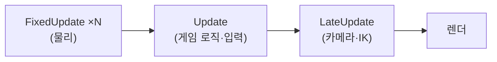
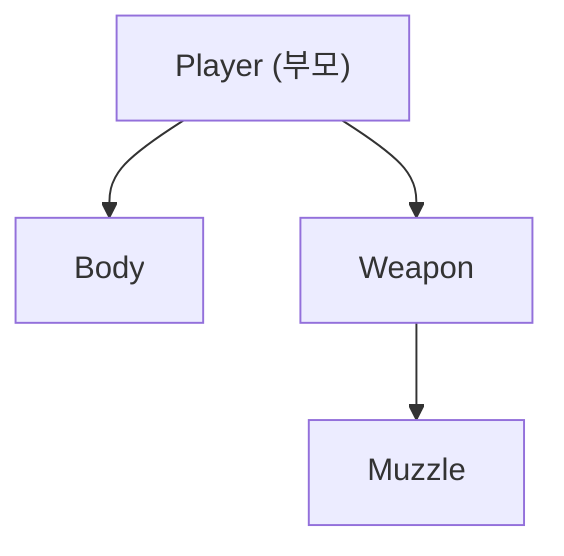
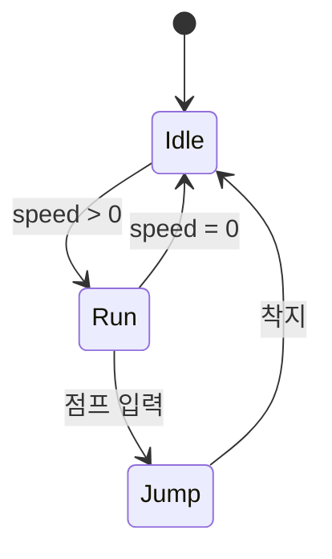

분야 핵심 개념을 얕고 넓게 정리한 노트. 쓱 훑어보며 복습한다.

## 생명주기와 프레임 루프

콜백이 언제, 어떤 순서로 불리는지.

### Awake / OnEnable / Start 순서

초기화를 두 단계로 나눠, 오브젝트끼리 서로 참조할 때 누가 먼저 준비됐는지 모르는 문제를 푸는 구조.

| 콜백 | 호출 시점 | 횟수 | 용도 |
| --- | --- | --- | --- |
| `Awake` | 게임오브젝트가 처음 활성화될 때 | 수명당 1회 | 자기 초기화 |
| `OnEnable` | 활성화될 때마다 | 켤 때마다 | 구독·재초기화 |
| `Start` | 첫 `Update` 직전 | 수명당 1회 | 다른 오브젝트와 연결 |

모든 오브젝트의 Awake가 끝난 뒤에야 Start가 시작됨. 오브젝트 간 Awake 순서는 보장되지 않지만, 이 장벽 덕에 Start에서는 남이 Awake 초기화를 마쳤다고 믿고 참조 가능. "내 준비는 Awake, 남과 연결은 Start".

<svg viewBox="0 0 620 214" width="720" style="max-width:100%;height:auto" xmlns="http://www.w3.org/2000/svg" role="img" aria-label="모든 오브젝트의 Awake가 끝난 뒤에야 Start가 시작되는 2단계 초기화"><defs><marker id="aw-a" markerWidth="8" markerHeight="8" refX="6" refY="3" orient="auto"><path d="M0,0L6,3L0,6Z" fill="currentColor" opacity="0.6"/></marker></defs><g fill="none" stroke="currentColor" stroke-opacity="0.25" stroke-dasharray="4 3"><rect x="16" y="40" width="250" height="140" rx="10"/><rect x="354" y="40" width="250" height="140" rx="10"/></g><g font-size="13" fill="currentColor" text-anchor="middle" opacity="0.8"><text x="141" y="30">1단계 — Awake (순서 보장 안 됨)</text><text x="479" y="30">2단계 — Start (서로 참조 가능)</text></g><g fill="none" stroke="currentColor" stroke-opacity="0.6"><rect x="46" y="54" width="190" height="30" rx="4"/><rect x="46" y="96" width="190" height="30" rx="4"/><rect x="46" y="138" width="190" height="30" rx="4"/></g><g fill="#3fae7a" fill-opacity="0.12" stroke="#3fae7a"><rect x="384" y="54" width="190" height="30" rx="4"/><rect x="384" y="96" width="190" height="30" rx="4"/><rect x="384" y="138" width="190" height="30" rx="4"/></g><g font-size="13" fill="currentColor" text-anchor="middle"><text x="141" y="74">A.Awake</text><text x="141" y="116">B.Awake</text><text x="141" y="158">C.Awake</text><text x="479" y="74">A.Start</text><text x="479" y="116">B.Start</text><text x="479" y="158">C.Start</text></g><line x1="272" y1="110" x2="346" y2="110" stroke="currentColor" stroke-opacity="0.6" stroke-width="1.4" marker-end="url(#aw-a)"/><line x1="310" y1="40" x2="310" y2="180" stroke="#e2574c" stroke-width="1.6" stroke-dasharray="5 4"/><text x="310" y="202" font-size="12" fill="#e2574c" text-anchor="middle">모든 Awake가 끝난 뒤에야 Start 시작</text></svg>

```csharp
public class Player : MonoBehaviour {
    Inventory inventory;

    void Awake() {
        inventory = new Inventory();            // 내 것만 준비 — 남은 아직 준비 전일 수 있음
    }

    void Start() {
        GameManager.Instance.Register(this);    // 남과 연결 — 모든 Awake가 끝난 뒤라 안전
    }
}
```

Awake에서 `GameManager.Instance`를 참조하면, GameManager의 Awake가 아직 안 돈 경우 null이라 터짐.

- 순서 지정 — Awake끼리의 순서가 꼭 필요하면 Script Execution Order로 지정
- OnEnable의 위치 — 자기 Awake 직후 바로 호출돼 남의 Awake보다 먼저일 수 있음. 장벽은 Start 앞에만 있으므로 OnEnable에서 남을 참조할 땐 주의
- 비활성 생성 — 비활성으로 생성되면 Awake가 미뤄졌다가 첫 `SetActive(true)` 때 Awake, OnEnable 순으로 호출. 이후 껐다 켜면 OnEnable·OnDisable만 반복

### Update vs FixedUpdate

`Update`는 매 프레임 호출돼 간격이 기기 성능·부하에 따라 들쭉날쭉하고, `FixedUpdate`는 고정 간격(기본 0.02초)으로 호출됨.

물리를 들쭉날쭉한 간격으로 계산하면 같은 힘을 줘도 기기마다 결과가 달라지고, 충돌 판정이 한 번에 건너뛰는 거리도 달라짐. 그래서 물리 엔진을 거치는 이동·힘(Rigidbody)은 FixedUpdate에서 처리해 프레임률과 무관하게 결과를 재현.

<svg viewBox="0 0 620 186" width="720" style="max-width:100%;height:auto" xmlns="http://www.w3.org/2000/svg" role="img" aria-label="프레임 길이에 따라 한 프레임 안에서 FixedUpdate가 2회, 0회, 4회 호출되는 타임라인"><g font-size="13" fill="currentColor" opacity="0.8"><text x="16" y="24">Update — 매 프레임 (간격 불규칙)</text><text x="16" y="110">FixedUpdate — 고정 간격 (기본 0.02초)</text></g><g stroke="currentColor" stroke-opacity="0.4"><line x1="16" y1="50" x2="604" y2="50"/><line x1="16" y1="136" x2="604" y2="136"/></g><g stroke="#4f83e0" stroke-dasharray="3 3"><line x1="60" y1="120" x2="60" y2="152"/><line x1="222" y1="120" x2="222" y2="152"/><line x1="262" y1="120" x2="262" y2="152"/><line x1="540" y1="120" x2="540" y2="152"/></g><g fill="#4f83e0"><circle cx="60" cy="50" r="6"/><circle cx="222" cy="50" r="6"/><circle cx="262" cy="50" r="6"/><circle cx="540" cy="50" r="6"/></g><g fill="#3fae7a"><circle cx="40" cy="136" r="5"/><circle cx="120" cy="136" r="5"/><circle cx="200" cy="136" r="5"/><circle cx="280" cy="136" r="5"/><circle cx="360" cy="136" r="5"/><circle cx="440" cy="136" r="5"/><circle cx="520" cy="136" r="5"/><circle cx="600" cy="136" r="5"/></g><g font-size="11" fill="currentColor" text-anchor="middle" opacity="0.6"><text x="141" y="72">긴 프레임</text><text x="242" y="72">짧은</text><text x="401" y="72">긴 프레임</text></g><g font-size="12" fill="currentColor" text-anchor="middle"><text x="141" y="172">2회</text><text x="242" y="172" fill="#e2574c">0회</text><text x="401" y="172">4회 — 밀린 만큼 몰아서 실행</text></g></svg>

고정 간격을 맞추다 보니 FixedUpdate는 한 프레임에 0번·1번·여러 번 돌 수 있음. 그 프레임에만 true인 `GetKeyDown`을 FixedUpdate에서 읽으면 문제가 됨.

- 0번 돈 프레임 — 입력을 놓침
- 여러 번 돈 프레임 — 한 번 누른 것을 중복 감지

그래서 입력은 Update에서 받아 플래그에 저장하고, FixedUpdate에서 읽어 물리에 반영.

```csharp
bool jumpQueued;

void Update() {                          // 매 프레임 — 입력은 여기서 받아 저장
    if (Input.GetKeyDown(KeyCode.Space)) jumpQueued = true;
}

void FixedUpdate() {                     // 고정 간격 — 물리는 여기서
    if (!jumpQueued) return;
    rb.AddForce(Vector3.up * power, ForceMode.Impulse);
    jumpQueued = false;
}
```

가르는 기준은 물리 엔진을 거치느냐. 물리 엔진을 안 거치는 transform 이동은 Update에서 `deltaTime`을 곱해 처리해도 됨. FixedUpdate로 움직인 물체가 화면에서 뚝뚝 끊겨 보이면 Rigidbody의 Interpolate 옵션으로 고정 스텝 사이를 렌더에서 보간.

### Update vs LateUpdate

`LateUpdate`는 그 프레임의 모든 `Update`가 끝난 뒤 실행. 한 프레임 안에서 Update끼리의 호출 순서는 보장되지 않아, 남이 다 움직인 결과를 보고 반응해야 하는 일을 위한 단계.

카메라와 플레이어를 둘 다 Update에 두면, 카메라가 먼저 불린 프레임엔 아직 안 움직인 플레이어를 따라가 한 박자 뒤처짐. 이게 프레임마다 엇갈리며 화면이 떨림(지터). 카메라를 LateUpdate에 두면 항상 이동을 마친 플레이어를 따라감.

```csharp
// 플레이어 — Update에서 이동
void Update() {
    transform.position += move * speed * Time.deltaTime;
}

// 카메라 — LateUpdate에서 추적 (플레이어 이동이 끝난 걸 보장받음)
void LateUpdate() {
    transform.position = target.position + offset;
}
```



LateUpdate에 두는 것:

- 카메라 추적
- IK 보정 — 애니메이션이 뼈대를 움직인 뒤 손·발 위치를 맞춤
- 월드 UI — 캐릭터를 따라다니는 체력바·이름표

LateUpdate끼리의 오브젝트 간 순서는 여전히 보장되지 않음. 카메라를 FixedUpdate에 두면 물리 간격과 렌더 프레임이 어긋나 오히려 더 끊겨 보임.

### timeScale과 unscaledDeltaTime

`timeScale = 0`이면 `deltaTime`이 0이 되어(timeScale이 곱해짐) 게임 움직임이 정지.

일시정지 메뉴 UI 애니메이션은 timeScale의 영향을 안 받는 `unscaledDeltaTime`으로 구동해야 계속 움직임.

### 입력 시스템 — 레거시 vs 새 Input System

코드가 "어떤 키를 눌렀나"를 직접 묻느냐, "무슨 행동인가"와 "어떤 키인가"를 분리해 데이터로 두느냐의 차이.

| | 레거시 (Input Manager) | 새 Input System |
| --- | --- | --- |
| 방식 | `Update`에서 키를 직접 폴링 | 액션·바인딩을 에셋으로 분리 |
| 다중 기기 | 기기별 분기 필요 | 키보드·패드·터치 통합 |
| 리바인딩 | 매핑을 직접 관리 | 바인딩 교체로 해결 |
| 비용 | 간단·빠름, 확장에 약함 | 초기 설정 복잡, 확장에 강함 |

레거시는 "점프 = 스페이스"가 코드에 박힘. 새 Input System은 "점프·이동" 같은 행동(액션)과 실제 키(바인딩) 사이에 한 겹을 끼워, 코드는 액션만 구독하고 어떤 키인지는 바인딩 에셋이 정함.

```csharp
// 레거시 — 코드가 "스페이스 키"를 직접 지목
void Update() {
    if (Input.GetKeyDown(KeyCode.Space)) Jump();
}

// 새 Input System — 코드는 "점프"라는 액션만 앎
[SerializeField] InputActionReference jumpAction;

void OnEnable()  => jumpAction.action.performed += OnJump;
void OnDisable() => jumpAction.action.performed -= OnJump;
void OnJump(InputAction.CallbackContext ctx) => Jump();
```

이 간접 계층을 설정·유지하는 비용을 내고 유연성(기기 통합·리바인딩)을 사는 구조라, 입력 소스가 하나뿐인 작은 프로젝트면 레거시가 더 간편. 레거시가 매 프레임 묻는 폴링이라면, 새 시스템은 액션이 발생할 때 콜백으로 받는 방식도 지원.

## 코루틴과 이벤트

시간을 다루는 코루틴과, 오브젝트를 느슨하게 잇는 이벤트.

### 코루틴과 yield

`yield` 지점에서 멈췄다가 나중에 그 자리부터 이어서 재개되는 함수. 보통 함수는 호출되면 끝까지 돌고 반환하지만, 코루틴은 `yield`를 만나면 제어를 유니티에 돌려주고 멈추고, 유니티가 조건이 될 때 다시 이어서 실행. 여러 프레임에 걸친 연출·대기를 한 프레임을 붙잡지 않고 풀어 쓸 수 있음.

```csharp
IEnumerator FadeOut() {
    for (float a = 1f; a > 0f; a -= Time.deltaTime) {
        SetAlpha(a);
        yield return null;   // 여기서 멈추고 다음 프레임에 이어서 재개
    }
    SetAlpha(0f);
}

StartCoroutine(FadeOut());   // 호출 즉시 끝까지 도는 게 아니라 프레임에 걸쳐 조금씩 진행
```

`yield` 뒤에 두는 대상이 재개 시점을 정함.

| yield | 재개 시점 |
| --- | --- |
| `yield return null` | 다음 프레임 |
| `WaitForSeconds(t)` | t초 후(스케일된 시간. `timeScale = 0`이면 안 풀림 → 실시간은 `WaitForSecondsRealtime`) |
| `WaitForEndOfFrame` | 그 프레임 렌더링이 끝난 직후(스크린샷 등) |
| `WaitForFixedUpdate` | 다음 FixedUpdate 직후 |

엔진은 프레임 루프를 돌며 매 프레임 조건을 확인하고, 조건이 맞은 프레임에만 재개. `null`과 `WaitForSeconds`는 Update 뒤·LateUpdate 앞에서 재개됨.

<svg viewBox="0 0 620 132" width="720" style="max-width:100%;height:auto" xmlns="http://www.w3.org/2000/svg" role="img" aria-label="코루틴 본문이 프레임마다 한 조각씩 실행되고 yield에서 멈췄다가 다음 프레임에 재개되는 모습"><defs><marker id="co-a" markerWidth="8" markerHeight="8" refX="6" refY="3" orient="auto"><path d="M0,0L6,3L0,6Z" fill="currentColor" opacity="0.6"/></marker></defs><g stroke="currentColor" stroke-opacity="0.25" stroke-dasharray="4 3"><line x1="30" y1="34" x2="30" y2="78"/><line x1="170" y1="34" x2="170" y2="78"/><line x1="310" y1="34" x2="310" y2="78"/><line x1="450" y1="34" x2="450" y2="78"/><line x1="590" y1="34" x2="590" y2="78"/></g><g font-size="13" fill="currentColor" text-anchor="middle" opacity="0.8"><text x="100" y="24">프레임 1</text><text x="240" y="24">프레임 2</text><text x="380" y="24">프레임 3</text><text x="520" y="24">프레임 4</text></g><g fill="#4f83e0" fill-opacity="0.12" stroke="#4f83e0"><rect x="40" y="42" width="64" height="28" rx="4"/><rect x="180" y="42" width="64" height="28" rx="4"/><rect x="320" y="42" width="64" height="28" rx="4"/><rect x="460" y="42" width="64" height="28" rx="4"/></g><g font-size="13" fill="currentColor" text-anchor="middle"><text x="72" y="61">실행</text><text x="212" y="61">실행</text><text x="352" y="61">실행</text><text x="492" y="61">실행</text></g><g font-size="12" fill="currentColor" opacity="0.7"><text x="109" y="52">yield</text><text x="249" y="52">yield</text><text x="389" y="52">yield</text></g><g stroke="currentColor" stroke-opacity="0.6" stroke-width="1.4" stroke-dasharray="3 3" marker-end="url(#co-a)"><line x1="109" y1="62" x2="175" y2="62"/><line x1="249" y1="62" x2="315" y2="62"/><line x1="389" y1="62" x2="455" y2="62"/></g><g font-size="13" fill="currentColor" text-anchor="middle" opacity="0.8"><text x="310" y="102">한 조각 실행 → yield에서 멈춤 → 다음 프레임에 그 자리부터 재개</text><text x="310" y="122">모두 메인 스레드 위 — 병렬 실행이 아님</text></g></svg>

코루틴은 스레드가 아님. `yield`는 제어를 유니티에 돌려줬다가 다시 받는 협력적 양보일 뿐, 그 사이에 코루틴이 다른 스레드에서 계속 도는 게 아님.

그래서 본문에 무거운 계산을 한 번에 몰면 그 프레임이 그대로 멈춤. 코루틴은 작업을 프레임 단위로 쪼개 나눠 담을 뿐 병렬화도 가속도 아님.

### WaitForSeconds 캐싱

`WaitForSeconds`는 class(참조 타입)라 `new` 할 때마다 힙에 객체가 생김. 스폰 타이머·깜빡임·쿨다운처럼 주기 반복하는 코루틴에서 매번 new 하면, 게임이 도는 내내 쓰레기가 조금씩 계속 쌓여 GC를 자주 부름.

대기 시간이 고정이면 한 번만 만들어 필드에 캐싱해 재사용. 동작은 똑같고 할당만 사라짐.

```csharp
// 반복마다 new — 루프를 돌 때마다 객체가 힙에 쌓임
IEnumerator SpawnLoop() {
    while (true) {
        Spawn();
        yield return new WaitForSeconds(1f);
    }
}

// 한 번만 만들어 재사용 — 반복 중 할당 0
readonly WaitForSeconds wait = new WaitForSeconds(1f);

IEnumerator SpawnLoop() {
    while (true) {
        Spawn();
        yield return wait;
    }
}
```

- 공유해도 되는 이유 — 생성할 때 시간만 담아두고 이후 바뀌지 않아, 여러 코루틴이 같은 인스턴스를 써도 됨. `WaitForSecondsRealtime`은 내부에 진행 상태를 갖고 있어 동시에 공유하면 안 됨
- 캐싱이 안 되는 경우 — 대기 시간이 매번 다르면 재사용 불가. `yield return null`로 도는 수동 타이머나 UniTask 같은 대안을 씀
- `yield return null` — 객체를 만들지 않아 매번 써도 할당이 없음

### 코루틴 vs async/await

둘 다 멈췄다 재개하는 방식이지만, 누가 재개하느냐와 오브젝트 수명에 묶이느냐가 다름.

코루틴은 엔진이 프레임 루프에서 조건을 확인해 재개하고, `StartCoroutine`을 호출한 MonoBehaviour에 소속됨. async/await는 유니티 기능이 아니라 C# 언어 기능 — 컴파일러가 메서드를 상태 머신으로 바꾸고 `await`한 작업(Task)이 끝나면 이어서 실행하며, 엔진은 이 메서드의 존재를 모름.

| | 코루틴 | async/await |
| --- | --- | --- |
| 정체 | 유니티 엔진 기능 | C# 언어 기능(Task 기반) |
| 재개 주체 | 엔진의 프레임 루프 | await한 작업의 완료 |
| 수명 | 게임오브젝트 비활성·파괴 시 자동 중단 | 자동 중단 없음 — 취소 토큰 필요 |
| 반환값·예외 | 반환값 없음, `yield`에 try-catch 불가 | `Task<T>`로 반환, try-catch 가능 |
| 맞는 용도 | 프레임 대기·연출·타이머 | 파일·네트워크 같은 비동기 I/O |

<svg viewBox="0 0 620 172" width="720" style="max-width:100%;height:auto" xmlns="http://www.w3.org/2000/svg" role="img" aria-label="게임오브젝트가 파괴되면 코루틴은 자동으로 멈추지만 async 메서드는 계속 실행돼 파괴된 객체에 접근한다"><text x="380" y="20" font-size="13" fill="#e2574c" text-anchor="middle">게임오브젝트 파괴</text><line x1="380" y1="28" x2="380" y2="96" stroke="#e2574c" stroke-width="1.6" stroke-dasharray="5 4"/><g font-size="13" fill="currentColor" opacity="0.8"><text x="16" y="63">코루틴</text><text x="16" y="123">async/await</text></g><g fill="#4f83e0" fill-opacity="0.12" stroke="#4f83e0"><rect x="130" y="42" width="250" height="32" rx="4"/><rect x="130" y="102" width="250" height="32" rx="4"/></g><rect x="380" y="102" width="180" height="32" rx="4" fill="#e2574c" fill-opacity="0.12" stroke="#e2574c"/><g font-size="13" fill="currentColor" text-anchor="middle"><text x="255" y="63">조건이 맞으면 재개</text><text x="255" y="123">await 대기</text><text x="470" y="123">계속 실행</text></g><text x="392" y="63" font-size="13" fill="currentColor" opacity="0.7">자동 중단</text><text x="470" y="158" font-size="13" fill="#e2574c" text-anchor="middle">파괴된 객체 접근 → 예외</text></svg>

코루틴은 엔진이 소유자를 알아서 오브젝트가 사라지면 재개를 그만둠. async 메서드는 엔진과 무관하니 오브젝트가 사라져도 `await` 뒤의 코드가 그대로 실행됨.

```csharp
// 코루틴 — 오브젝트가 파괴되면 같이 멈춤
IEnumerator Co() {
    yield return new WaitForSeconds(3f);
    transform.position = Vector3.zero;   // 3초 안에 파괴됐으면 여기까지 오지 않음
}

// async — 오브젝트와 무관하게 끝까지 실행
async Task RunAsync() {
    await Task.Delay(3000);
    transform.position = Vector3.zero;   // 3초 안에 파괴됐으면 MissingReferenceException
}

// 해결 — 수명에 묶인 취소 토큰을 넘긴다
async Task RunAsync() {
    await Task.Delay(3000, destroyCancellationToken);   // 파괴되면 취소 예외로 빠져나감
    transform.position = Vector3.zero;
}
```

- 취소 토큰 — `destroyCancellationToken`은 그 오브젝트가 파괴될 때, `Application.exitCancellationToken`은 플레이 모드·앱 종료 때 취소(둘 다 유니티 2022.2 이상). 이전 버전은 `CancellationTokenSource`를 만들어 `OnDestroy`에서 취소
- 에디터에서 — 플레이 모드를 꺼도 에디터 프로세스는 살아 있어, 취소하지 않은 Task가 계속 진행되다 플레이가 끝난 뒤에 로그를 찍거나 예외를 냄. 빌드한 게임은 종료하면 프로세스가 끝나 Task도 함께 사라짐

대신 async는 결과값을 돌려주고 예외를 평소처럼 처리할 수 있음.

```csharp
async Task<string> LoadTextAsync(string path) {
    try {
        return await File.ReadAllTextAsync(path);   // 결과값을 그대로 반환
    } catch (IOException e) {
        Debug.LogError(e.Message);                  // 예외도 평소처럼 처리
        return null;
    }
}
```

- async도 스레드가 아님 — `await`는 끝나면 이어서 해 달라는 예약일 뿐 새 스레드를 만들지 않음. 유니티에서는 `await` 뒤가 기본적으로 메인 스레드에서 이어져 유니티 API를 그대로 쓸 수 있음. 다른 스레드에서 도는 건 `Task.Run`으로 넘긴 작업뿐이고 그 안에서는 유니티 API 호출 불가
- 코루틴은 컴포넌트를 꺼도 안 멈춤 — `enabled = false`로는 계속 돌고, 게임오브젝트 비활성·파괴나 `StopCoroutine`으로 멈춤
- 할당 — `Task`는 class라 만들 때마다 힙 할당. 그래서 구조체 기반이고 프레임 루프와 연동되는 UniTask를 많이 쓰고, 유니티 2023.1부터는 엔진의 `Awaitable`로 프레임 대기를 async로 쓸 수 있음

### OnEnable / OnDisable 이벤트 구독

`Start`는 한 번뿐이라, 풀링으로 활성/비활성을 반복하는 오브젝트는 `OnEnable`에서 구독·`OnDisable`에서 해제해야 짝이 맞음.

`Start`에서만 구독하면 비활성 상태에서도 반응하거나 재활성 시 중복 구독이 쌓임.

### UnityEvent vs C# event

| | 연결 | 특징 |
| --- | --- | --- |
| C# event | 코드에서 `+=` 구독 | 빠르고 타입 안전, 인스펙터에 안 보임 |
| UnityEvent | 인스펙터에서 드래그로 연결 | 기획자가 코드 없이 배선, 리플렉션 호출이라 느리고 GC 있음 |

코드끼리의 고빈도 통신은 C# event(또는 Action), 인스펙터에 노출해 비프로그래머가 잇는 버튼·트리거 콜백은 UnityEvent.

UnityEvent는 대상이 파괴돼도 자동 해제되지 않으니 관리가 필요.

## 씬과 오브젝트

오브젝트의 계층, 켜고 끄기, 파괴, 씬 전환.

### Transform 계층 — 로컬과 월드

씬은 Transform의 부모-자식 트리다. 자식의 위치·회전·크기는 부모 기준(로컬)이라 부모가 움직이면 자식도 따라감.

월드 좌표는 조상들의 변환을 누적해 계산 — `position`은 월드, `localPosition`은 부모 기준. 부모에 스케일이 걸리면 자식의 월드 크기·거리가 함께 왜곡되니 주의.



### SetActive vs enabled

| | 범위 | 결과 |
| --- | --- | --- |
| `SetActive(false)` | 게임 오브젝트 전체(자식 포함) | Update도 안 돌고 `OnDisable` 호출 |
| `enabled = false` | 그 컴포넌트 하나 | 나머지 컴포넌트·렌더링은 유지 |

풀 반환은 SetActive, 공격 히트박스만 잠깐 끄기는 enabled.

### activeSelf vs activeInHierarchy

| | 의미 |
| --- | --- |
| `activeSelf` | 자신의 SetActive 플래그(부모 무관) |
| `activeInHierarchy` | 조상까지 모두 활성일 때만 true인 실제 활성 상태 |

자신은 켜져 있어도 부모가 꺼져 있으면 `activeSelf = true`, `activeInHierarchy = false`.

### Destroy vs DestroyImmediate

| | 파괴 시점 | 용도 |
| --- | --- | --- |
| `Destroy` | 현재 프레임 끝에 지연 파괴 | 런타임에 안전 |
| `DestroyImmediate` | 즉시 파괴 | 원래 에디터 툴링용 |

런타임에, 특히 컬렉션 순회 중 DestroyImmediate를 쓰면 참조·순회가 깨져 에러.

### DontDestroyOnLoad

씬 전환 후에도 유지할 매니저용.

씬을 다시 들어오면 중복 인스턴스가 생기니, 이미 존재하는지 검사해 새로 생긴 중복을 파괴.

### LoadSceneAsync / Additive

- `LoadSceneAsync` — 비동기 로드라 로딩 중 프레임 멈춤 없이 로딩 화면·진행바 진행 가능
- Additive — 현재 씬 위에 새 씬을 얹어 동시 유지(대형 맵 스트리밍, UI 씬 분리)

## 메모리와 CPU 최적화

프레임 끊김의 두 축은 힙 할당과 매 프레임 반복되는 탐색·호출 비용.

### GC 스파이크

GC가 힙을 회수할 때 메인 스레드를 잠깐 멈춰 프레임이 끊김. 원인은 무거운 계산이 아니라 힙 할당.

Update에서 피할 것은 new 객체 생성, 박싱, LINQ, 문자열 결합, 람다 클로저. 캐싱·풀링으로 대응.

### 오브젝트 풀링

`Instantiate`/`Destroy` 반복 비용을 풀 보관·재활용으로 없앰. 특히 `Destroy` 반복은 GC 부담을 키워 프레임이 끊김.

미리 만들어두고 활성/비활성으로 재활용해 할당·해제 자체를 없애는 것.

### Instantiate 위치 인자

- `Instantiate(prefab, pos, rot)` — 처음부터 그 위치로 생성해 Transform 갱신이 1회
- `Instantiate` 후 `transform.position` 대입 — "기본 위치 생성 → 다시 이동"이라 갱신(자식 월드 좌표 재계산, 물리 통보)이 2회 일어날 수 있음

대량 스폰에서 차이가 쌓임.

### GetComponent 캐싱과 TryGetComponent

`GetComponent`는 컴포넌트 목록을 뒤지는 비용이 있어 매 프레임 `Update`에 넣지 말고 `Awake`/`Start`에서 캐싱해 재사용.

한 번 쓰거나 조건부면 `TryGetComponent`가 깔끔 — bool + out 패턴이라 null 체크가 포함되고, 못 찾았을 때 발생하던 가비지 할당도 피함.

### Camera.main 캐싱

`Camera.main`은 호출마다 'MainCamera' 태그 오브젝트를 `FindWithTag`로 찾음 → Update에서 매 프레임 호출하면 비쌈.

`Awake`/`Start`에서 한 번 캐싱해 재사용.

### GameObject.Find / FindObjectOfType 비용

씬의 모든 오브젝트를 순회해 비쌈(특히 `Update`에서 매 프레임이면 치명적). 대안:

- `Awake`/`Start`에서 한 번 찾아 캐싱
- `[SerializeField]`로 인스펙터에서 직접 연결
- 이벤트/의존성 주입으로 넘겨받기

### Update 일괄 처리

엔진(C++)이 각 MonoBehaviour의 `Update`를 매 프레임 하나씩 호출하는데, C++↔C# 경계 넘기에 건당 오버헤드가 있음. 매니저 하나가 리스트를 돌면 경계 호출이 1번으로 줄고 나머지는 C# 내부 루프.

핵심은 "매 프레임 콜백을 가진 인스턴스 수"를 줄여 경계 호출 횟수를 낮추는 것. 빈 `Update`도 호출 비용이 있으니 안 쓰면 지울 것.

### Job System과 Burst

메인 스레드만 쓰던 무거운 계산(대량 이동·충돌·절차 생성)을 병렬화하는 도구들.

- Job System — C# 잡을 워커 스레드에 분산해 멀티코어를 활용하는 멀티스레딩 프레임워크
- Burst — 잡 코드를 SIMD 최적화된 네이티브 코드로 바꿔 수 배 가속하는 컴파일러
- DOTS/ECS — 데이터를 촘촘히 배열로 두는 방식. 잡과 맞물려 캐시 지역성을 극대화
- NativeArray — 안전을 위해 관리 객체 대신 쓰는 값 타입 컨테이너

## 렌더링과 UI

화면에 그리는 비용, 특히 드로우콜을 줄이는 방법.

### 배칭 — Static / Dynamic / GPU Instancing

| | 대상 | 제약 |
| --- | --- | --- |
| Static Batching | 움직이지 않는 오브젝트를 결합 | 정적이어야 함 |
| Dynamic Batching | 작은 메시 | 정점 수 제한 |
| GPU Instancing | 같은 메시·머티리얼 다수 | 움직이든 정점이 많든 한 드로우콜로 처리 |

Dynamic Batching는 정점 수 제한이 있으므로, 정점 많은 동일 메시가 다수면 GPU Instancing.

### 스프라이트 아틀라스

여러 스프라이트를 한 텍스처로 묶어, 같은 아틀라스를 쓰는 것끼리 드로우콜을 배칭. 텍스처 전환(머티리얼 변경)마다 배치가 끊기는데, 아틀라스로 텍스처를 하나로 합치면 UI·2D 스프라이트가 한 콜로 묶임.

텍스처 바인딩 횟수를 줄이는 게 핵심이고, 관련 없는 스프라이트를 한 아틀라스에 몰면 메모리 낭비.

### material vs sharedMaterial

`renderer.material` 접근 시 머티리얼 인스턴스가 복제됨 → 렌더러마다 고유 머티리얼이 되어 배칭이 깨지고 드로우콜 증가, 인스턴스도 누수.

- `sharedMaterial` — 전체가 공유하는 값을 다룰 때
- `MaterialPropertyBlock` — 개별 색만 바꿀 때

### 오클루전 컬링

프러스텀 컬링이 시야 밖을 걸러낸다면, 오클루전 컬링은 시야 안이지만 다른 물체에 완전히 가려 안 보이는 것을 그리지 않음. 정적 지형을 미리 구워(bake) 셀·포털 정보로 런타임에 가시성을 판정.

실내·복잡한 도심처럼 가림이 많은 씬에서 드로우콜을 크게 줄이나, 굽는 비용과 데이터가 들고 탁 트인 야외에선 효과가 적음.

### 렌더 파이프라인 — Built-in / URP / HDRP

| | 대상 | 특징 |
| --- | --- | --- |
| Built-in | 레거시 기본 | 검증됐으나 커스터마이즈가 어렵고 확장 한계 |
| URP | 모바일·중간 사양 | 가볍고 플랫폼 폭넓음, 단일 패스 포워드 중심 |
| HDRP | 고사양 PC·콘솔 | 고품질 라이팅·포스트, 무겁고 모바일 불가 |

SRP(스크립터블 렌더 파이프라인)로 렌더 흐름을 C#에서 제어. URP·HDRP는 프로젝트 초기에 정하며, 중간 전환은 셰이더·머티리얼을 다 갈아야 해 비쌈.

### UGUI 캔버스 리빌드

UGUI는 캔버스 단위로 UI 메시를 묶어(배치) 그리는데, 한 요소만 바뀌어도 그 캔버스 전체가 더티로 표시돼 다시 빌드됨. 큰 캔버스 하나에 자주 바뀌는 것과 정적인 것을 섞으면 매 변경마다 전체 리빌드라 비쌈.

- 캔버스 분리 — 자주 갱신되는 요소(체력바·타이머)는 별도 캔버스로
- Raycast Target 끄기 — 안 쓰는 그래픽에서 꺼 레이캐스트 비용도 줄임

## 애니메이션

Animator의 구조와 파라미터 접근 비용.

### Animator 상태 머신과 블렌드 트리

애니메이션을 상태(Idle·Run·Jump 등)로 두고 파라미터(속도·isGrounded) 조건으로 전이. 전이마다 블렌드 시간을 줘 뚝 끊기지 않고 부드럽게 이어짐.

블렌드 트리는 한 상태 안에서 파라미터로 여러 클립을 섞음(속도에 따라 걷기·뛰기 보간).



### Animator StringToHash

`SetTrigger("Jump")`는 매 호출마다 문자열을 내부적으로 해시로 변환·조회함. `StringToHash`로 해시를 미리 구해 캐싱하고 정수로 넘기면 반복되는 문자열 해싱을 건너뜀.

아끼는 건 GC가 아니라 문자열 해싱 비용이다.

## 물리와 내비게이션

물리 엔진에 이동을 제대로 알리는 법, 충돌 감지의 갈래, 길찾기.

### Rigidbody vs CharacterController

| | 물리 | 용도 |
| --- | --- | --- |
| Rigidbody | 물리 엔진으로 중력·힘·충돌 자동 처리 | 물리 상호작용 |
| CharacterController | 물리 안 쓰고 충돌 감지만, 중력·이동은 직접 구현 | 미끄러짐 없는 정밀한 캐릭터 이동 |

### transform.position vs Rigidbody.MovePosition

| | 동작 | 결과 |
| --- | --- | --- |
| `transform.position` 대입 | 순간 이동(물리 무시) | 콜라이더를 뚫는 터널링 위험 |
| `Rigidbody.MovePosition` | 물리 엔진을 통해 이동 | 충돌을 존중하고 보간 적용 |

### 물리 오브젝트 이동과 broad phase

물리 엔진은 오브젝트 위치를 자체 자료구조(공간 분할)에 캐싱. 물리 함수(`MovePosition`)는 이동을 엔진에 등록해 캐시가 갱신됨.

`transform` 직접 대입은 엔진 캐시와 실제 위치가 어긋나 강제 재계산(비쌈) + 경로 중간을 건너뛰어 터널링·충돌 누락.

### OnCollision vs OnTrigger

| | `isTrigger` | 동작 |
| --- | --- | --- |
| OnTrigger | 켬 | 물리적으로 안 부딪히고 통과 — 범위 감지용 |
| OnCollision | 끔 | 물리 충돌(부딪힘) |

둘 다 호출되려면 적어도 한쪽에 Rigidbody가 필요한데, 이건 둘의 차이가 아니라 공통 전제.

### 레이어 충돌 매트릭스

오브젝트를 물리 레이어로 나누고, Physics 설정의 매트릭스에서 어떤 레이어 쌍이 서로 충돌·감지할지 켜고 끔.

무관한 쌍(예: 아군 총알↔아군)의 충돌 계산을 아예 건너뛰어 broad phase 비용을 줄이고 원치 않는 충돌을 없앰. Raycast의 LayerMask와 같은 레이어 개념을 물리 충돌 전반에 적용한 것.

### Raycast와 LayerMask

광선(origin + direction)을 쏴 부딪히는 첫 콜라이더를 `RaycastHit`로 반환(맞은 오브젝트·지점·법선·거리). 마우스는 `ScreenPointToRay`로 화면 좌표를 월드 광선으로 변환.

LayerMask(비트마스크)로 특정 레이어만 검사 → 성능(대상 축소) + 정확성(원치 않는 것 무시).

- `Raycast` — 가장 가까운 하나
- `RaycastAll` — 전부
- `RaycastNonAlloc` — 다발

### NavMesh 길찾기

걸을 수 있는 표면을 미리 구운 내비게이션 메시(폴리곤 그물) 위에서 A*로 경로를 찾음. NavMeshAgent가 목적지까지 경로를 따라 이동하며 서로 회피.

- 정적 지형 — 미리 굽는다(bake)
- 동적 장애물 — NavMeshObstacle로 실시간에 구멍을 냄
- 끊긴 구간(계단·점프) — Off-Mesh Link로 잇는다

## 데이터·에셋·빌드

데이터를 어디에 두고, 무엇이 저장되며, 어떻게 불러오고 빌드하는지.

### ScriptableObject

데이터를 MonoBehaviour에서 분리해 에셋으로 관리. 핵심은 공유 참조 — 적 1000마리가 같은 스킬 데이터를 쓸 때 MonoBehaviour면 인스턴스마다 복제되지만 SO는 하나의 에셋을 모두가 참조해 메모리에 한 벌만 존재.

단일 진실 공급원이 되고 씬 간 공유·데이터 교체도 쉬움.

### 프리팹과 프리팹 변형

프리팹은 게임오브젝트 구성을 에셋으로 저장한 틀 — 원본을 고치면 모든 인스턴스에 반영돼 일관 관리.

- 오버라이드 — 인스턴스에서 특정 값만 바꾸면 그 항목만 남고 나머지는 원본을 따름
- 프리팹 변형(Variant) — 기존 프리팹을 상속해 일부만 바꾼 파생본. 공통은 부모에서 물려받고 차이만 유지(색·스탯만 다른 적 종류)
- 중첩 프리팹 — 프리팹 안에 프리팹을 넣어 조립

### SerializeField private

private이라 외부 코드 접근을 막아 캡슐화를 지키면서 인스펙터엔 노출돼 편집·디버깅 가능. public은 인스펙터 노출과 외부 접근이 한 묶음이라 다른 클래스가 마음대로 바꿔 불변식이 깨질 수 있음.

"에디터 편집"과 "코드 접근 권한"을 분리하는 것.

### 유니티 직렬화 규칙

인스펙터 노출·저장·프리팹은 유니티 직렬화를 거치는데, 대상은 public이거나 `[SerializeField]`인 필드로 한정.

- 기본적으로 안 되는 것 — 프로퍼티, static, readonly, Dictionary
- 다형 필드 — 기본은 안 돼 `[SerializeReference]`가 필요

직렬화되는지 여부가 값 유지·인스펙터 노출·스크립트 핫 리로드 생존을 좌우.

### Resources.Load vs Addressables

| | 로드 방식 | 대가 |
| --- | --- | --- |
| Resources | 폴더 내용이 빌드에 통째로 포함되어 로컬에서 로드 | 빌드 크기 증가, 문자열 경로 오류 위험 |
| Addressables | 주소로 온디맨드 로드 | 원격 다운로드·콘텐츠 갱신·비동기·참조 카운트 관리 가능 |

Resources는 원격 다운로드가 아니라 빌드에 포함된 로컬 로드라는 점에 주의.

### IL2CPP vs Mono

| | 방식 | 특징 |
| --- | --- | --- |
| Mono | IL을 런타임 JIT 컴파일 | 빌드 빠름, 개발 중 유리, 일부 플랫폼 미지원 |
| IL2CPP | IL을 C++로 변환 후 네이티브 컴파일(AOT) | 실행 빠르고 역공학이 어려움, iOS 등 필수, 빌드 느림 |

IL2CPP는 AOT라 런타임 코드 생성(일부 리플렉션·`dynamic`)에 제약이 있어 코드 스트리핑 설정에 주의. 출시 빌드는 성능·보안·플랫폼 요건으로 IL2CPP가 흔함.
